# 1. Download VMware Workstation

The first step was to download **VMware Workstation**, which is the virtualization software used to create and manage the virtual machines for this lab.

### Steps

1. Open a web browser.
2. Navigate to the official VMware/Broadcom website.
3. Locate **VMware Workstation Pro**.
4. Select the Windows version.
5. Download the VMware Workstation installer.
6. Save the installer on the host computer.

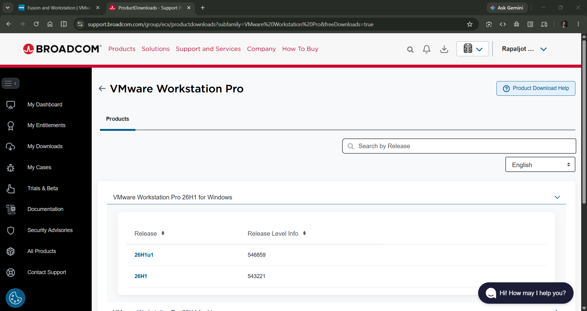

*Figure 1: Downloading VMware Workstation.*

---

# 2. Install VMware Workstation

After downloading VMware Workstation, I installed it on the host computer.

### Steps

1. Locate the downloaded VMware Workstation installer.
2. Double-click the installer to start the setup.
3. Click **Next**.
4. Accept the license agreement.
5. Continue through the installation wizard.
6. Leave the default installation options unless a different configuration is required.
7. Click **Install**.
8. Wait for the installation to complete.
9. Click **Finish**.
10. Open VMware Workstation.

*Figure 2: Installing VMware Workstation on the host computer.*

---

# 3. Verify VMware Workstation Installation

After the installation was completed, I opened VMware Workstation to verify that it was installed successfully.

The VMware Workstation home screen confirmed that the virtualization software was ready to create and manage virtual machines.

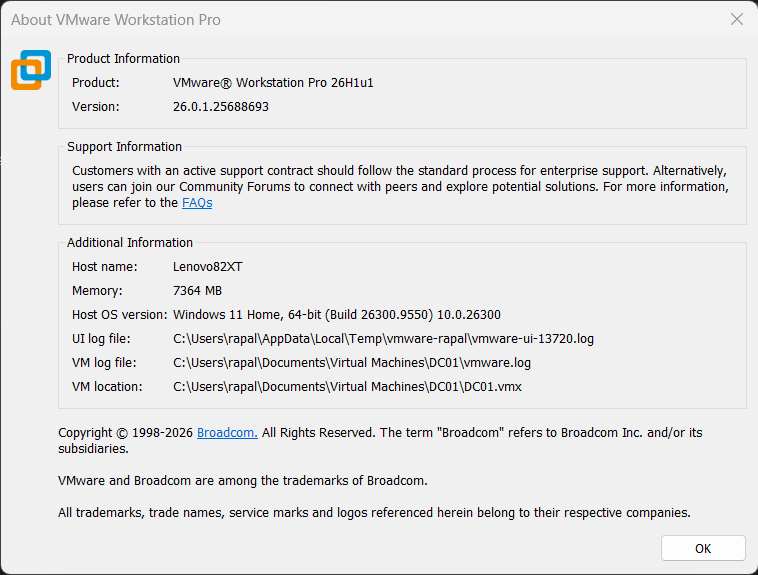

*Figure 3: VMware Workstation successfully installed and running.*

---

# 4. Download Windows Server 2019

The next step was to download the **Windows Server 2019 ISO image**.

An ISO file contains the Windows Server installation files and can be attached to a virtual machine as a virtual DVD.

### Steps

1. Open a web browser.
2. Navigate to the Microsoft Windows Server Evaluation Center.
3. Locate **Windows Server 2019**.
4. Select the **ISO** download option.
5. Select the required language.
6. Start the download.
7. Save the ISO file in an easily accessible location.

For example:

```text
Downloads/Windows_Server_2019.iso
```

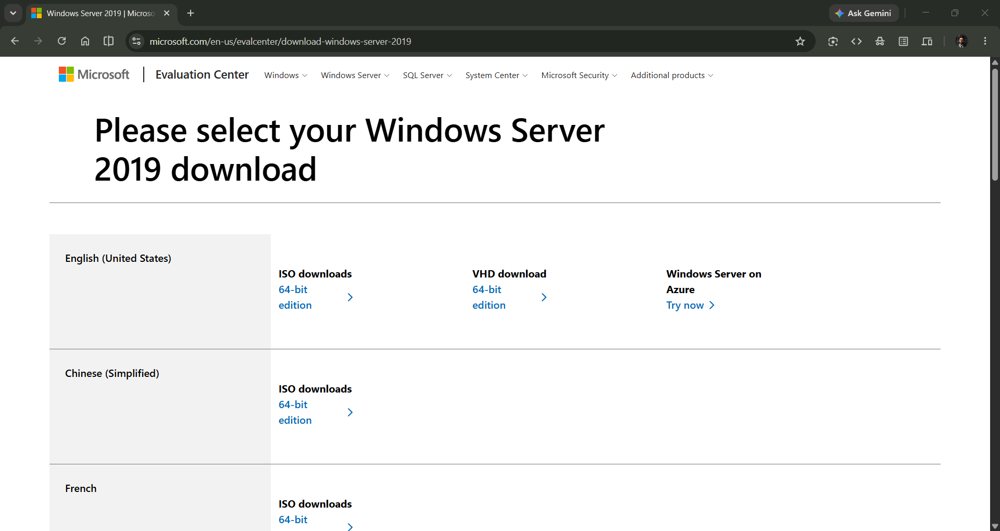

*Figure 4: Downloading the Windows Server 2019 ISO.*

---

# 5. Create a New Virtual Machine

After downloading the Windows Server 2019 ISO, I created a new virtual machine in VMware Workstation.

### Steps

1. Open **VMware Workstation**.
2. Select **Create a New Virtual Machine**.

Alternatively, select:

```text
File > New Virtual Machine
```

3. The **New Virtual Machine Wizard** will open.

---

## 5.1 Select the Virtual Machine Configuration

The New Virtual Machine Wizard provides different configuration options.

I selected:

```text
Typical (recommended)
```

The **Typical** option automatically configures most of the common virtual machine settings.

### Steps

1. Select **Typical (recommended)**.
2. Click **Next**.

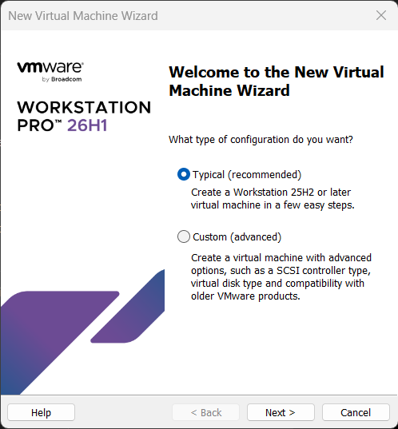

*Figure 6: Selecting the Typical virtual machine configuration.*

---

## 5.2 Select the Windows Server ISO

Choose option that states "I will install the operating system later"

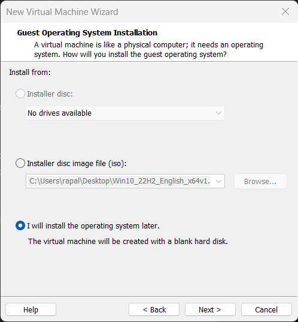

---

## 5.3 Select the Guest Operating System

I manually selected the appropriate guest operating system.

### Configuration

**Guest Operating System:**

```text
Microsoft Windows
```

**Version:**

```text
Windows Server 2019
```

After selecting the operating system, I clicked **Next**.

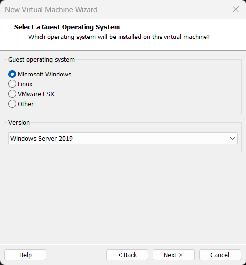

*Figure 8: Selecting Microsoft Windows as the guest operating system.*

---

## 5.4 Name the Virtual Machine

I assigned a descriptive name to the virtual machine so that it could easily be identified within VMware Workstation.

For example:

```text
DC01
```

I also selected the location where the virtual machine files would be stored on the host computer.


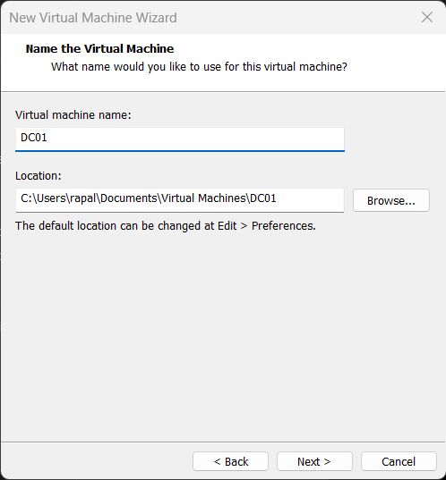
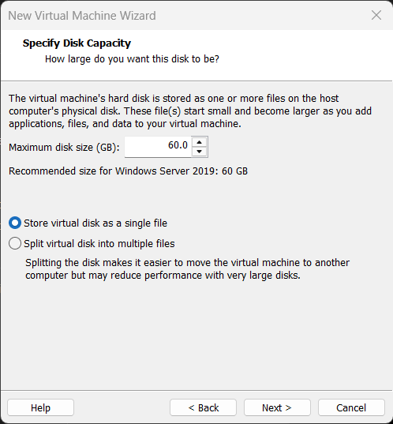

*Figure 9: Naming the Windows Server 2019 virtual machine.*

---

# 6. Configure Virtual Machine Hardware

Before installing Windows Server, I configured the virtual hardware allocated to the virtual machine.

The main virtual hardware components included:

- Memory (RAM)
- Processor
- Virtual hard disk
- Network adapter
- CD/DVD drive

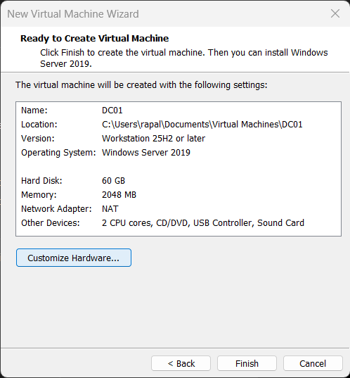

The amount of resources assigned depends on the hardware available on the host computer.

---

## 6.1 Configure Memory

I assigned memory to the Windows Server virtual machine.

For example:

```text
1 GB RAM
```

More RAM can be assigned if sufficient memory is available on the physical computer.

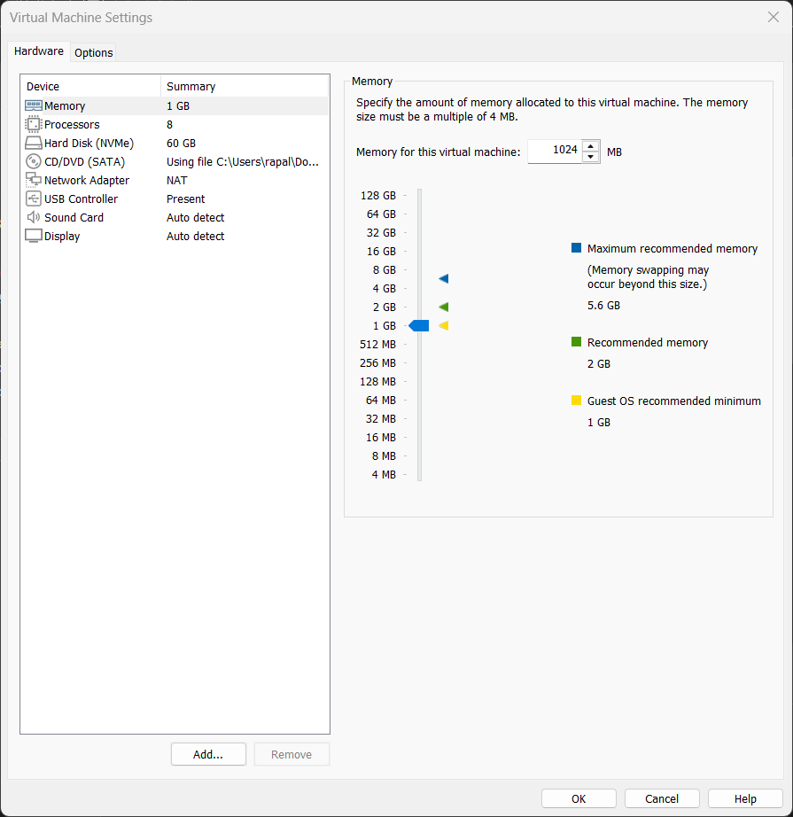

*Figure 10: Configuring memory for the Windows Server virtual machine.*

---

## 6.2 Configure Processor

I configured the processor resources available to the virtual machine.

For a basic lab environment, one or two processor cores can be sufficient.

Example configuration:

```text
Processors: 2
Processor Cores: 4
```

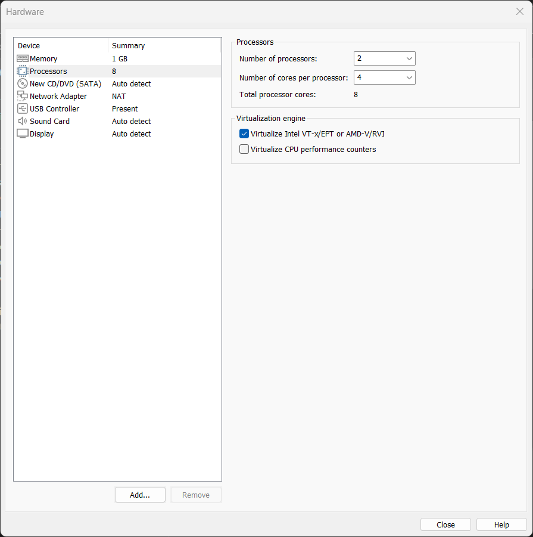

*Figure 11: Configuring processor resources for the Windows Server virtual machine.*

---

## 6.3 Configure the Virtual Hard Disk

I created a virtual hard disk to store the Windows Server operating system, applications, and server configuration.

Example:

```text
60 GB
```

The virtual disk is stored as a file on the host computer.

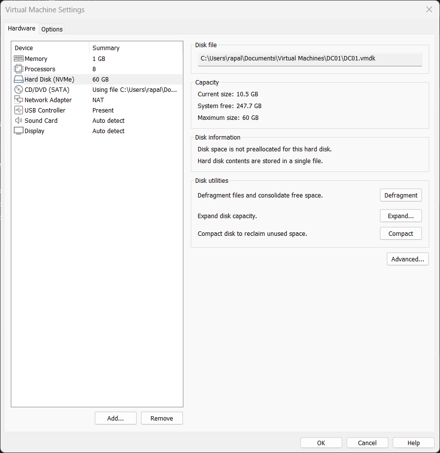

*Figure 12: Configuring the virtual hard disk for Windows Server 2019.*

---

## 6.4 Configure the Network Adapter

I configured the virtual network adapter so that the Windows Server virtual machine could communicate with the host computer, other virtual machines, and the network.

VMware provides several networking modes, including:

- **NAT**
- **Bridged**
- **Host-only**

The appropriate network mode can be selected based on the requirements of the lab environment.

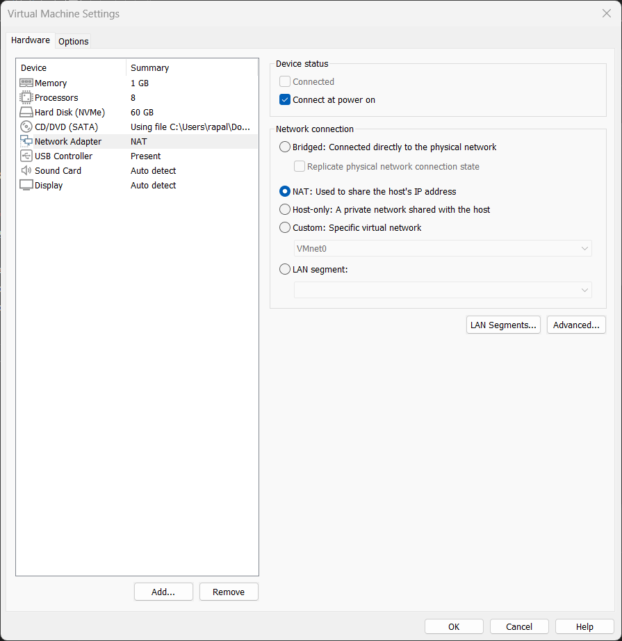

*Figure 13: Configuring the VMware virtual network adapter.*

---

# 7. Review the Virtual Machine Configuration

Before starting the virtual machine, I reviewed the hardware configuration.

I verified the following settings:

- Memory allocation
- Processor configuration
- Virtual hard disk size
- Network adapter
- CD/DVD drive
# Add an ISO file we downloaded from microsoft website.

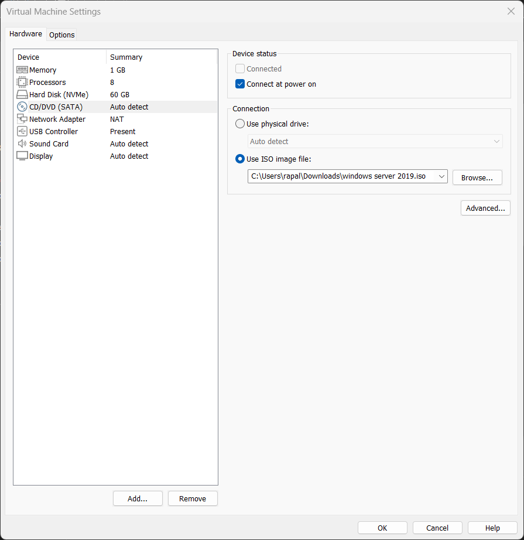

- Windows Server 2019 ISO

After confirming the configuration, I clicked **Finish**.

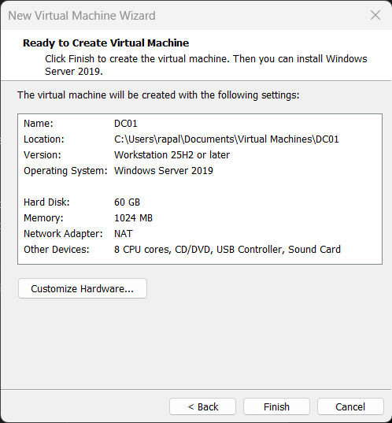

*Figure 14: Reviewing the Windows Server virtual machine hardware configuration.*

---

# 8. Start the Windows Server 2019 Virtual Machine

After creating the virtual machine, I powered it on.

### Steps

1. Select the Windows Server 2019 virtual machine in VMware Workstation.
2. Click **Power on this virtual machine**.
3. The virtual machine starts from the attached Windows Server 2019 ISO.

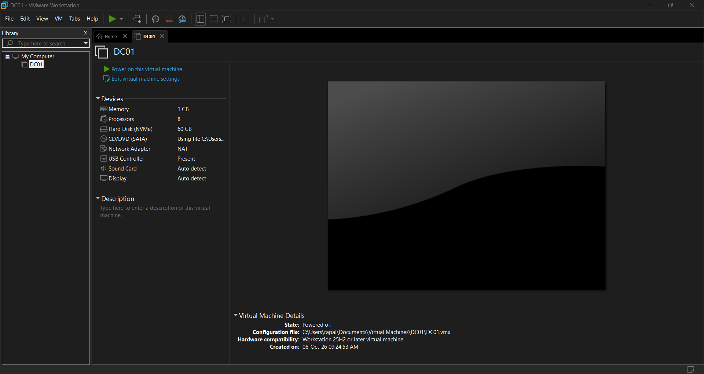

*Figure 15: Starting the Windows Server 2019 virtual machine.*

---

# 9. Start the Windows Server 2019 Installation

After the virtual machine started, the Windows Server installation screen appeared.

I selected the appropriate installation settings.

### Configuration

- **Language to install:** English
- **Time and currency format:** Appropriate regional setting
- **Keyboard or input method:** Appropriate keyboard layout

After selecting the required settings, I clicked **Next**.

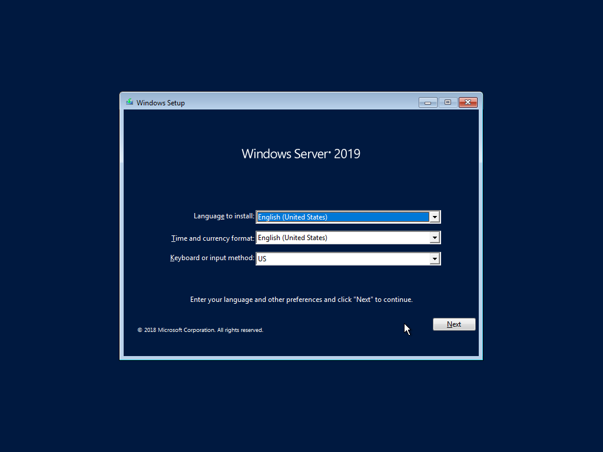

*Figure 16: Selecting the Windows Server 2019 language and keyboard settings.*

---

# 10. Begin the Windows Server Installation

On the Windows Setup screen, I clicked:

```text
Install now
```

This started the Windows Server 2019 installation process.

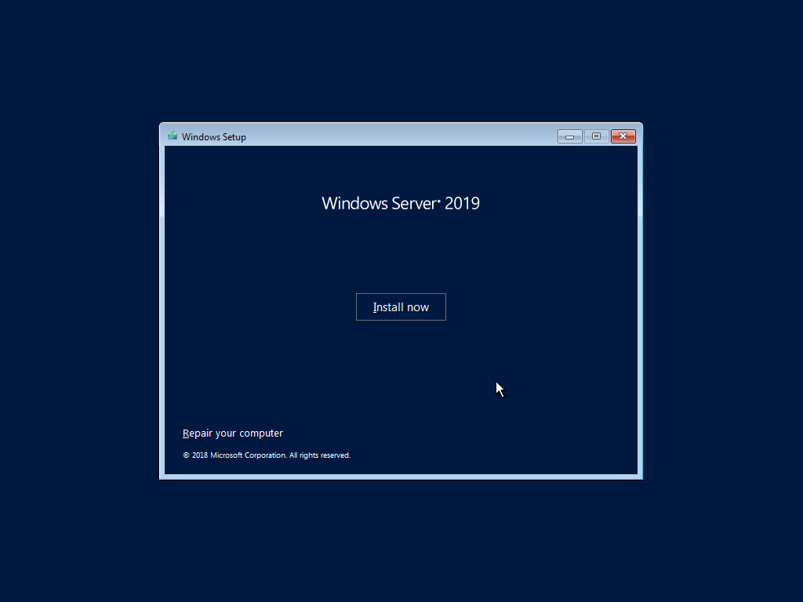

*Figure 17: Starting the Windows Server 2019 installation.*

---

# 11. Select the Windows Server Edition

Windows Server 2019 provides different editions and installation options.

For this lab, I selected an edition that included:

```text
Desktop Experience
```

The **Desktop Experience** option provides a graphical user interface (GUI).

This makes it easier to learn Windows Server administration using graphical management tools such as **Server Manager**.

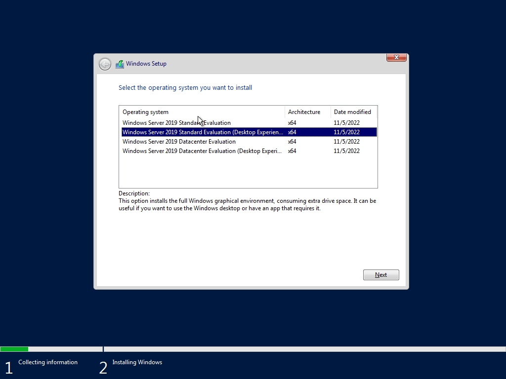

*Figure 18: Selecting a Windows Server 2019 edition with Desktop Experience.*

---

# 12. Accept the License Agreement

I reviewed the Microsoft license terms before continuing with the installation.

### Steps

1. Read the license terms.
2. Select:

```text
I accept the license terms
```
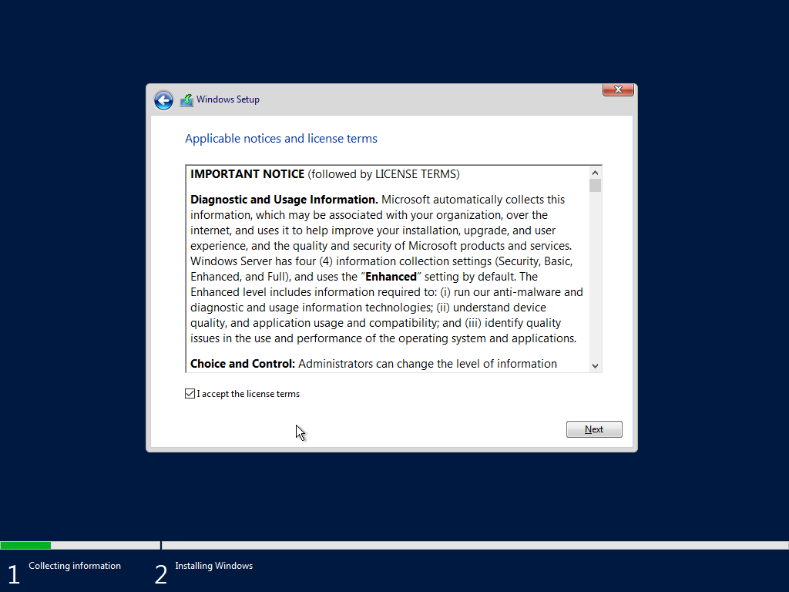

3. Click **Next**.

---

# 13. Select the Installation Type

Windows Setup provided different installation options.

Because this was a new installation, I selected:

```text
Custom: Install Windows only (advanced)
```

The **Custom** installation option is used when performing a fresh installation of Windows Server.

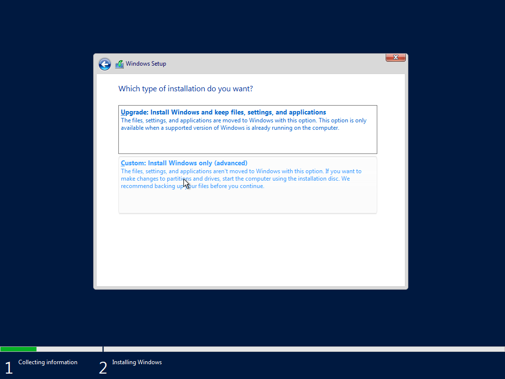

*Figure 19: Selecting the Custom installation option for Windows Server 2019.*

---

# 14. Select the Installation Disk

Next, I selected the virtual hard disk that I created earlier in VMware Workstation.

### Steps

1. Select the available virtual disk.
2. Verify that the correct disk is selected.
3. Click **Next**.

Windows Setup then began installing Windows Server 2019 on the selected virtual disk.

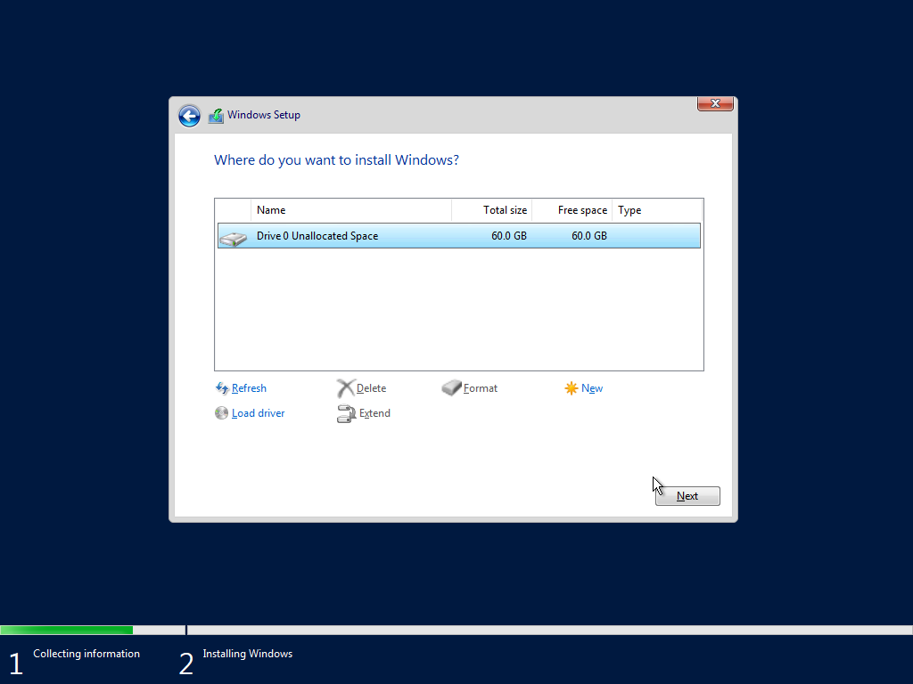

*Figure 20: Selecting the virtual disk for the Windows Server 2019 installation.*

---

## Windows Server Installation Process

Windows Setup automatically completed several installation tasks, including:

- Copying Windows files
- Preparing files for installation
- Installing Windows features
- Installing required components
- Completing the installation

The virtual machine restarted automatically during the installation process.

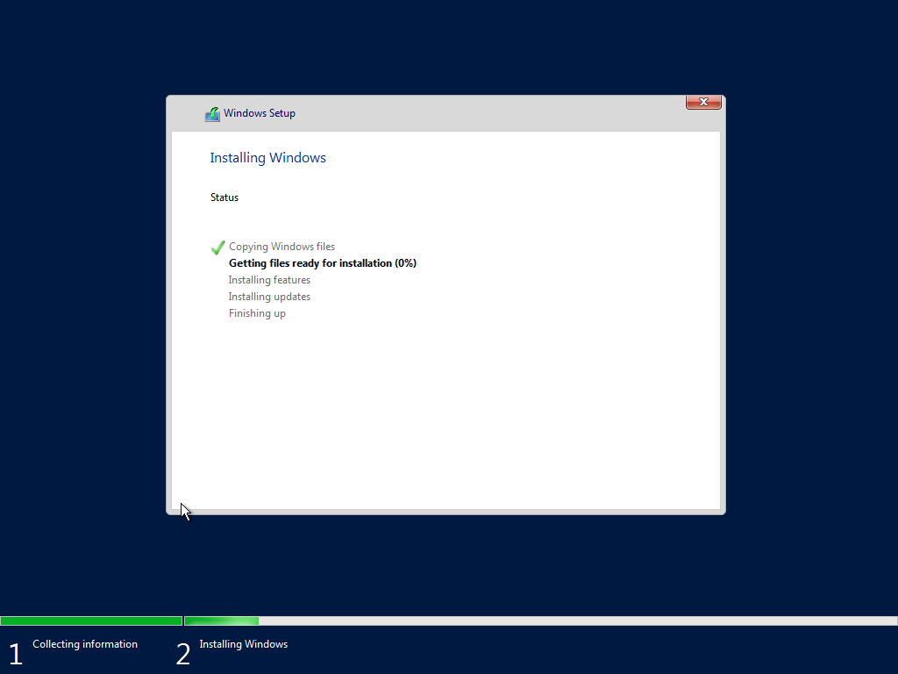

*Figure 21: Windows Server 2019 installation in progress.*

---

# 15. Configure the Administrator Password

After Windows Server 2019 finished installing, I was prompted to configure the built-in **Administrator** account.

The Administrator account is used to perform administrative and server management tasks.

### Steps

1. Enter a strong Administrator password.
2. Confirm the password.
3. Click **Finish**.

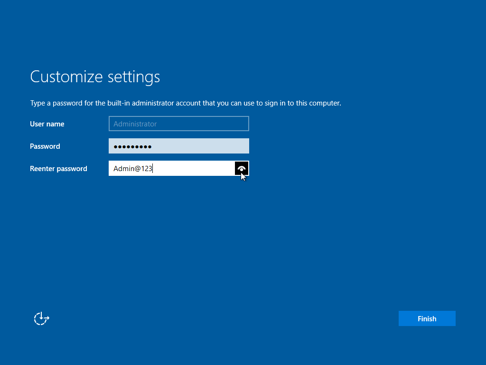

*Figure 22: Configuring the Windows Server Administrator account.*

> **Security Note:** Administrator passwords and other sensitive information should never be visible in project screenshots or public documentation.

---

# 16. Log In to Windows Server

After configuring the Administrator password, I logged in to Windows Server 2019 using the built-in Administrator account.

After signing in, the Windows Server desktop opened.

**Server Manager** also started automatically.

Server Manager is one of the primary tools used to configure and manage Windows Server. It can be used to:

- Install server roles and features
- View server information
- Manage local and remote servers
- Configure server services
- Monitor server status

At this stage, the base installation of Windows Server 2019 was successfully completed.


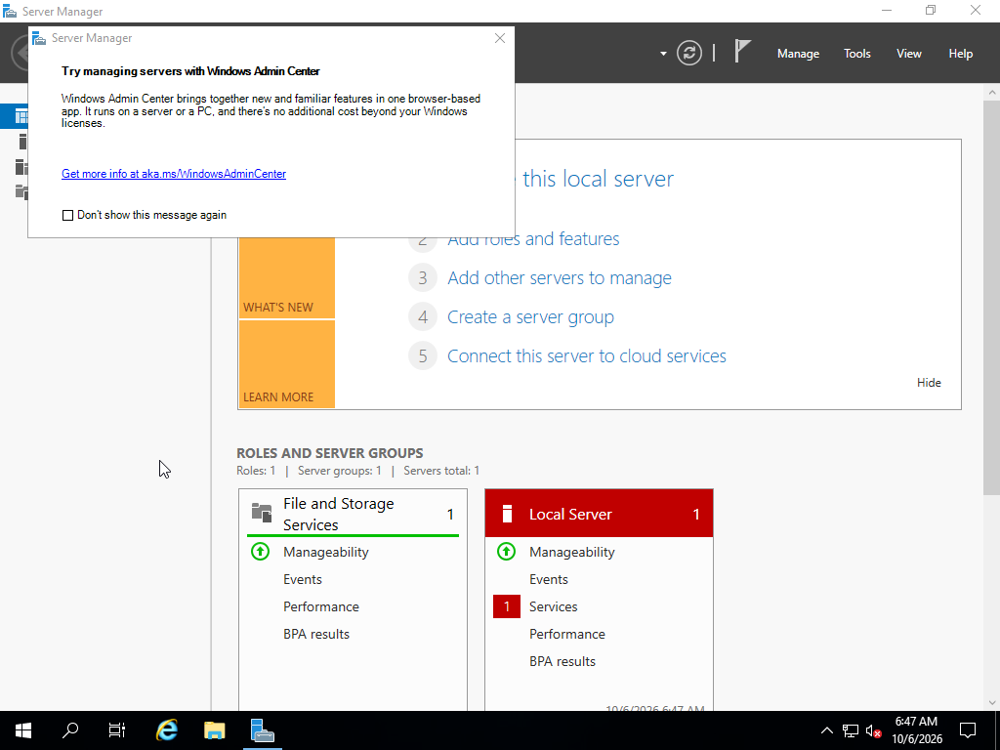

*Figure 23: Windows Server 2019 desktop and Server Manager after installation.*

---

## Current Progress

At this point, I have successfully:

- Installed VMware Workstation
- Downloaded the Windows Server 2019 ISO
- Created a Windows Server 2019 virtual machine
- Configured the virtual machine hardware
- Installed Windows Server 2019
- Created the Administrator password
- Logged in to Windows Server 2019
- Verified that Server Manager opened successfully

The next step is to install **VMware Tools** and continue configuring the Windows Server environment.