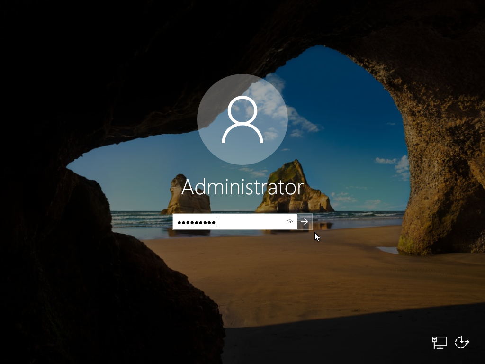
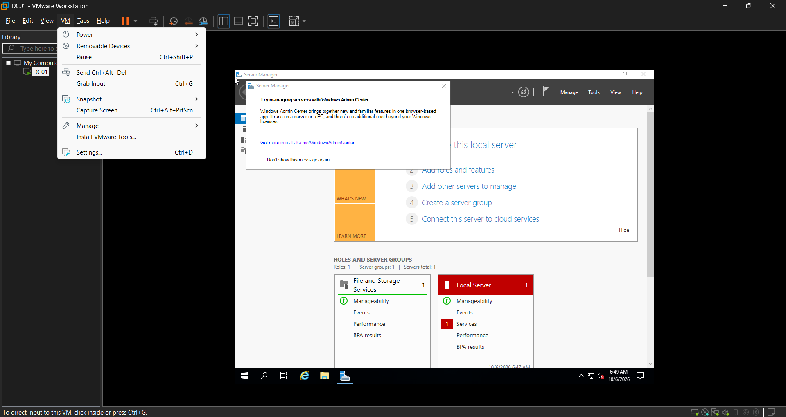
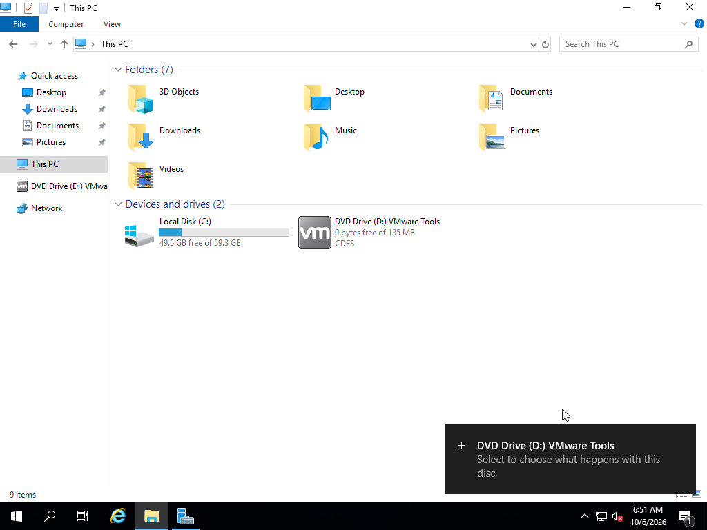
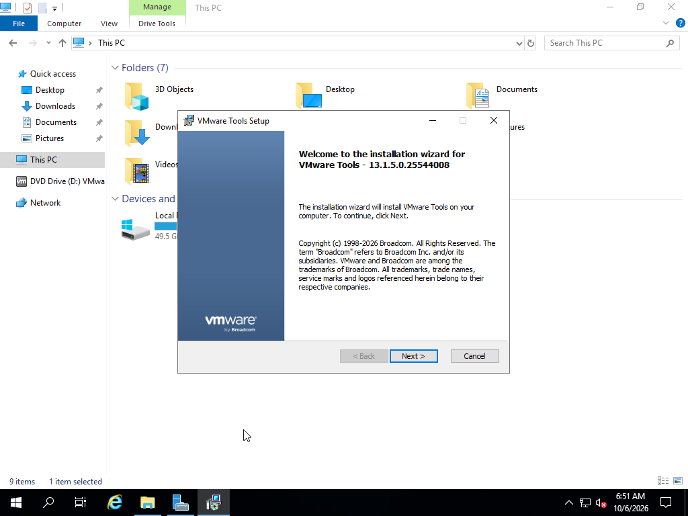
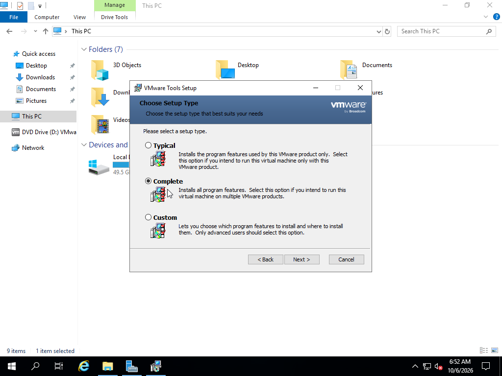
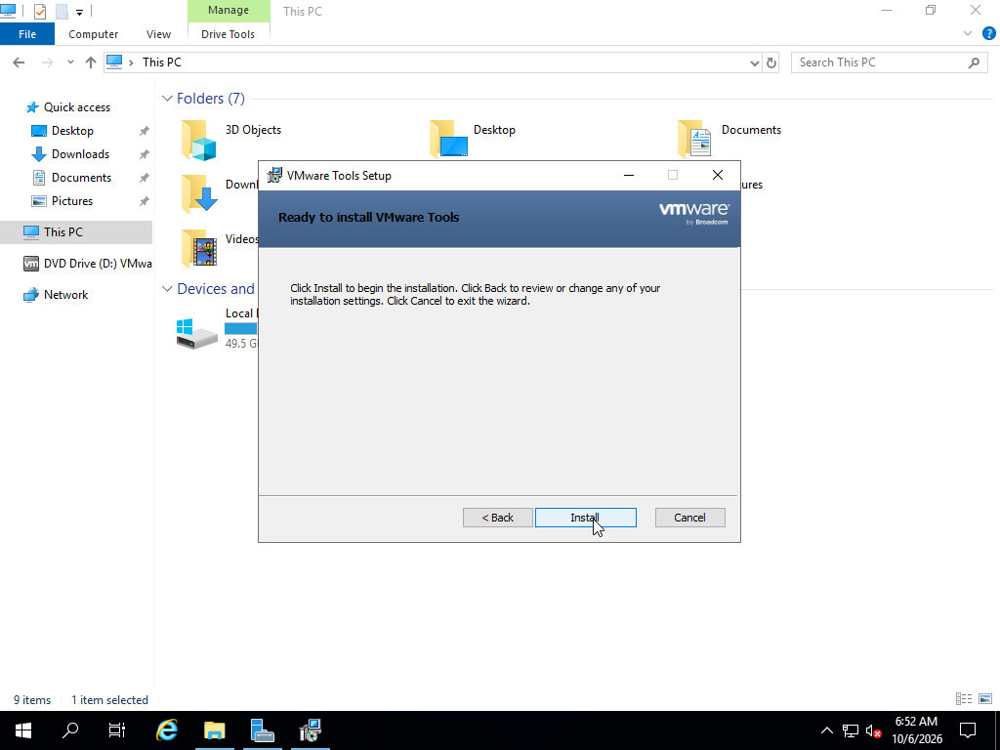
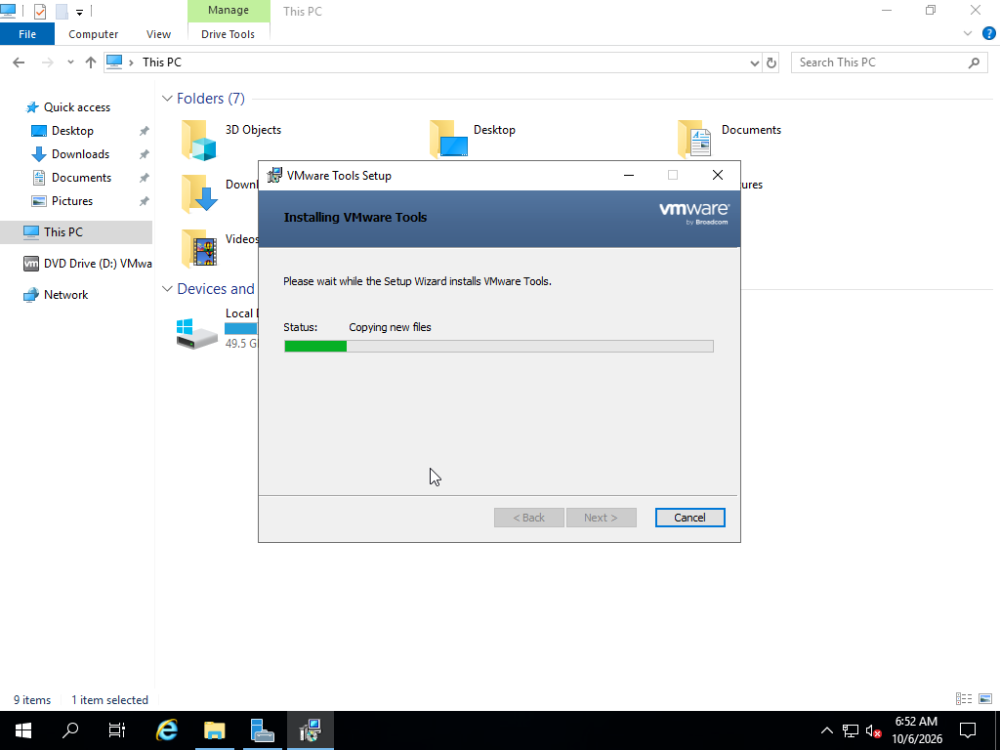
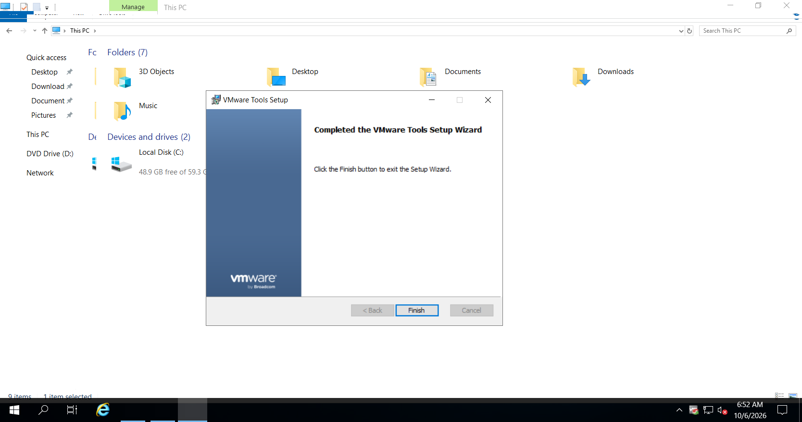
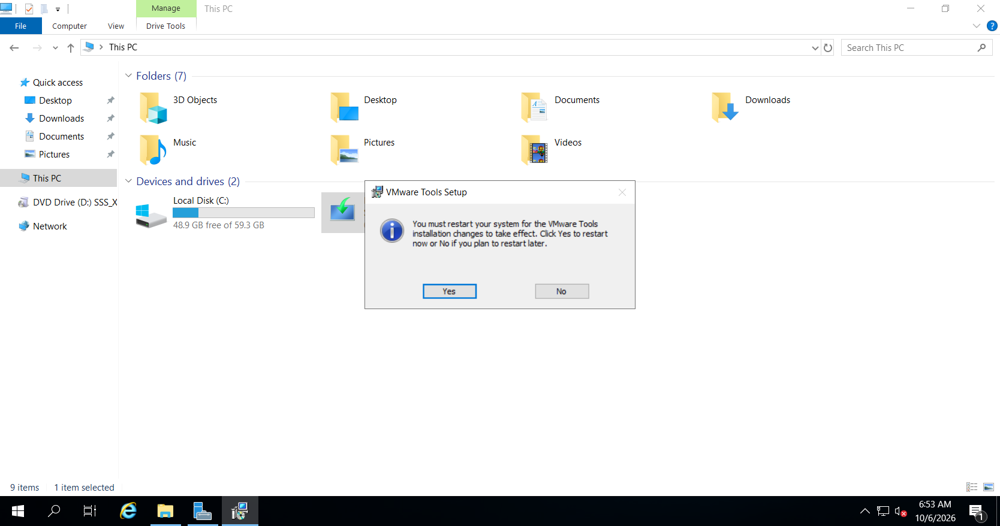
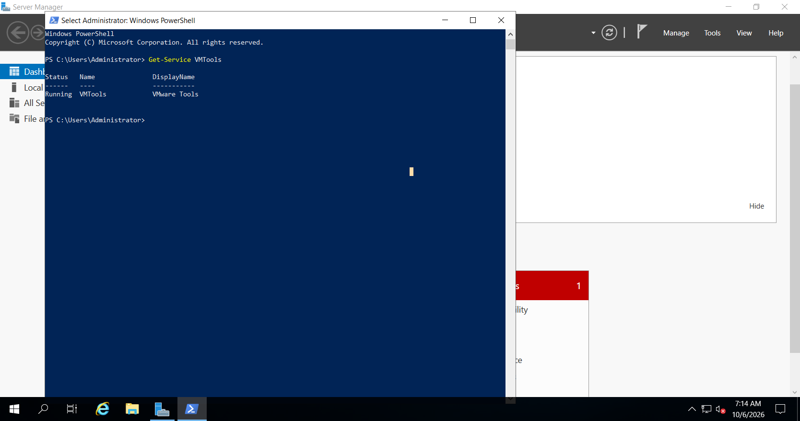

## Installing VMware Tools

VMware Tools was installed on the Windows Server virtual machine to improve the integration and performance between the virtual machine and VMware Workstation.

### Step 1 — Start the Virtual Machine

Start the Windows Server 2019 virtual machine and log in using the administrator account.

### Step 2 — Mount VMware Tools

From the VMware Workstation menu, select:

`VM > Install VMware Tools`

This mounts the VMware Tools installation files as a virtual CD/DVD inside the Windows Server virtual machine.

*Figure: Selecting the Install VMware Tools option from VMware Workstation.*

### Step 3 — Open the VMware Tools Installer

Open **File Explorer** inside Windows Server and select **This PC**.

Open the VMware Tools virtual CD/DVD drive.

Run the VMware Tools installer.

*Figure: VMware Tools installation media mounted inside Windows Server.*

### Step 4 — Start the Installation Wizard

When the VMware Tools Setup wizard appears, click **Next**.

Select **Typical** installation unless a custom configuration is required.

Click **Next** and then click **Install**.

*Figure: VMware Tools Setup wizard.*

### Step 5 — Complete the Installation

Wait for the installation process to complete.

Once the installation is finished, click **Finish**.

### Step 6 — Restart the Server

Restart the Windows Server virtual machine when prompted so that all VMware Tools components can be loaded properly.

*Figure: VMware Tools installation completed successfully.*

### Verification

After restarting the server, I verified that VMware Tools was installed successfully.

VMware Tools improves the virtual machine by providing features such as:

- Improved mouse and keyboard integration
- Better display performance
- Improved network and device support
- Better communication between VMware Workstation and the virtual machine
- Automatic adjustment of the virtual machine display resolution

The successful installation confirmed that the Windows Server 2019 virtual machine was properly integrated with VMware Workstation.