# Windows Server 2019 — Active Directory Domain Services Installation

## Overview

After completing the initial Windows Server 2019 configuration, the next phase of my lab project was to install and configure Active Directory Domain Services (AD DS).

Active Directory Domain Services is a Microsoft directory service that enables centralized management of users, computers, groups, and other network resources.

In an enterprise environment, Active Directory allows IT administrators to manage user authentication, access permissions, and security policies across multiple computers.

In this lab, I will configure DC01 as the first Domain Controller in a new Active Directory forest.

## Lab Objectives

The objectives of this section are to:

1. Verify the server's initial configuration.
2. Install Active Directory Domain Services.
3. Understand the purpose of a Domain Controller.
4. Create a new Active Directory forest.
5. Configure a domain name.
6. Configure Domain Controller options.
7. Install and configure DNS alongside Active Directory.
8. Promote Windows Server 2019 to a Domain Controller.
9. Verify the Active Directory installation.
10. Test domain and DNS functionality.

## Lab Environment

| Component               | Configuration                    |
| ----------------------- | -------------------------------- |
| Virtualization Platform | VMware Workstation               |
| Operating System        | Windows Server 2019              |
| Server Name             | DC01                             |
| Server IP Address       | 192.168.164.10         |
| Domain Name             | rapaljotlab.local                |
| NetBIOS Domain Name     | RAPALJOTLAB                      |
| Server Role             | Active Directory Domain Services |
| Additional Role         | DNS Server                       |

---

# Step 1 — Verify Windows Server Configuration

Before installing Active Directory Domain Services, I verified that Windows Server 2019 was configured correctly.

This verification helps identify potential configuration issues before promoting the server to a Domain Controller.

## 1.1 Verify the Computer Name

I opened Command Prompt and executed:

```cmd
hostname
```

### Expected Output

```text
DC01
```

This confirmed that the server was using the correct computer name.

## 1.2 Verify the Network Configuration

Next, I executed:

```cmd
ipconfig /all
```

This command displays detailed network configuration information.

I reviewed the following settings:

* IPv4 address
* Subnet mask
* Default gateway
* DNS server
* DHCP configuration

I confirmed that DC01 was configured with a static IPv4 address.

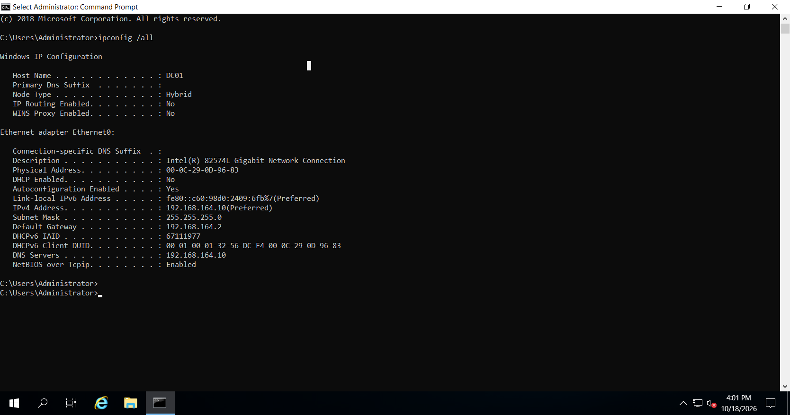

*Figure 1: Verifying the computer name and network configuration before installing Active Directory.*

---

# Step 2 — Open Server Manager

After verifying the server configuration, I opened Server Manager to install Active Directory Domain Services.

Server Manager is a Windows Server administration tool used to install and manage server roles, features, and services.

## Configuration Steps

1. Logged in to Windows Server 2019 using the Administrator account.
2. Opened **Server Manager**.
3. Waited for the Server Manager dashboard to load.
4. Located the **Manage** option in the upper-right corner.
5. Clicked **Manage**.
6. Selected **Add Roles and Features**.

The Add Roles and Features Wizard opened.

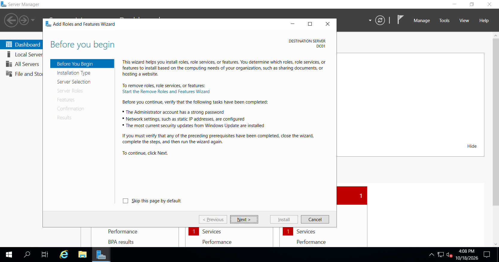

*Figure 2: Opening the Add Roles and Features Wizard in Server Manager.*

---

# Step 3 — Select Installation Type

The Add Roles and Features Wizard provides options for installing server roles and features.

## Configuration Steps

1. Reviewed the information on the **Before You Begin** page.

2. Clicked **Next**.

3. On the Installation Type page, selected:

   **Role-based or feature-based installation**

4. Clicked **Next**.

### Explanation

Role-based or feature-based installation allows administrators to install server roles such as:

* Active Directory Domain Services
* DNS Server
* DHCP Server
* File and Storage Services
* Web Server (IIS)

For this lab, I selected this option because I needed to install Active Directory Domain Services directly on DC01.

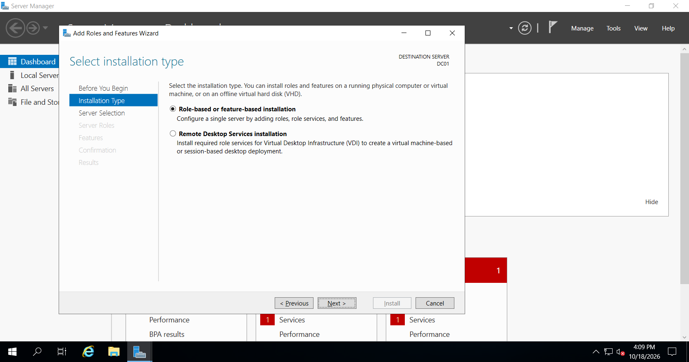

*Figure 3: Selecting role-based or feature-based installation.*

---

# Step 4 — Select the Destination Server

The next step was to select the server where Active Directory Domain Services would be installed.

## Configuration Steps

1. On the Server Selection page, selected:

   **Select a server from the server pool**

2. Located the server named `DC01`.

3. Selected DC01 from the available server list.

4. Verified that the selected server was correct.

5. Clicked **Next**.

### Explanation

The server selection page allows administrators to choose the destination server for installing roles and features.

In this lab, DC01 was the only Windows Server available.

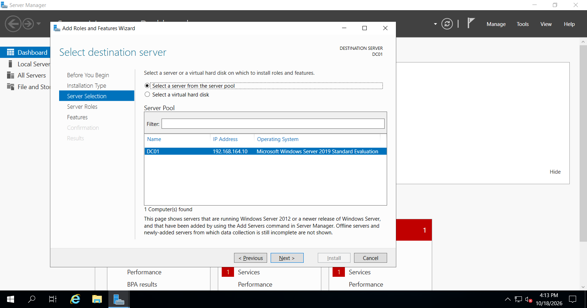

*Figure 4: Selecting DC01 as the destination server.*

---

# Step 5 — Install Active Directory Domain Services Role

After selecting the destination server, I installed the Active Directory Domain Services role.

## 5.1 Select Active Directory Domain Services

### Configuration Steps

1. On the **Server Roles** page, located:

   **Active Directory Domain Services**

2. Selected the checkbox beside Active Directory Domain Services.

3. A new window appeared requesting additional features.

4. Clicked **Add Features**.

The required management tools and dependencies were automatically selected.

5. Confirmed that Active Directory Domain Services was selected.
6. Clicked **Next**.

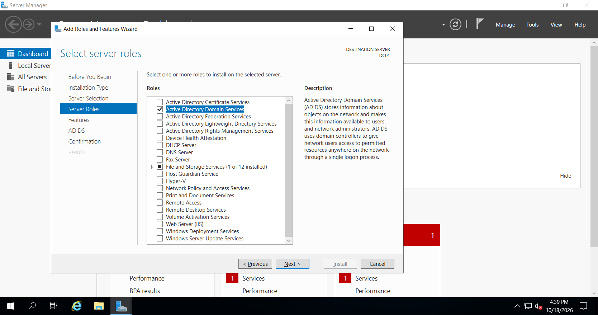

*Figure 5: Selecting the Active Directory Domain Services role.*

---

## 5.2 Add Required Features

Active Directory Domain Services requires additional components and management tools.

When prompted, I selected **Add Features** to include the necessary components.

These tools help administrators manage Active Directory after installation.

Examples include:

* Active Directory Users and Computers
* Active Directory Administrative Center
* Active Directory PowerShell module
* Additional AD DS management tools

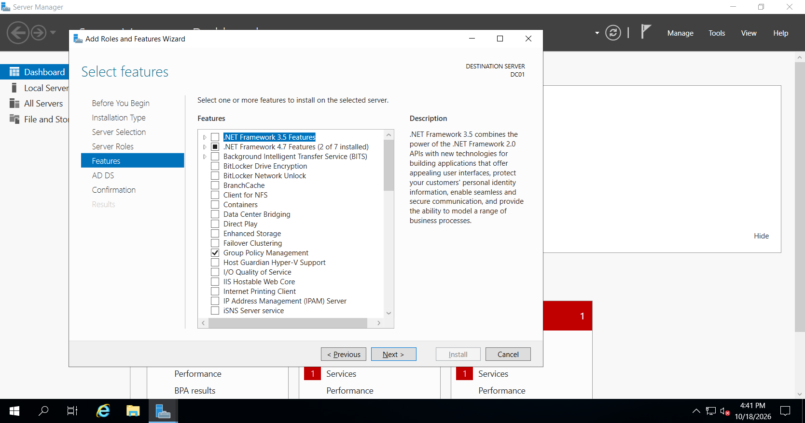

*Figure 6: Adding the required Active Directory Domain Services management features.*

---

# Step 6 — Review Active Directory Domain Services Information

After selecting the required features, the wizard displayed information about Active Directory Domain Services.

I reviewed the information before continuing with the installation.

## Configuration Steps

1. Clicked **Next** on the Features page.
2. Reviewed the Active Directory Domain Services information page.
3. Clicked **Next**.

### Explanation

Installing the AD DS role does not automatically make Windows Server a Domain Controller.

The server must be promoted to a Domain Controller after the role installation is completed.

---

# Step 7 — Install Active Directory Domain Services

The next step was to install the selected server role.

## Configuration Steps

1. Reviewed the installation summary.
2. Confirmed that Active Directory Domain Services was selected.
3. Clicked **Install**.
4. Waited for Windows Server to install the required components.
5. Confirmed that the installation completed successfully.

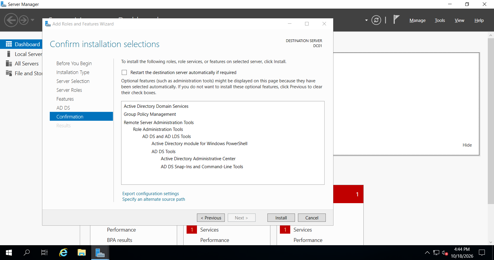

*Figure 7: Installing Active Directory Domain Services on Windows Server 2019.*

---

# Step 8 — Promote DC01 to a Domain Controller

After installing Active Directory Domain Services, the server needed to be promoted to a Domain Controller.

A Domain Controller is a server that provides Active Directory directory services and handles domain authentication and authorization.

It allows users and computers to access resources based on their domain identities and assigned permissions.

## Configuration Steps

1. Opened **Server Manager**.

2. Clicked the notification flag in the upper-right corner.

3. Located the post-deployment configuration notification.

4. Selected:

   **Promote this server to a domain controller**

5. The Active Directory Domain Services Configuration Wizard opened.

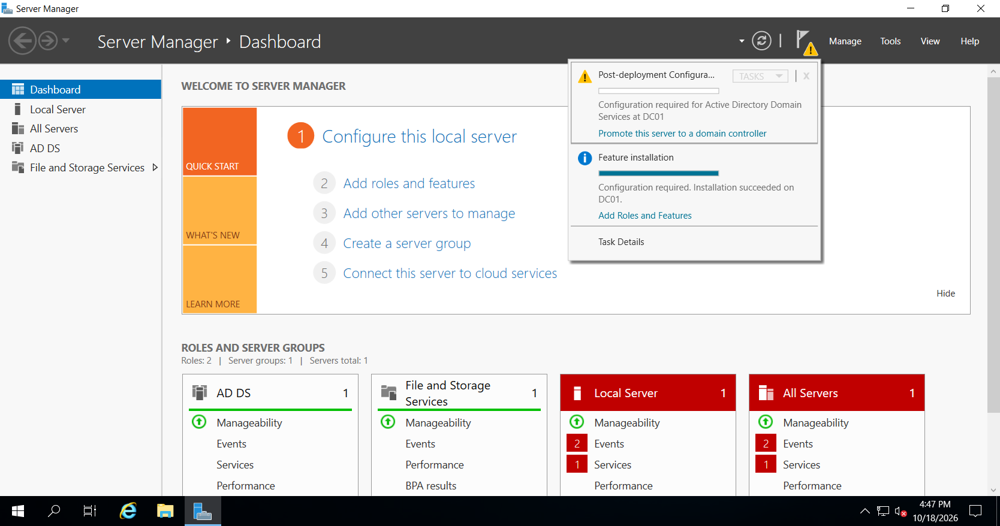

*Figure 8: Starting the Domain Controller promotion process.*

---

# Step 9 — Create a New Active Directory Forest

Because this was the first Domain Controller in the lab environment, I needed to create a new Active Directory forest.

## 9.1 Understanding an Active Directory Forest

An Active Directory forest is the highest-level logical structure in Active Directory.

A forest can contain one or more domains that share a common directory schema and configuration.

For this lab, I created a new forest containing a single domain.

## 9.2 Configure the Forest

### Configuration Steps

1. On the Deployment Configuration page, selected:

   **Add a new forest**

2. Located the **Root domain name** field.

3. Entered the domain name:

   `rapaljotlab.local`

4. Clicked **Next**.

### Domain Configuration

| Setting                 | Value             |
| ----------------------- | ----------------- |
| Deployment Operation    | Add a new forest  |
| Root Domain Name        | rapaljotlab.local |
| First Domain Controller | DC01              |

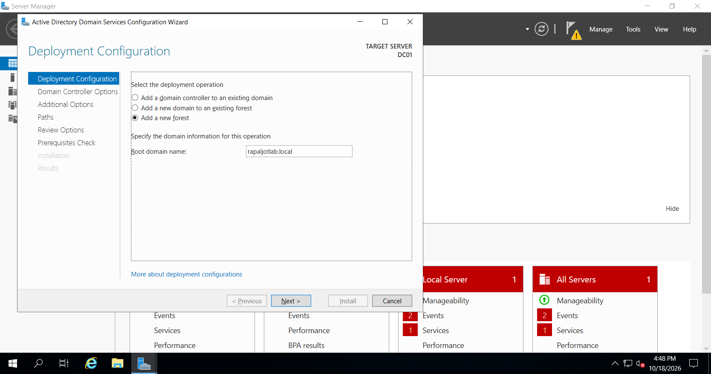

*Figure 9: Creating a new Active Directory forest named rapaljotlab.local.*

---

# Step 10 — Configure Domain Controller Options

After entering the domain name, the wizard displayed the Domain Controller Options page.

This page allows administrators to configure important Domain Controller settings.

## 10.1 Select Forest and Domain Functional Levels

I reviewed the available forest and domain functional levels.

For this Windows Server 2019 lab, I selected:

* **Forest functional level:** Windows Server 2016
* **Domain functional level:** Windows Server 2016

Windows Server 2016 is the highest available Active Directory functional level for a new forest created with Windows Server 2019.

The functional level determines which Active Directory capabilities are available and the minimum supported Domain Controller operating system version.

---

## 10.2 Configure Domain Controller Capabilities

I reviewed the available Domain Controller capabilities.

### DNS Server

I kept the **DNS Server** option selected.

DNS is required for Active Directory domain name resolution and Domain Controller discovery.

### Global Catalog

The **Global Catalog (GC)** option was selected.

A Global Catalog contains information about objects in the Active Directory forest and supports various directory searches and authentication operations.

The first Domain Controller in a new forest must be a Global Catalog server.

### Read Only Domain Controller

The **Read Only Domain Controller (RODC)** option was not available for the first Domain Controller.

A new forest requires a writable Domain Controller.

---

## 10.3 Configure Directory Services Restore Mode Password

I entered a secure **Directory Services Restore Mode (DSRM)** password.

The DSRM password is used for recovery and maintenance operations involving Active Directory.

### Configuration Steps

1. Selected the required functional levels.
2. Verified that DNS Server was selected.
3. Confirmed that Global Catalog was enabled.
4. Entered a secure DSRM password.
5. Confirmed the password.
6. Clicked **Next**.

> **Security Note:** The DSRM password must be stored securely and should never appear in screenshots or public project documentation.

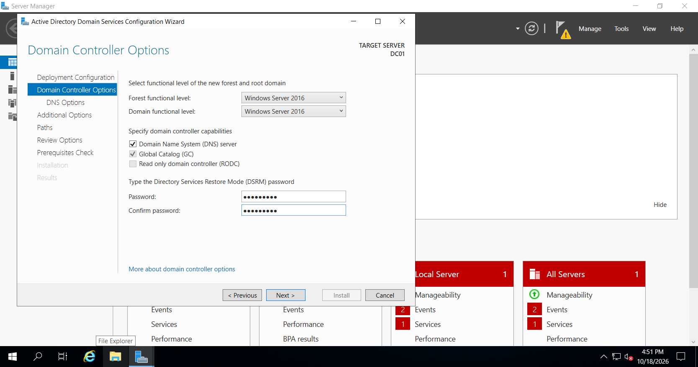

*Figure 10: Configuring Domain Controller options, DNS, Global Catalog, and DSRM settings.*

---

# Step 11 — Configure DNS Options

The next page displayed the DNS configuration settings.

Because this was the first Domain Controller in a new forest, DNS was configured alongside Active Directory Domain Services.

The wizard may display a warning indicating that a DNS delegation cannot be created.

This warning is generally expected when creating a new standalone lab forest without an existing parent DNS zone in which delegation could be configured.

## Configuration Steps

1. Reviewed the DNS Options page.
2. Left **Create DNS delegation** unchecked.
3. Clicked **Next**.

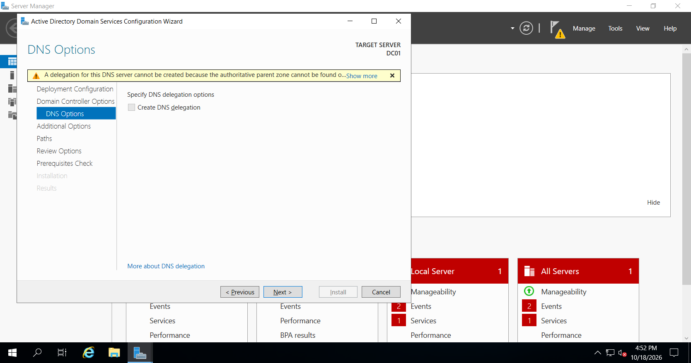

*Figure 11: Reviewing DNS options during Domain Controller promotion.*

---

# Step 12 — Configure the NetBIOS Domain Name

The wizard automatically generated a NetBIOS domain name based on the root domain name.

For this lab, the domain name was:

`rapaljotlab.local`

The proposed NetBIOS name was:

`RAPALJOTLAB`

## Configuration Steps

1. Reviewed the proposed NetBIOS domain name.
2. Confirmed that it was correct.
3. Clicked **Next**.

### Explanation

The NetBIOS domain name provides a shorter name that can be used in certain Windows authentication and compatibility scenarios.

For example, users can sign in using:

```text
RAPALJOTLAB\username
```
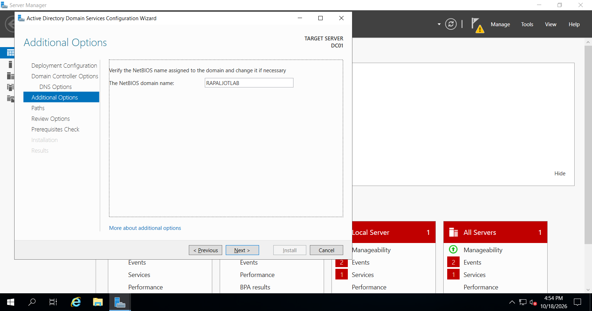

*Figure 12: Configuring the NetBIOS domain name for the Active Directory environment.*

---

# Step 13 — Configure Active Directory Database Paths

The next step was to configure the storage locations used by Active Directory.

The wizard displayed paths for the:

* Active Directory database
* Active Directory log files
* SYSVOL folder

## Default Locations

**Database folder:**

```text
C:\Windows\NTDS
```

**Log files folder:**

```text
C:\Windows\NTDS
```

**SYSVOL folder:**

```text
C:\Windows\SYSVOL
```

For this lab, I retained the default storage locations.

### Explanation

The Active Directory database stores directory information about users, groups, computers, and other objects.

The log files record database transactions and support recovery operations.

The SYSVOL folder contains files that must be accessible to domain computers, including Group Policy templates and scripts.

### Configuration Steps

1. Reviewed the database location.
2. Reviewed the log files location.
3. Reviewed the SYSVOL location.
4. Left the default paths unchanged.
5. Clicked **Next**.

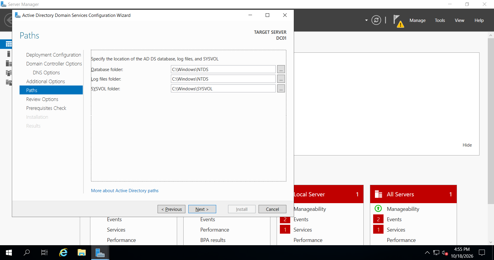

*Figure 13: Configuring Active Directory database, log, and SYSVOL storage locations.*

---

# Step 14 — Review Domain Controller Configuration

Before beginning the Domain Controller promotion, I reviewed the selected configuration settings.

## Configuration Summary

| Setting                 | Configuration       |
| ----------------------- | ------------------- |
| Deployment Type         | New Forest          |
| Domain Name             | rapaljotlab.local   |
| NetBIOS Name            | RAPALJOTLAB         |
| Forest Functional Level | Windows Server 2016 |
| Domain Functional Level | Windows Server 2016 |
| DNS Server              | Enabled             |
| Global Catalog          | Enabled             |
| Domain Controller       | DC01                |

After verifying the configuration, I clicked **Next**.

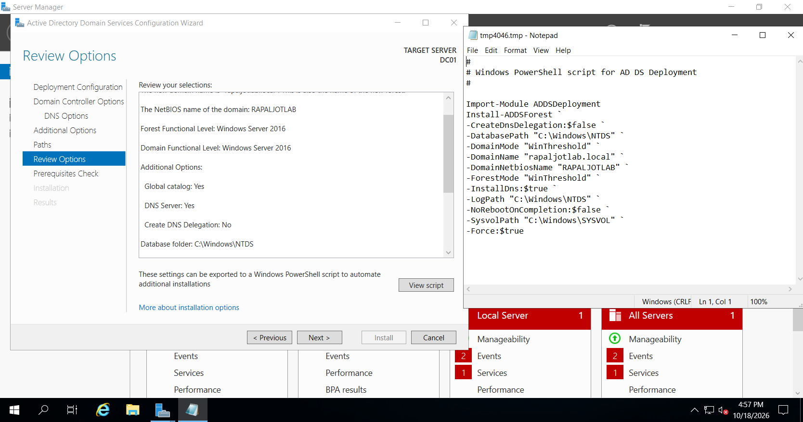

*Figure 14: Reviewing the Active Directory Domain Services configuration before installation.*

---

# Step 15 — Run Prerequisites Check

Before promoting the server, Windows Server performed prerequisite checks.

These checks help identify configuration issues that may prevent Active Directory from installing correctly.

## Configuration Steps

1. Waited for the prerequisite checks to complete.
2. Reviewed the results.
3. Confirmed that no blocking errors were detected.
4. Clicked **Install**.

Some warnings may appear during the prerequisite checks.

Warnings should be reviewed before continuing. A warning does not necessarily prevent installation.

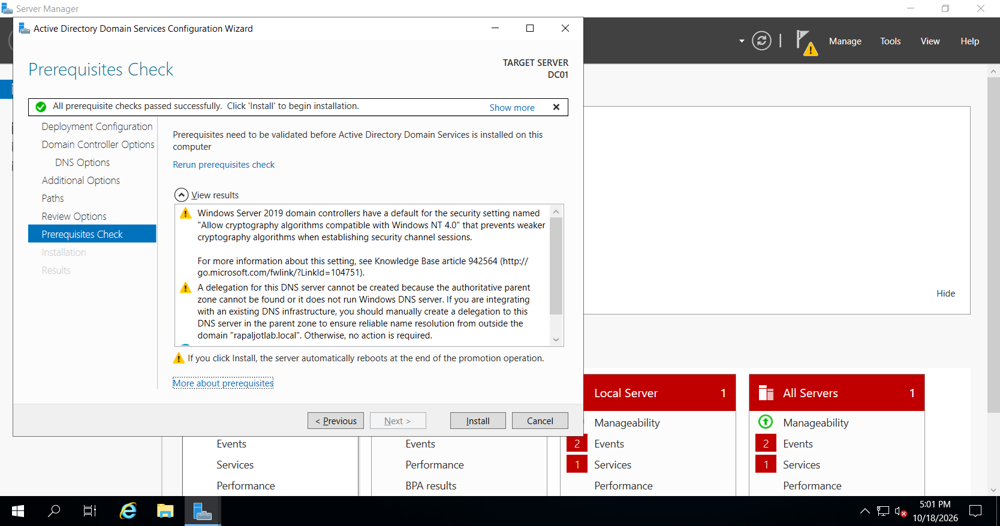

*Figure 15: Running prerequisite checks before promoting DC01 to a Domain Controller.*

---

# Step 16 — Promote the Server

After the prerequisite checks completed successfully, I started the Domain Controller promotion.

Windows Server performed the required configuration tasks, including:

* Creating the Active Directory forest
* Creating the root domain
* Configuring Active Directory Domain Services
* Installing and configuring DNS
* Creating the Active Directory database
* Configuring SYSVOL
* Configuring the Domain Controller

After the configuration completed, Windows Server restarted automatically.

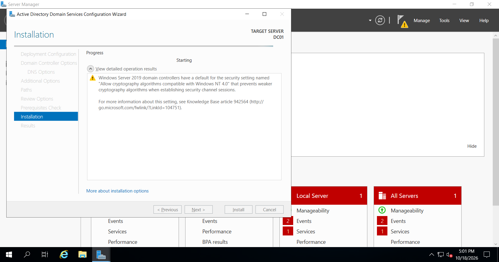

*Figure 16: Installing and configuring the first Active Directory Domain Controller.*

---

# Step 17 — Log In to the Domain Controller

After the server restarted, I logged in using the domain Administrator account.

The login screen displayed the newly configured domain.

### Domain Login

```text
RAPALJOTLAB\Administrator
```

I entered the Administrator password and signed in.

### Explanation

Before the server was promoted, I used a local Administrator account.

After promoting DC01 to a Domain Controller, the server used Active Directory domain accounts for normal administrative sign-in.

The built-in Administrator account is now associated with the Active Directory domain.

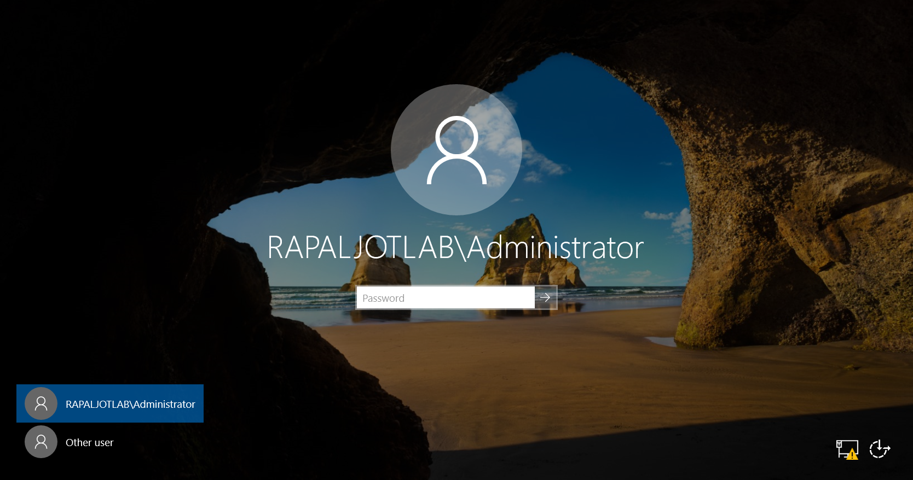

*Figure 17: Signing in to DC01 using the Active Directory domain Administrator account.*

---

# Step 18 — Verify Active Directory Installation

After logging in, I verified that Active Directory Domain Services was installed and operating correctly.

## 18.1 Verify Using Server Manager

### Verification Steps

1. Opened **Server Manager**.
2. Located the installed server roles.
3. Confirmed that **AD DS** appeared.
4. Confirmed that **DNS** appeared.

This indicated that the required server roles had been installed.

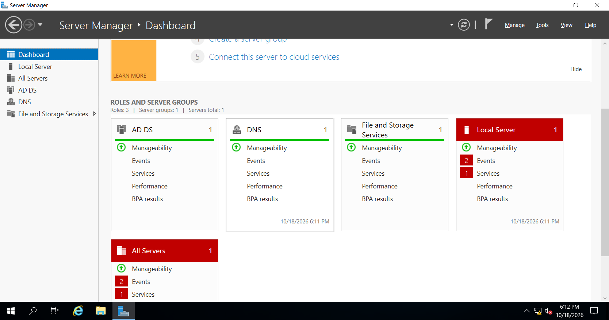

*Figure 18: Verifying the AD DS and DNS roles in Server Manager.*

---

## 18.2 Open Active Directory Users and Computers

Next, I opened the Active Directory Users and Computers management console.

### Verification Steps

1. Opened **Server Manager**.

2. Clicked **Tools**.

3. Selected **Active Directory Users and Computers**.

4. Expanded the domain:

   `rapaljotlab.local`

5. Reviewed the default Active Directory containers.

### Explanation

Active Directory Users and Computers is a management tool that allows administrators to manage:

* User accounts
* Computer accounts
* Security groups
* Organizational Units
* Domain objects

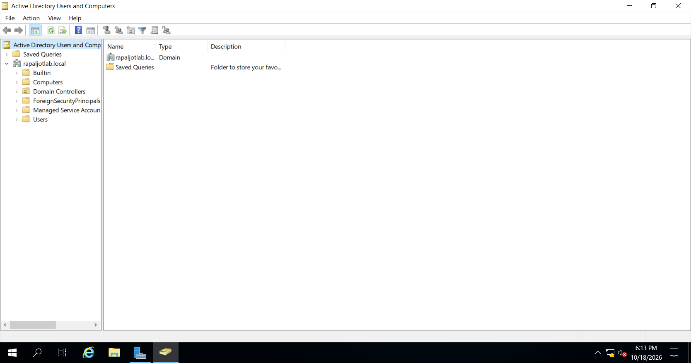

*Figure 19: Verifying the newly created Active Directory domain using Active Directory Users and Computers.*

---

# Step 19 — Verify Active Directory Using PowerShell

After verifying the domain through the graphical interface, I used Windows PowerShell to confirm the configuration.

I opened PowerShell and executed:

```powershell
Get-ADDomain
```

### Purpose

The `Get-ADDomain` command retrieves information about an Active Directory domain.

The output includes information such as:

* Domain name
* Distinguished name
* Domain functional level
* Domain Controllers
* NetBIOS name

### Expected Domain Information

```text
DNSRoot      : rapaljotlab.local
NetBIOSName  : RAPALJOTLAB
```

The actual output contains additional domain properties.

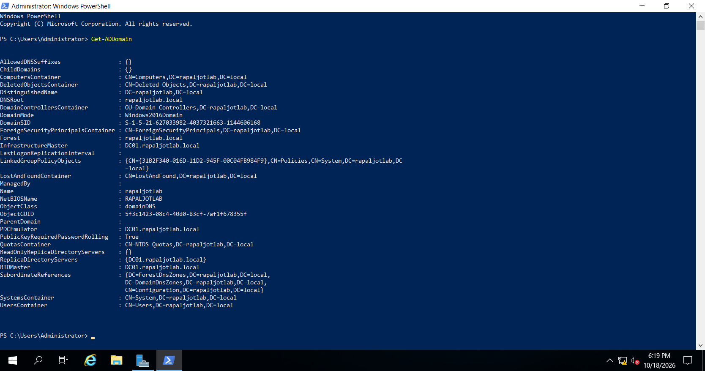

*Figure 20: Verifying the Active Directory domain using PowerShell.*

---

# Step 20 — Verify DNS Configuration

After installing Active Directory Domain Services, I verified that DNS was configured correctly.

DNS allows domain computers to locate Active Directory services.

## 20.1 Configure the Preferred DNS Server

Because DC01 is the first and only Domain Controller in this lab, its DNS client settings should point to its own static IP address.

For example:

```text
DC01 IP Address: 192.168.80.10
Preferred DNS: 192.168.80.10
```

The example IP must be replaced with the actual static IP address assigned to DC01.

The DNS Server role must be installed and running before using DC01 as its own DNS resolver.

---

## 20.2 Open DNS Manager

### Verification Steps

1. Opened **Server Manager**.
2. Clicked **Tools**.
3. Selected **DNS**.
4. Expanded DC01.
5. Expanded **Forward Lookup Zones**.
6. Verified that the following zone existed:

   `rapaljotlab.local`

I also reviewed the DNS records associated with the Active Directory domain.

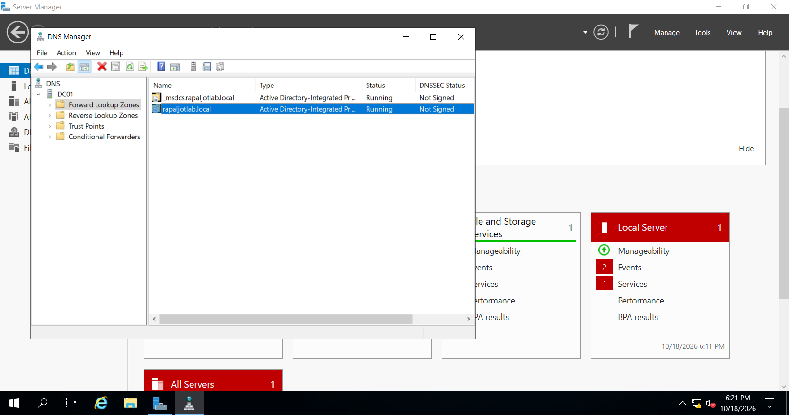

*Figure 21: Verifying the Active Directory-integrated DNS zone.*

---

## 20.3 Test Domain Name Resolution

I opened Command Prompt and executed:

```cmd
nslookup rapaljotlab.local
```

### Purpose

The `nslookup` command queries DNS to resolve a domain name.

A successful lookup helps confirm that the configured DNS server can resolve the Active Directory domain name.

I also tested the Domain Controller hostname:

```cmd
nslookup dc01.rapaljotlab.local
```

The DNS response should resolve the hostname to the static IP address assigned to DC01.

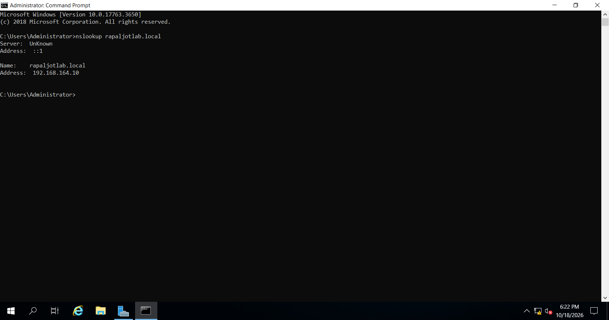

*Figure 22: Testing Active Directory domain name resolution using nslookup.*

---

# Step 21 — Verify Domain Controller Health

As an additional verification step, I used the Domain Controller Diagnostic tool.

I opened Command Prompt as Administrator and executed:

```cmd
dcdiag
```

### Purpose

The `dcdiag` command performs diagnostic tests on Active Directory Domain Controllers.

It helps administrators identify problems with:

* Active Directory services
* Domain Controller configuration
* DNS registration
* SYSVOL availability
* Domain Controller connectivity
* Directory service health

The diagnostic results were reviewed to identify any errors or warnings requiring investigation.

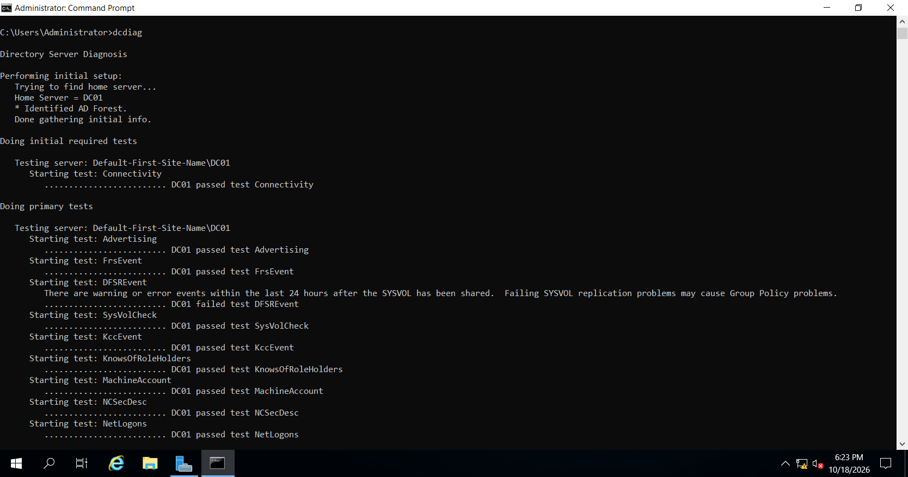

*Figure 23: Performing a Domain Controller diagnostic test using dcdiag.*

---

# Conclusion

In this section, I installed and configured Active Directory Domain Services on Windows Server 2019.

I created a new Active Directory forest and configured the domain:

**rapaljotlab.local**

I promoted DC01 to the first Domain Controller and enabled DNS services.

The configuration was verified using Server Manager, Active Directory Users and Computers, PowerShell, DNS Manager, and command-line diagnostic tools.

DC01 is now prepared for additional Active Directory administration tasks.

## Next Phase

The next phase of the project will focus on creating and organizing Active Directory objects.

This includes:

* Creating Organizational Units
* Creating user accounts
* Creating security groups
* Organizing users by department
* Configuring group membership
* Testing Active Directory user management

---
