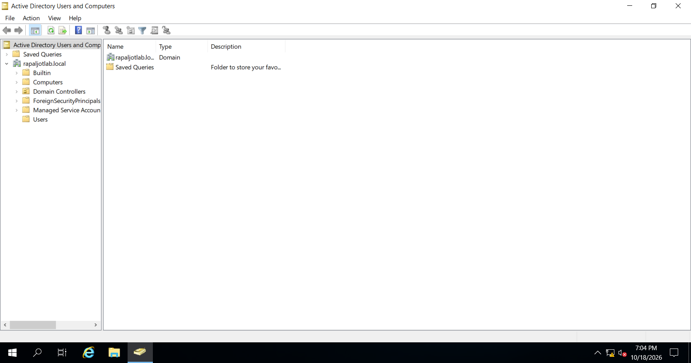
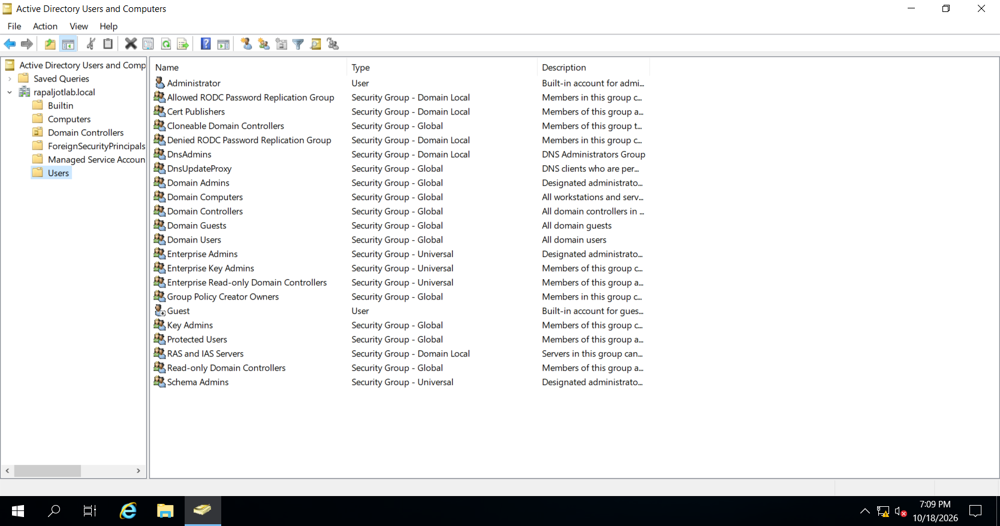
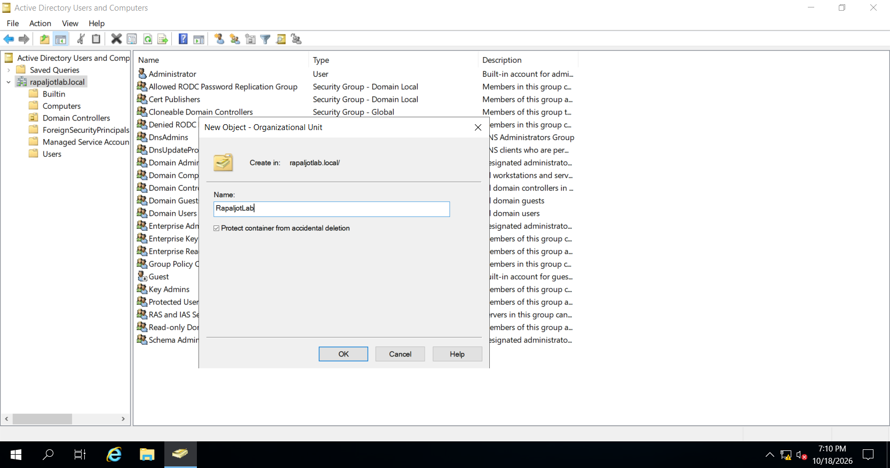
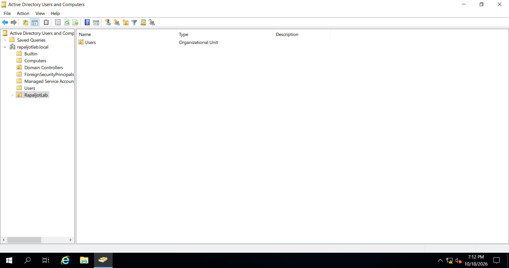
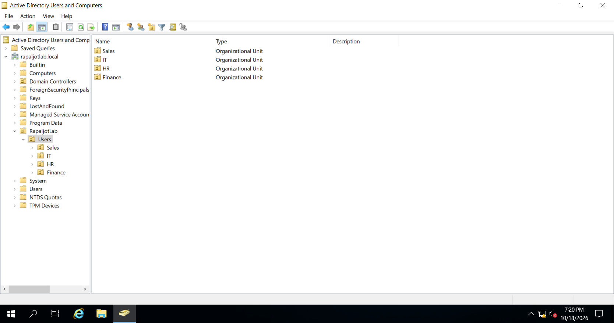
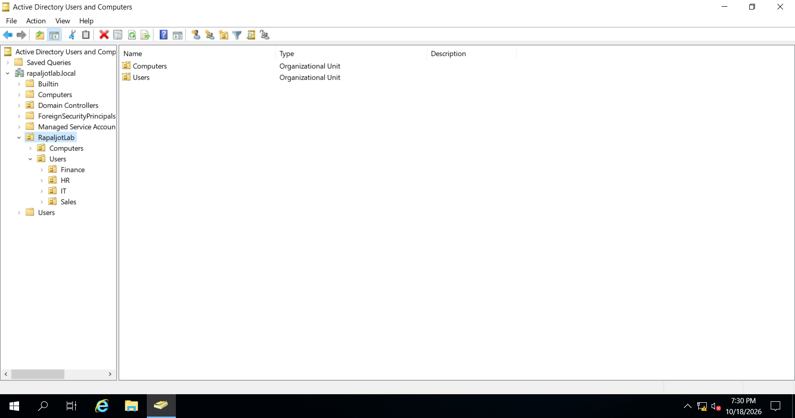
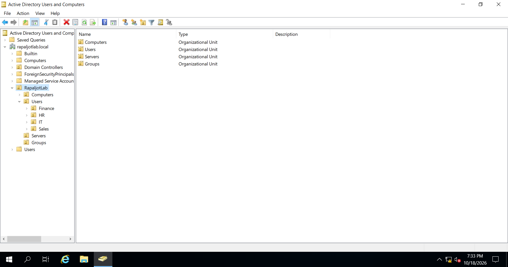
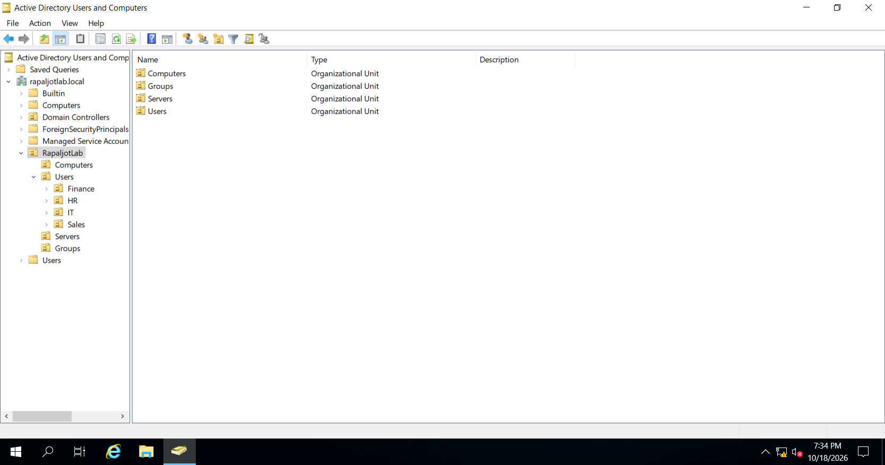
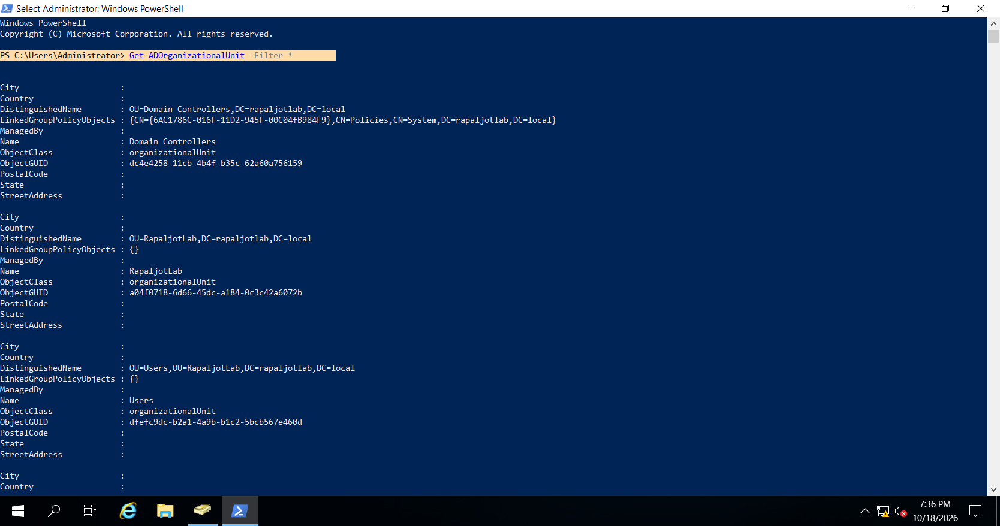

# Active Directory Organizational Units Configuration

## 1. Overview

After successfully installing Active Directory Domain Services (AD DS) and promoting Windows Server 2019 to a Domain Controller, the next step was to configure Organizational Units (OUs).

Organizational Units are containers within Active Directory that allow administrators to organize and manage directory objects.

These objects can include:

* User accounts
* Computer accounts
* Security groups
* Other Organizational Units

In an enterprise environment, Organizational Units help administrators manage resources efficiently and apply administrative policies to specific groups of users and computers.

For this lab, I created a fictional company structure to simulate an enterprise Active Directory environment.

## Objectives

The objectives of this section are to:

1. Understand the purpose of Organizational Units.
2. Open Active Directory Users and Computers.
3. Create a parent Organizational Unit.
4. Create an Organizational Unit for employees.
5. Create departmental Organizational Units.
6. Create an Organizational Unit for computers.
7. Create an Organizational Unit for servers.
8. Create an Organizational Unit for security groups.
9. Verify the Organizational Unit structure.
10. Verify the configuration using PowerShell.

---

## Lab Environment

| Component               | Configuration                        |
| ----------------------- | ------------------------------------ |
| Virtualization Platform | VMware Workstation                   |
| Operating System        | Windows Server 2019                  |
| Server Name             | DC01                                 |
| Domain Name             | rapaljotlab.local                    |
| Domain Controller       | DC01                                 |
| Management Tool         | Active Directory Users and Computers |
| Parent OU               | RapaljotLab                          |

---

# Step 1 — Open Active Directory Users and Computers

## 1.1 Purpose

Active Directory Users and Computers (ADUC) is a Microsoft Management Console tool used to manage objects within an Active Directory domain.

Administrators use this tool to perform tasks such as:

* Creating user accounts
* Creating security groups
* Creating Organizational Units
* Resetting user passwords
* Managing computer accounts
* Configuring group membership
* Enabling and disabling user accounts

For this lab, I used Active Directory Users and Computers to create the Organizational Unit structure.

## 1.2 Configuration Steps

1. Started the Windows Server 2019 virtual machine in VMware Workstation.
2. Logged in using the domain Administrator account.
3. Opened **Server Manager**.
4. Located the **Tools** menu in the upper-right corner.
5. Clicked **Tools**.
6. Selected **Active Directory Users and Computers**.

The Active Directory Users and Computers management console opened.

### Alternative Method

Active Directory Users and Computers can also be opened using the Run dialog.

1. Press `Windows + R`.
2. Enter the following command:

```cmd
dsa.msc
```

3. Press **Enter**.

This command opens the Active Directory Users and Computers console.



*Figure 1: Opening Active Directory Users and Computers from Server Manager.*

---

# Step 2 — Examine the Active Directory Domain

Before creating Organizational Units, I reviewed the existing Active Directory domain structure.

## 2.1 Configuration Steps

1. Opened **Active Directory Users and Computers**.

2. Located the domain in the left navigation panel.

3. Expanded the domain:

   `rapaljotlab.local`

4. Reviewed the default containers and Organizational Units.

The domain contained several default objects, including:

* Builtin
* Computers
* Domain Controllers
* ForeignSecurityPrincipals
* Managed Service Accounts
* Users

Some objects are containers, while others, such as Domain Controllers, are Organizational Units.

## 2.2 Understanding the Default Containers

Active Directory automatically creates several containers when a new domain is established.

For example:

**Users**

The default Users container stores several built-in user and group objects.

**Computers**

The default Computers container is commonly used for computer accounts when devices join the domain without specifying another location.

**Domain Controllers**

The Domain Controllers OU contains computer accounts for Domain Controllers.

For this lab, I decided to create a separate Organizational Unit structure to organize company resources.

> Note: The default Users and Computers containers are not the same as the custom Organizational Units created later in this lab.



*Figure 2: Reviewing the default Active Directory domain structure.*

---

# Step 3 — Create the Parent Organizational Unit

The first Organizational Unit I created was named:

`RapaljotLab`

This Organizational Unit will act as the parent container for the fictional company's Active Directory structure.

## 3.1 Purpose

Creating a parent Organizational Unit provides a central location for managing the company's users, computers, groups, and other resources.

It also allows additional Organizational Units to be created within a structured hierarchy.

## 3.2 Configuration Steps

1. Opened **Active Directory Users and Computers**.

2. Expanded the domain:

   `rapaljotlab.local`

3. Right-clicked the domain name.

4. Selected **New**.

5. Clicked **Organizational Unit**.

The New Object — Organizational Unit window appeared.

6. Entered the following name:

   `RapaljotLab`

7. Left the following option enabled:

   **Protect container from accidental deletion**

8. Clicked **OK**.

The Organizational Unit was created successfully.

## 3.3 Understanding Accidental Deletion Protection

The option **Protect container from accidental deletion** prevents the Organizational Unit from being deleted accidentally through normal administrative actions.

This protection is useful because Organizational Units may contain important user accounts, computers, and security groups.

Deleting an Organizational Unit without proper planning could affect multiple Active Directory objects.

For this lab, accidental deletion protection was left enabled.



*Figure 3: Creating the parent Organizational Unit named RapaljotLab.*

---

# Step 4 — Create the Users Organizational Unit

After creating the parent Organizational Unit, I created a child Organizational Unit named:

`Users`

This OU will contain additional Organizational Units for different company departments.

## 4.1 Purpose

In an enterprise environment, employee accounts are commonly organized according to departments.

For example:

* Human Resources
* Finance
* Sales
* Information Technology

Organizing employee accounts in this way helps administrators manage users and apply policies to different departments.

## 4.2 Configuration Steps

1. Expanded the domain `rapaljotlab.local`.

2. Located the parent Organizational Unit named `RapaljotLab`.

3. Right-clicked `RapaljotLab`.

4. Selected **New**.

5. Clicked **Organizational Unit**.

6. Entered the name:

   `Users`

7. Left accidental deletion protection enabled.

8. Clicked **OK**.

The Users Organizational Unit was created inside RapaljotLab.

## 4.3 Result

The Active Directory structure now appeared as follows:

```text
rapaljotlab.local
│
└── RapaljotLab
    │
    └── Users
```



*Figure 4: Creating the Users Organizational Unit inside RapaljotLab.*

---

# Step 5 — Create Departmental Organizational Units

After creating the Users Organizational Unit, I created separate OUs for each department.

The departments used in this lab were:

* HR
* Finance
* Sales
* IT

Creating separate departmental Organizational Units provides a structured approach to managing employee accounts.

---

## 5.1 Create the HR Organizational Unit

The first departmental Organizational Unit was created for Human Resources.

### Purpose

The Human Resources department is responsible for employee-related activities.

In a corporate environment, HR employees may require access to confidential employee records and department-specific resources.

Creating a dedicated HR Organizational Unit allows administrators to organize HR user accounts and apply appropriate Group Policy settings.

### Configuration Steps

1. Opened **Active Directory Users and Computers**.

2. Expanded the `RapaljotLab` Organizational Unit.

3. Located the `Users` Organizational Unit.

4. Right-clicked **Users**.

5. Selected **New > Organizational Unit**.

6. Entered:

   `HR`

7. Left accidental deletion protection enabled.

8. Clicked **OK**.

The HR Organizational Unit was created successfully.

---

## 5.2 Create the Finance Organizational Unit

The next Organizational Unit was created for the Finance department.

### Purpose

The Finance department manages financial records, accounting information, and other financial resources.

A dedicated Finance OU provides a logical location for managing Finance employee accounts.

### Configuration Steps

1. Right-clicked the `Users` Organizational Unit.

2. Selected **New > Organizational Unit**.

3. Entered:

   `Finance`

4. Left accidental deletion protection enabled.

5. Clicked **OK**.

The Finance Organizational Unit was created inside the Users OU.

---

## 5.3 Create the Sales Organizational Unit

Next, I created an Organizational Unit for the Sales department.

### Purpose

The Sales department may use business applications, customer relationship management systems, and shared resources.

Creating a separate Sales OU allows administrators to organize Sales user accounts and apply department-specific policies.

### Configuration Steps

1. Right-clicked the `Users` Organizational Unit.

2. Selected **New > Organizational Unit**.

3. Entered:

   `Sales`

4. Left accidental deletion protection enabled.

5. Clicked **OK**.

The Sales Organizational Unit was created successfully.

---

## 5.4 Create the IT Organizational Unit

The final departmental Organizational Unit was created for the Information Technology department.

### Purpose

The IT department is responsible for maintaining and supporting the organization's technology infrastructure.

IT employees may be responsible for:

* Managing user accounts
* Troubleshooting computers
* Maintaining servers
* Configuring networks
* Managing security permissions
* Providing technical support

A dedicated IT Organizational Unit allows IT employee accounts to be organized separately from other departments.

### Configuration Steps

1. Right-clicked the `Users` Organizational Unit.

2. Selected **New > Organizational Unit**.

3. Entered:

   `IT`

4. Left accidental deletion protection enabled.

5. Clicked **OK**.

---

# Step 6 — Verify the Departmental OU Structure

After creating all departmental Organizational Units, I verified the structure in Active Directory Users and Computers.

## Verification Steps

1. Opened **Active Directory Users and Computers**.
2. Expanded the domain `rapaljotlab.local`.
3. Expanded `RapaljotLab`.
4. Expanded `Users`.
5. Verified that the following Organizational Units were present:

   * HR
   * Finance
   * Sales
   * IT

## Expected Structure

```text
rapaljotlab.local
│
└── RapaljotLab
    │
    └── Users
        │
        ├── HR
        │
        ├── Finance
        │
        ├── Sales
        │
        └── IT
```



*Figure 9: Verifying the departmental Organizational Unit structure.*

---

# Step 7 — Create the Computers Organizational Unit

After creating the departmental Organizational Units, I created an OU to organize domain-joined client computers.

## 7.1 Purpose

In an enterprise environment, administrators manage many client computers running operating systems such as Windows 10 and Windows 11.

Organizing computer accounts in a dedicated OU allows administrators to:

* Manage computer objects.
* Apply computer-specific Group Policies.
* Configure security settings.
* Organize workstations.
* Simplify administration.

## 7.2 Configuration Steps

1. Opened **Active Directory Users and Computers**.

2. Expanded the `RapaljotLab` Organizational Unit.

3. Right-clicked `RapaljotLab`.

4. Selected **New > Organizational Unit**.

5. Entered:

   `Computers`

6. Left accidental deletion protection enabled.

7. Clicked **OK**.

The Computers Organizational Unit was created successfully.



*Figure 10: Creating the Computers Organizational Unit.*

> **Note:** Creating this OU does not automatically place newly joined computers inside it. We will move client computer accounts into this OU after joining them to the domain, unless their destination OU is specified during domain joining.

---

# Step 8 — Create the Servers Organizational Unit

Next, I created an Organizational Unit for managing future member servers.

## 8.1 Purpose

In an enterprise environment, organizations may use multiple servers for different services.

Examples include:

* File servers
* Application servers
* Web servers
* Database servers

Creating a dedicated Servers OU allows administrators to organize member server computer accounts and apply appropriate Group Policies.

## 8.2 Configuration Steps

1. Expanded the `RapaljotLab` Organizational Unit.

2. Right-clicked `RapaljotLab`.

3. Selected **New > Organizational Unit**.

4. Entered:

   `Servers`

5. Left accidental deletion protection enabled.

6. Clicked **OK**.

The Servers Organizational Unit was created successfully.


*Figure 11: Creating the Servers Organizational Unit.*

> **Important:** DC01 is a Domain Controller and should remain in the default **Domain Controllers** OU for this lab. The newly created Servers OU is intended for future member servers.

---

# Step 9 — Create the Groups Organizational Unit

After creating the Computers and Servers OUs, I created an Organizational Unit for managing Active Directory groups.

## 9.1 Purpose

Active Directory security groups are commonly used to manage access to network resources.

Instead of assigning permissions individually to multiple employees, administrators can assign permissions to groups.

For example, a security group named `HR-Users` could contain employees from the Human Resources department.

Administrators could then use this group when assigning access to HR-related resources.

Creating a Groups OU provides a central location for organizing custom security groups.

## 9.2 Configuration Steps

1. Opened **Active Directory Users and Computers**.

2. Expanded `RapaljotLab`.

3. Right-clicked the `RapaljotLab` Organizational Unit.

4. Selected **New > Organizational Unit**.

5. Entered:

   `Groups`

6. Left accidental deletion protection enabled.

7. Clicked **OK**.

The Groups Organizational Unit was created successfully.



*Figure 12: Creating the Groups Organizational Unit.*

---

# Step 10 — Verify the Complete Organizational Unit Structure

After completing the Organizational Unit configuration, I reviewed the entire Active Directory structure.

## Verification Steps

1. Opened **Active Directory Users and Computers**.
2. Expanded the domain `rapaljotlab.local`.
3. Expanded `RapaljotLab`.
4. Expanded the `Users` Organizational Unit.
5. Confirmed that all required Organizational Units were present.

## Final OU Structure

```text
rapaljotlab.local
│
└── RapaljotLab
    │
    ├── Users
    │   │
    │   ├── HR
    │   │
    │   ├── Finance
    │   │
    │   ├── Sales
    │   │
    │   └── IT
    │
    ├── Computers
    │
    ├── Servers
    │
    └── Groups
```



*Figure 13: Verifying the completed Active Directory Organizational Unit hierarchy.*

---

# Step 11 — Verify Organizational Units Using PowerShell

In addition to verifying the Organizational Units using the graphical interface, I used Windows PowerShell.

PowerShell provides command-line tools for managing Active Directory objects.

## 11.1 Open Windows PowerShell

1. Opened the Start menu.
2. Searched for **Windows PowerShell**.
3. Opened Windows PowerShell.
4. Verified that the Active Directory PowerShell module was available.

## 11.2 Display All Organizational Units

I executed the following command:

```powershell
Get-ADOrganizationalUnit -Filter *
```

### Explanation

The `Get-ADOrganizationalUnit` cmdlet retrieves Organizational Unit objects from Active Directory.

The `-Filter *` parameter instructs PowerShell to return all Organizational Units within the default search scope.

This command allows administrators to verify Organizational Units without navigating through the graphical management console.

---

## 11.3 Display Organizational Unit Names and Distinguished Names

To display a more organized output, I executed:

```powershell
Get-ADOrganizationalUnit -Filter * |
    Select-Object Name, DistinguishedName
```

### Explanation

This command displays the name and distinguished name of each Organizational Unit.

A distinguished name identifies an object's location within the Active Directory hierarchy.

For example:

```text
OU=HR,OU=Users,OU=RapaljotLab,DC=rapaljotlab,DC=local
```

This distinguished name identifies the HR Organizational Unit.

It indicates that:

* `OU=HR` represents the HR Organizational Unit.
* `OU=Users` represents its parent Organizational Unit.
* `OU=RapaljotLab` represents the company Organizational Unit.
* `DC=rapaljotlab,DC=local` represents the Active Directory domain.



*Figure 14: Verifying Active Directory Organizational Units using PowerShell.*

---

# Step 12 — Final Configuration Verification

After creating the Organizational Units, I verified the configuration.

## Verification Checklist

| Configuration                     | Expected Result |
| --------------------------------- | --------------- |
| Parent OU                         | RapaljotLab     |
| Users OU                          | Created         |
| HR OU                             | Created         |
| Finance OU                        | Created         |
| Sales OU                          | Created         |
| IT OU                             | Created         |
| Computers OU                      | Created         |
| Servers OU                        | Created         |
| Groups OU                         | Created         |
| Active Directory GUI Verification | Successful      |
| PowerShell Verification           | Successful      |

The completed Organizational Unit structure provides a logical foundation for managing users, computers, groups, and future server resources.

---

# Conclusion

In this section, I created a structured Organizational Unit hierarchy within Active Directory Domain Services.

I configured a parent Organizational Unit named `RapaljotLab` and created separate OUs for employees, departments, computers, servers, and groups.

The departmental Organizational Units included:

* Human Resources
* Finance
* Sales
* Information Technology

I verified the Organizational Unit structure using Active Directory Users and Computers and Windows PowerShell.

This configuration prepares the Active Directory environment for user account creation, security group management, and Group Policy administration.

## Next Phase

The next phase of the lab will focus on creating and managing Active Directory user accounts.

I will create fictional employees and organize them into their respective departmental Organizational Units.

This will simulate common user management tasks performed by IT Help Desk Technicians and System Administrators.

---
