# Windows Server 2019 — Active Directory Security Groups and AGDLP

## 1. Overview

After creating and configuring 15 employee accounts across different departments, the next phase of my Windows Server 2019 lab was to implement Active Directory Security Groups.

Security groups allow administrators to manage permissions for multiple users without assigning permissions individually to every employee.

In an enterprise environment, employees typically require different levels of access depending on their department and job responsibilities.

For example:

* Human Resources employees require access to HR resources.
* Finance employees require access to financial resources.
* Sales employees require access to sales-related resources.
* IT employees require access to IT resources.

Instead of assigning permissions directly to individual user accounts, I used security groups to organize employees and prepare resource-based permissions.

I also implemented the **AGDLP (Accounts → Global Groups → Domain Local Groups → Permissions)** model to demonstrate a scalable approach to access management.

---

## 2. Lab Objectives

The objectives of this section are to:

1. Understand Active Directory Security Groups.
2. Understand the difference between Global Groups and Domain Local Groups.
3. Understand the AGDLP model.
4. Create departmental Global Security Groups.
5. Add employee accounts to the appropriate Global Groups.
6. Create resource-based Domain Local Security Groups.
7. Add Global Groups to Domain Local Groups.
8. Verify group memberships using Active Directory Users and Computers.
9. Verify group configuration using PowerShell.
10. Prepare security groups for future shared-folder permission assignments.

---

## 3. Lab Environment

| Component               | Configuration                        |
| ----------------------- | ------------------------------------ |
| Virtualization Platform | VMware Workstation                   |
| Operating System        | Windows Server 2019                  |
| Domain Controller       | DC01                                 |
| Active Directory Domain | rapaljotlab.local                    |
| Parent OU               | RapaljotLab                          |
| Employee Accounts       | 15                                   |
| Departments             | HR, Finance, Sales, IT               |
| Management Tool         | Active Directory Users and Computers |

---

# Step 1 — Understand Active Directory Security Groups

## 1.1 What Is a Security Group?

An Active Directory Security Group is a collection of user accounts, computer accounts, or other groups that can be used to manage access to resources.

Security groups simplify administration by allowing permissions to be assigned to groups rather than individual users.

For example, instead of assigning folder permissions individually to four HR employees, an administrator can create a security group containing those employees.

The administrator can then assign permissions to a group that represents access to the folder.

This approach makes access management easier as employees join, transfer between departments, or leave the organization.

## 1.2 Security Groups vs. Distribution Groups

Active Directory supports two main group types.

| Group Type   | Purpose                                            |
| ------------ | -------------------------------------------------- |
| Security     | Used to manage permissions and access to resources |
| Distribution | Used primarily for email distribution              |

For this lab, I selected **Security** as the group type because the groups will be used for access management.

---

# Step 2 — Understand Group Scopes

Active Directory supports three main group scopes:

* Global
* Domain Local
* Universal

Each scope determines which objects can become members of the group and where the group can be used.

## 2.1 Global Groups

Global Groups are commonly used to organize employees who share similar job responsibilities or belong to the same department.

A Global Group can contain user accounts and other Global Groups from the same domain.

For example:

`GG-HR-Users`

This group will contain employees from the HR department.

### Example

```text
GG-HR-Users
│
├── Sarah Johnson
├── Emma Wilson
├── Olivia Martin
└── James Anderson
```

The group represents HR employees but does not automatically grant access to the HR shared folder.

## 2.2 Domain Local Groups

Domain Local Groups are commonly used to manage permissions to resources within a domain.

For example:

`DL-FS-HR-Modify`

This group will later receive Modify permissions on the HR shared folder.

Instead of adding individual employees directly to the Domain Local Group, I will add the Global Group `GG-HR-Users`.

### Example

```text
DL-FS-HR-Modify
│
└── GG-HR-Users
    │
    ├── Sarah Johnson
    ├── Emma Wilson
    ├── Olivia Martin
    └── James Anderson
```

## 2.3 Universal Groups

Universal Groups can contain accounts and supported groups from different domains within the same Active Directory forest.

They are useful in environments containing multiple domains.

Because this lab uses a single domain, Universal Groups are not required for the planned permissions model.

---

# Step 3 — Understand the AGDLP Model

AGDLP stands for:

**A → G → DL → P**

Where:

* **A:** Accounts
* **G:** Global Groups
* **DL:** Domain Local Groups
* **P:** Permissions

The model separates employee organization from resource permissions.

## 3.1 How AGDLP Works

Consider a fictional company with an HR department.

Four employees require Modify access to an HR shared folder.

Instead of assigning permissions directly to each employee, the following structure can be implemented:

```text
Employee Accounts
       │
       ▼
Global Security Group
     GG-HR-Users
       │
       ▼
Domain Local Security Group
    DL-FS-HR-Modify
       │
       ▼
NTFS Folder Permissions
       │
       ▼
HR Shared Folder
```

### Benefits of AGDLP

The AGDLP model provides several advantages:

1. Simplifies permission management.
2. Reduces the need for individual permission assignments.
3. Supports role-based access control.
4. Makes employee onboarding and offboarding easier.
5. Helps administrators understand why users have access to resources.
6. Supports consistent security practices.

---

# Step 4 — Plan the Security Groups

Before creating the groups, I planned a consistent naming convention.

Using descriptive names makes it easier to identify the purpose of each group.

## 4.1 Global Security Groups

I planned the following Global Groups:

| Group Name       | Department | Group Scope |
| ---------------- | ---------- | ----------- |
| GG-HR-Users      | HR         | Global      |
| GG-Finance-Users | Finance    | Global      |
| GG-Sales-Users   | Sales      | Global      |
| GG-IT-Users      | IT         | Global      |

The prefix `GG` identifies a Global Group.

## 4.2 Domain Local Security Groups

I also planned resource-based Domain Local Groups.

| Group Name           | Intended Resource     | Group Scope  |
| -------------------- | --------------------- | ------------ |
| DL-FS-HR-Modify      | HR Shared Folder      | Domain Local |
| DL-FS-Finance-Modify | Finance Shared Folder | Domain Local |
| DL-FS-Sales-Modify   | Sales Shared Folder   | Domain Local |
| DL-FS-IT-Modify      | IT Shared Folder      | Domain Local |

The naming convention contains the following information:

* `DL` — Domain Local Group
* `FS` — File Server resource
* `HR`, `Finance`, `Sales`, or `IT` — Department
* `Modify` — Intended permission level

The actual permissions will be assigned when the shared folders are configured.

---

# Step 5 — Open Active Directory Users and Computers

I used Active Directory Users and Computers to create and manage the security groups.

## Configuration Steps

1. Started the Windows Server 2019 virtual machine.
2. Logged in using the domain Administrator account.
3. Opened **Server Manager**.
4. Clicked **Tools**.
5. Selected **Active Directory Users and Computers**.

Alternatively, I could open the console using:

```cmd
dsa.msc
```

## Navigate to the Groups OU

After opening Active Directory Users and Computers, I navigated to:

```text
rapaljotlab.local
│
└── RapaljotLab
    │
    ├── Users
    ├── Computers
    ├── Servers
    │
    └── Groups
```

The `Groups` Organizational Unit was created during the previous Active Directory configuration phase.

I will use this OU to store the custom security groups.

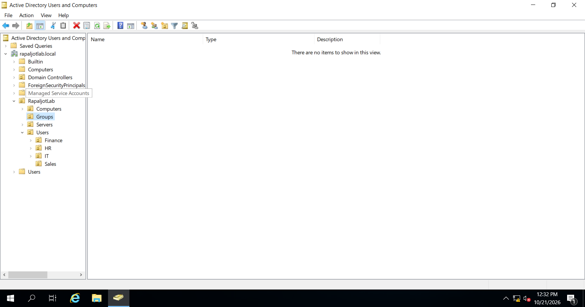

*Figure 1: Opening the Groups Organizational Unit in Active Directory Users and Computers.*

---

# Step 6 — Create the HR Global Security Group

The first security group was created for the Human Resources department.

## 6.1 Open the New Group Window

### Configuration Steps

1. Opened **Active Directory Users and Computers**.
2. Expanded `rapaljotlab.local`.
3. Expanded `RapaljotLab`.
4. Right-clicked the `Groups` Organizational Unit.
5. Selected **New**.
6. Clicked **Group**.

The **New Object — Group** window appeared.

## 6.2 Configure the Group

I entered the following information:

| Property                      | Configuration |
| ----------------------------- | ------------- |
| Group Name                    | GG-HR-Users   |
| Group Name (pre-Windows 2000) | GG-HR-Users   |
| Group Scope                   | Global        |
| Group Type                    | Security      |

### Configuration Steps

1. Entered `GG-HR-Users` in the Group Name field.
2. Verified the pre-Windows 2000 group name.
3. Selected **Global** under Group Scope.
4. Selected **Security** under Group Type.
5. Clicked **OK**.

The group was created inside the Groups OU.

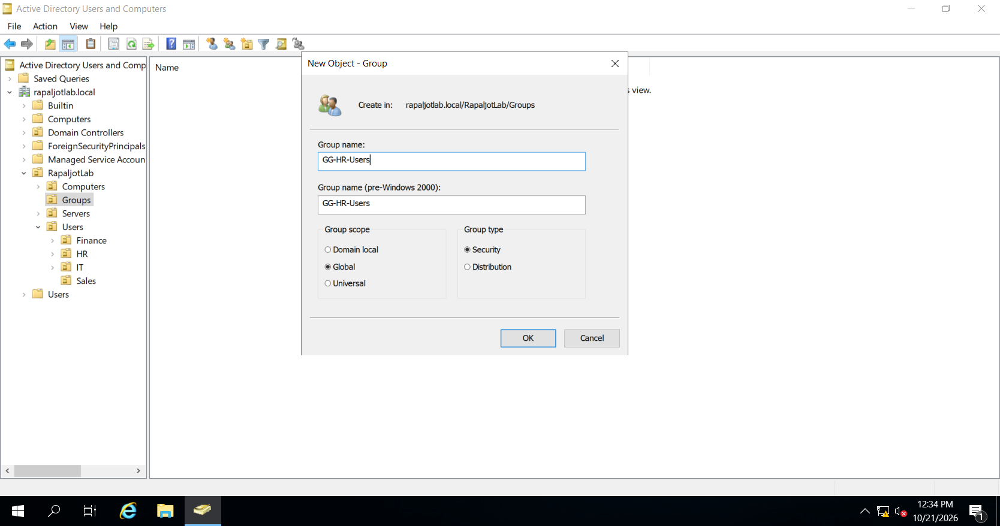

*Figure 2: Creating the GG-HR-Users Global Security Group.*

---

# Step 7 — Create the Remaining Global Security Groups

After creating the HR Global Group, I repeated the same process for the remaining departments.

## 7.1 Finance Global Group

Created the group:

`GG-Finance-Users`

Configuration:

* Group Scope: Global
* Group Type: Security

## 7.2 Sales Global Group

Created the group:

`GG-Sales-Users`

Configuration:

* Group Scope: Global
* Group Type: Security

## 7.3 IT Global Group

Created the group:

`GG-IT-Users`

Configuration:

* Group Scope: Global
* Group Type: Security

### Verification

After creating the groups, I verified that all four Global Security Groups appeared inside the Groups OU.

### Screenshot

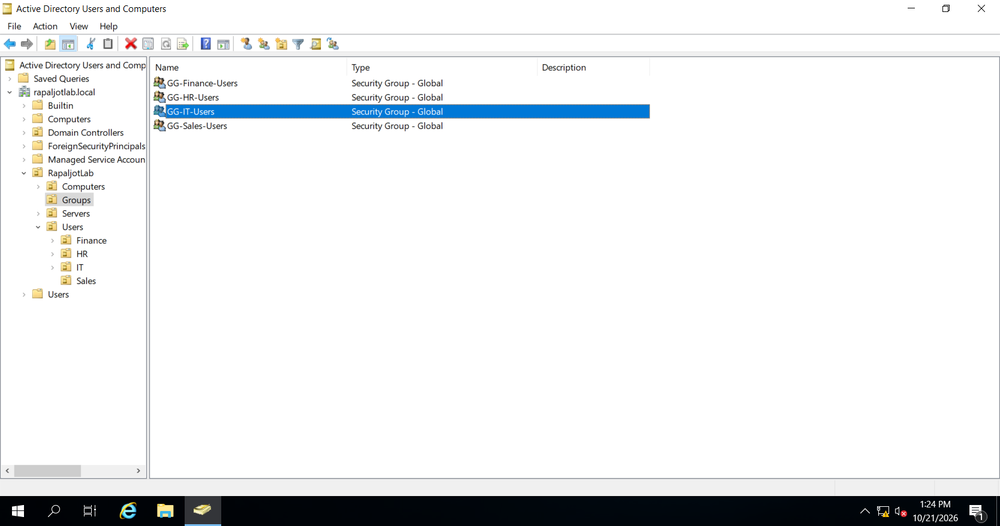

*Figure 3: Verifying the four departmental Global Security Groups.*

---

# Step 8 — Add HR Employees to the Global Group

After creating the Global Groups, I added employee accounts to their respective departmental groups.

The first group was:

`GG-HR-Users`

## 8.1 Open Group Properties

### Configuration Steps

1. Opened the `Groups` OU.
2. Located `GG-HR-Users`.
3. Right-clicked the group.
4. Selected **Properties**.
5. Opened the **Members** tab.

The Members tab displays the accounts and groups that belong to the selected security group.

## 8.2 Add Employee Accounts

1. Clicked **Add**.
2. Entered the usernames of the HR employees:

```text
sarah.johnson
emma.wilson
olivia.martin
james.anderson
```

3. Clicked **Check Names** to verify the accounts.
4. Confirmed that Active Directory recognized the usernames.
5. Clicked **OK**.
6. Clicked **Apply**.

The HR employee accounts were added to the Global Security Group.

> **Note:** Multiple usernames can be entered in the Add Members dialog, separated by semicolons.

## 8.3 Verify Membership

I confirmed that the following employees appeared in the Members tab:

| Employee       | Username       |
| -------------- | -------------- |
| Sarah Johnson  | sarah.johnson  |
| Emma Wilson    | emma.wilson    |
| Olivia Martin  | olivia.martin  |
| James Anderson | james.anderson |

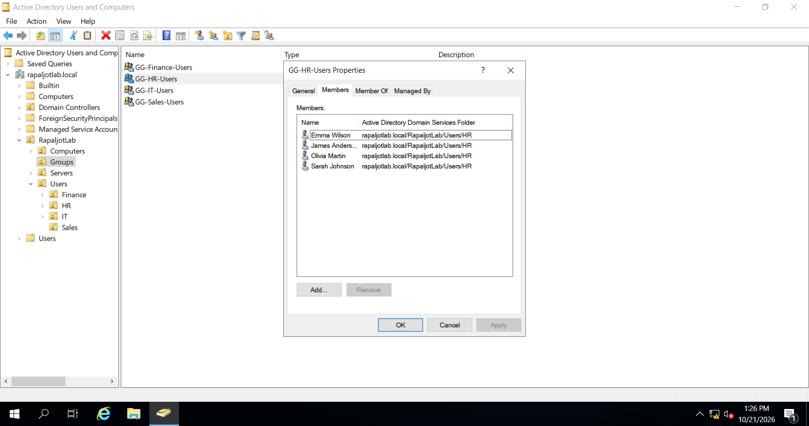

*Figure 4: Adding HR employee accounts to the GG-HR-Users security group.*

---

# Step 9 — Add Finance Employees to the Global Group

Next, I added Finance employees to:

`GG-Finance-Users`

## Configuration Steps

1. Opened the Groups OU.
2. Right-clicked `GG-Finance-Users`.
3. Selected **Properties**.
4. Opened the **Members** tab.
5. Clicked **Add**.
6. Entered the Finance employee usernames.
7. Clicked **Check Names**.
8. Clicked **OK**.
9. Applied the changes.

## Finance Group Members

| Employee      | Username      |
| ------------- | ------------- |
| Mike Brown    | mike.brown    |
| Sophia Davis  | sophia.davis  |
| Daniel Taylor | daniel.taylor |
| Emily White   | emily.white   |

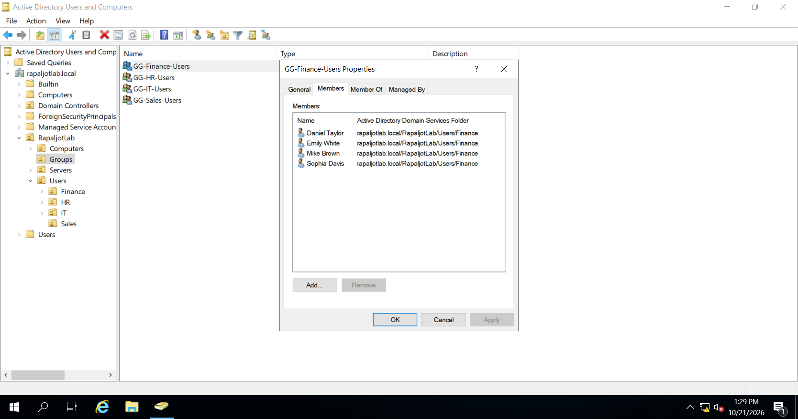

*Figure 5: Verifying the Finance Global Security Group membership.*

---

# Step 10 — Add Sales Employees to the Global Group

I added the Sales employees to:

`GG-Sales-Users`

## Group Members

| Employee      | Username      |
| ------------- | ------------- |
| David Smith   | david.smith   |
| Michael Clark | michael.clark |
| Jessica Moore | jessica.moore |
| Ryan Walker   | ryan.walker   |

I used the Members tab of the group properties to add the employee accounts.

### Screenshot


*Figure 6: Verifying Sales employee membership in the Global Security Group.*

---

# Step 11 — Add IT Employees to the Global Group

The final departmental Global Group was:

`GG-IT-Users`

## Group Members

| Employee      | Username      |
| ------------- | ------------- |
| Jennifer Lee  | jennifer.lee  |
| Robert Harris | robert.harris |
| Kevin Thomas  | kevin.thomas  |

I added all three accounts to the group using Active Directory Users and Computers.

### Security Consideration

Membership in the IT department does not automatically mean that an employee should have administrator privileges.

The `GG-IT-Users` group is a standard departmental security group.

It does not grant Domain Administrator privileges.

This supports the principle of least privilege.

### Screenshot
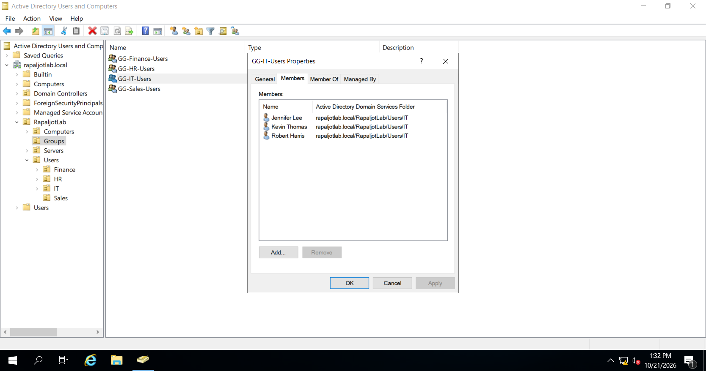

*Figure 7: Verifying IT employee membership in the GG-IT-Users group.*

---

# Step 12 — Create Domain Local Security Groups

After creating the departmental Global Security Groups, the next step was to create Domain Local Security Groups.

These groups will later be used to assign permissions to shared folders.

## 12.1 Create the HR Domain Local Group

### Configuration Steps

1. Opened **Active Directory Users and Computers**.

2. Navigated to the `Groups` OU.

3. Right-clicked the OU.

4. Selected **New > Group**.

5. Entered the group name:

   `DL-FS-HR-Modify`

6. Selected **Domain Local** under Group Scope.

7. Selected **Security** under Group Type.

8. Clicked **OK**.

### Group Configuration

| Property            | Value            |
| ------------------- | ---------------- |
| Group Name          | DL-FS-HR-Modify  |
| Group Scope         | Domain Local     |
| Group Type          | Security         |
| Intended Permission | Modify           |
| Intended Resource   | HR Shared Folder |

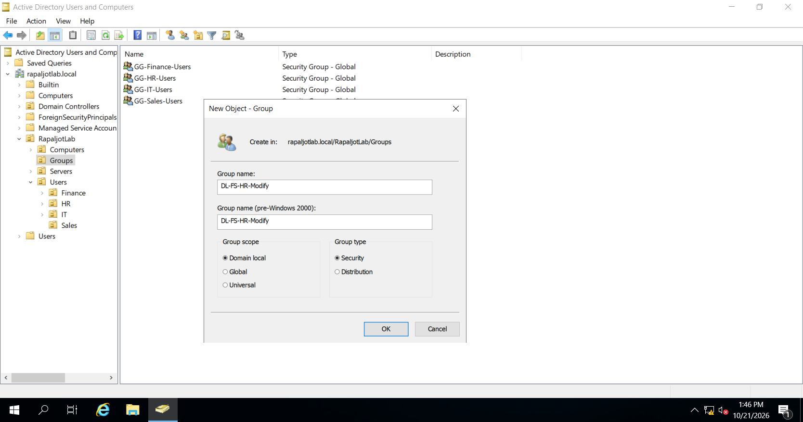

*Figure 8: Creating the Domain Local Security Group for HR shared-folder permissions.*

---

# Step 13 — Create the Remaining Domain Local Groups

I repeated the group creation process for the other departments.

The following Domain Local Security Groups were created:

| Group Name           | Group Scope  | Group Type |
| -------------------- | ------------ | ---------- |
| DL-FS-HR-Modify      | Domain Local | Security   |
| DL-FS-Finance-Modify | Domain Local | Security   |
| DL-FS-Sales-Modify   | Domain Local | Security   |
| DL-FS-IT-Modify      | Domain Local | Security   |

All four groups were created inside the Groups OU.

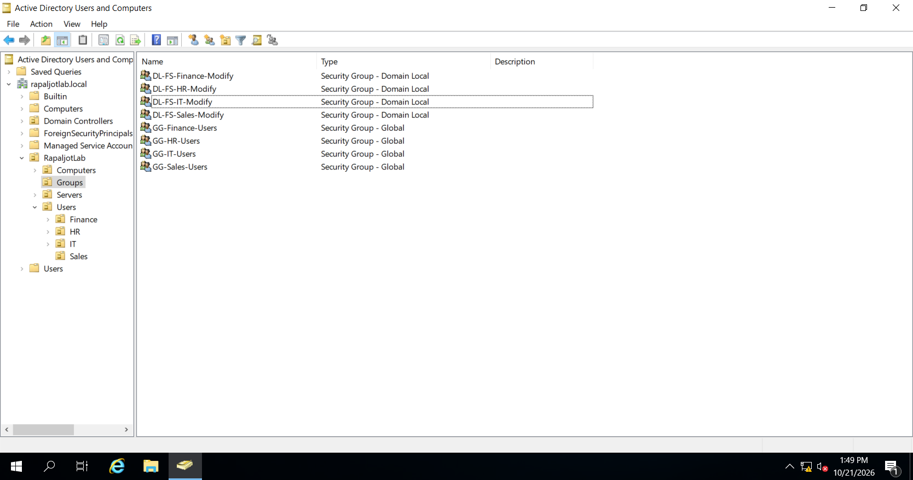

*Figure 9: Verifying the Domain Local Security Groups.*

---

# Step 14 — Add Global Groups to Domain Local Groups

After creating both group types, I configured group nesting.

Group nesting allows one security group to become a member of another security group.

This is an important component of the AGDLP model.

## 14.1 Add the HR Global Group to the HR Domain Local Group

### Configuration Steps

1. Opened **Active Directory Users and Computers**.
2. Navigated to the `Groups` OU.
3. Located `DL-FS-HR-Modify`.
4. Right-clicked the group.
5. Selected **Properties**.
6. Opened the **Members** tab.
7. Clicked **Add**.
8. Entered:

```text
GG-HR-Users
```

9. Clicked **Check Names**.
10. Confirmed that Active Directory recognized the group.
11. Clicked **OK**.
12. Clicked **Apply**.

The Global Group was successfully added as a member of the Domain Local Group.

## Result

```text
DL-FS-HR-Modify
│
└── GG-HR-Users
    │
    ├── Sarah Johnson
    ├── Emma Wilson
    ├── Olivia Martin
    └── James Anderson
```

### Screenshot
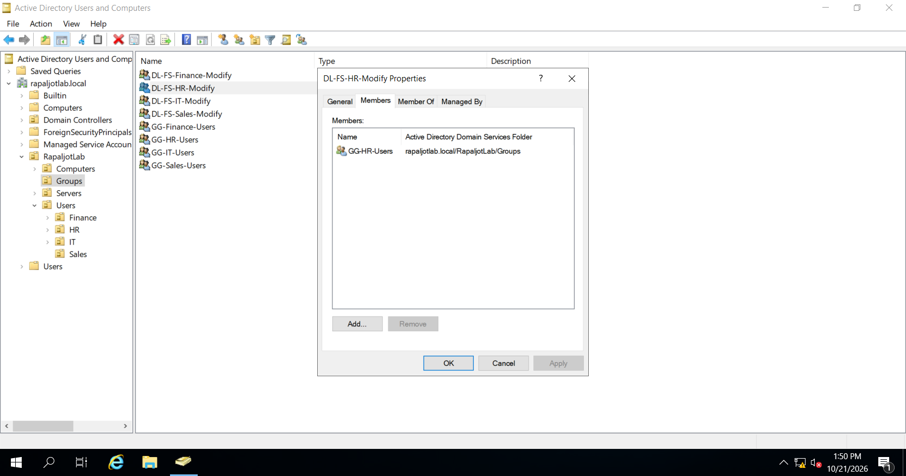

*Figure 10: Adding the HR Global Security Group to the HR Domain Local Security Group.*

---

# Step 15 — Configure Group Nesting for All Departments

I repeated the same group nesting process for the remaining departments.

## Group Nesting Configuration

| Domain Local Group   | Global Group Member |
| -------------------- | ------------------- |
| DL-FS-HR-Modify      | GG-HR-Users         |
| DL-FS-Finance-Modify | GG-Finance-Users    |
| DL-FS-Sales-Modify   | GG-Sales-Users      |
| DL-FS-IT-Modify      | GG-IT-Users         |

Each Domain Local Group contains the corresponding departmental Global Group.

This completes the group membership portion of the AGDLP model.

### Screenshot

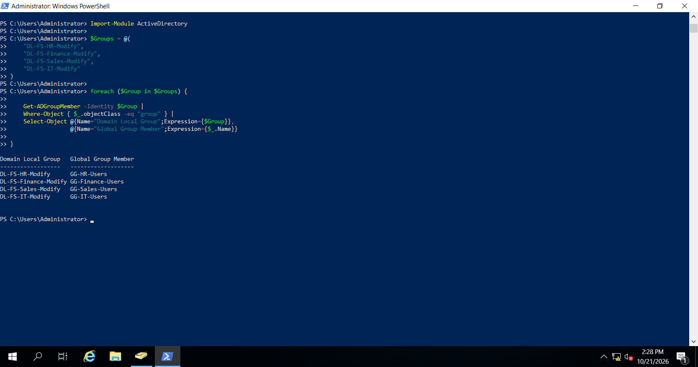
*Figure 11: Verifying the Global Group membership within the corresponding Domain Local Group.*

---

# Step 16 — Verify Security Groups Using PowerShell

After creating and configuring the security groups, I used Windows PowerShell to verify their properties and memberships.

PowerShell allows administrators to query Active Directory and perform administrative tasks through commands.

## 16.1 Open PowerShell

1. Logged in to DC01.
2. Opened the Start menu.
3. Searched for **Windows PowerShell**.
4. Opened PowerShell.

I imported the Active Directory module:

```powershell
Import-Module ActiveDirectory
```

## 16.2 Display the Created Security Groups

I executed:

```powershell
Get-ADGroup -Filter 'Name -like "GG-*" -or Name -like "DL-FS-*"' |
    Select-Object Name, GroupScope, GroupCategory
```

### Explanation

This command retrieves groups whose names begin with `GG-` or `DL-FS-`.

The output displays:

* Group name
* Group scope
* Group category

The expected group scopes are Global and DomainLocal.

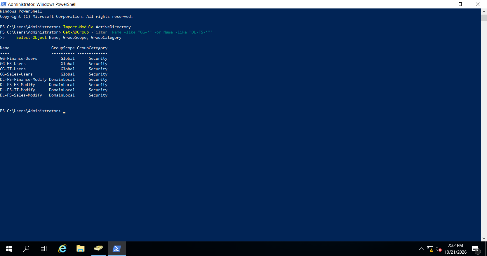

*Figure 12: Verifying Active Directory Security Groups using PowerShell.*

---

# Step 17 — Verify Global Group Membership

To verify the HR Global Group membership, I executed:

```powershell
Get-ADGroupMember -Identity "GG-HR-Users"
```

### Purpose

The `Get-ADGroupMember` command retrieves members of an Active Directory group.

The expected output contains the four HR employee accounts.

To display only member names, I executed:

```powershell
Get-ADGroupMember -Identity "GG-HR-Users" |
    Select-Object Name, SamAccountName
```

### Expected Members

```text
Sarah Johnson
Emma Wilson
Olivia Martin
James Anderson
```

I repeated the verification for the other departmental Global Groups.

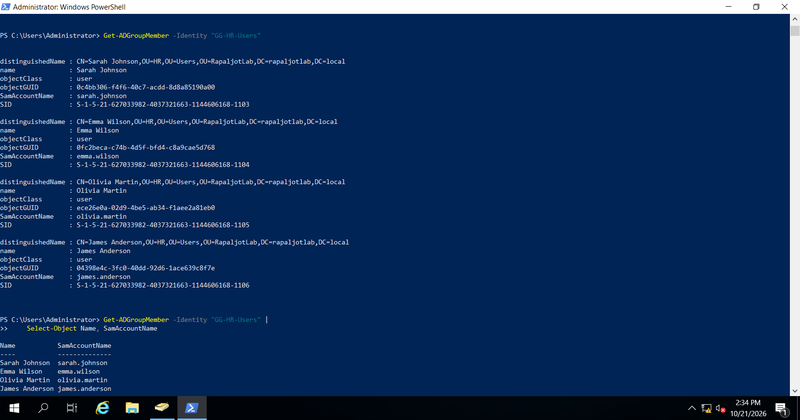

*Figure 13: Verifying employee membership in the HR Global Security Group.*

---

# Step 18 — Verify Domain Local Group Membership

Next, I verified that the Domain Local Group contained the appropriate Global Group.

I executed:

```powershell
Get-ADGroupMember -Identity "DL-FS-HR-Modify"
```

### Expected Result

```text
GG-HR-Users
```

This confirmed that the HR Global Group was directly nested inside the HR Domain Local Group.

## 18.1 Verify Nested User Membership

To display the user accounts within the nested groups, I executed:

```powershell
Get-ADGroupMember -Identity "DL-FS-HR-Modify" -Recursive |
    Select-Object Name, SamAccountName
```

### Explanation

The `-Recursive` parameter retrieves members through nested group relationships.

Instead of displaying only the Global Group, the command expands the membership and displays the employee accounts.

### Expected Members

```text
Sarah Johnson
Emma Wilson
Olivia Martin
James Anderson
```
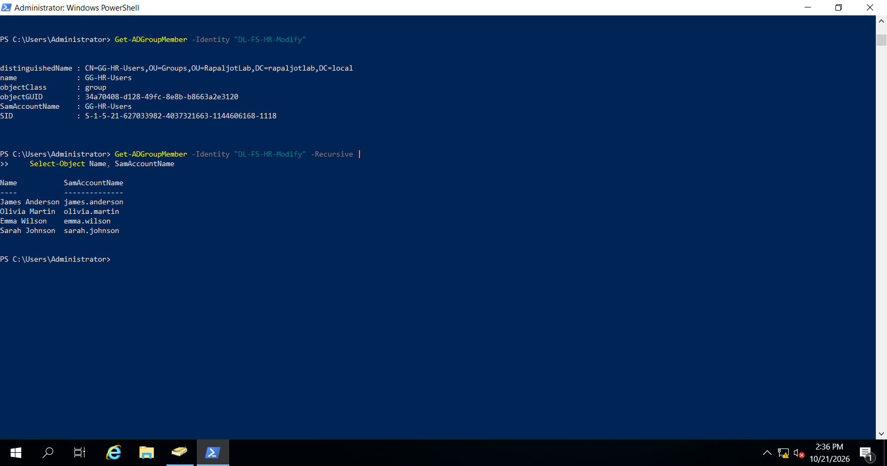

*Figure 14: Verifying nested group membership using PowerShell.*

---

# Step 19 — Understand How Permissions Will Be Assigned

After configuring the security groups, the Active Directory group structure was ready for resource permissions.

The final part of the AGDLP model involves assigning permissions to Domain Local Groups.

For example:

```text
HR Employees
     │
     ▼
GG-HR-Users
     │
     ▼
DL-FS-HR-Modify
     │
     ▼
NTFS Modify Permission
     │
     ▼
HR Shared Folder
```

The Domain Local Group will receive Modify permissions on the HR folder.

The employees will receive access through their membership in the nested Global Group.

## Important

Creating and nesting security groups does not automatically grant users access to folders or other resources.

The appropriate permissions must be configured on the resource.

This lab section focuses on configuring security groups and nested group membership.

The actual shared-folder and NTFS permissions will be configured during the File Server phase.

---

# Step 20 — Final Verification

After completing the security group configuration, I reviewed the results.

## Global Group Configuration

| Group            | Expected Direct User Members |
| ---------------- | ---------------------------: |
| GG-HR-Users      |                            4 |
| GG-Finance-Users |                            4 |
| GG-Sales-Users   |                            4 |
| GG-IT-Users      |                            3 |
| **Total**        |                       **15** |

## Domain Local Group Configuration

| Domain Local Group   | Expected Global Group Member |
| -------------------- | ---------------------------- |
| DL-FS-HR-Modify      | GG-HR-Users                  |
| DL-FS-Finance-Modify | GG-Finance-Users             |
| DL-FS-Sales-Modify   | GG-Sales-Users               |
| DL-FS-IT-Modify      | GG-IT-Users                  |

## Verification Checklist

| Task                                    | Expected Result |
| --------------------------------------- | --------------- |
| Create HR Global Group                  | Successful      |
| Create Finance Global Group             | Successful      |
| Create Sales Global Group               | Successful      |
| Create IT Global Group                  | Successful      |
| Add Employees to Global Groups          | Successful      |
| Create Domain Local Groups              | Successful      |
| Configure Group Nesting                 | Successful      |
| Verify Groups in ADUC                   | Successful      |
| Verify Membership Using PowerShell      | Successful      |
| Prepare Groups for Resource Permissions | Completed       |

---

# Conclusion

In this section, I configured Active Directory Security Groups in Windows Server 2019.

I created four departmental Global Security Groups and four resource-based Domain Local Security Groups.

I added the 15 fictional employee accounts to their appropriate departmental Global Groups.

I then implemented the group nesting portion of the AGDLP model by adding the Global Groups to the corresponding Domain Local Groups.

The configuration was verified using Active Directory Users and Computers and PowerShell.

This exercise demonstrated how security groups can simplify administration and support scalable, role-based access management.

## Next Phase

The next phase of the lab will focus on DNS configuration and verification.

Later, during the File Server configuration phase, I will use the Domain Local Security Groups created in this section to configure NTFS permissions and test access to departmental shared folders.

---
