# Windows Server 2019 — DNS Configuration and Testing

## Overview

After configuring Active Directory Domain Services (AD DS) on Windows Server 2019, the next phase of my enterprise lab was to configure and verify the Domain Name System (DNS).

DNS is an important network service that translates domain names into IP addresses.

In an Active Directory environment, DNS also allows computers to locate Domain Controllers and access domain services.

For this lab, DC01 is configured as both an Active Directory Domain Controller and a DNS server.

## Lab Environment

| Component | Configuration |
|---|---|
| Operating System | Windows Server 2019 |
| Virtualization | VMware Workstation |
| Server Name | DC01 |
| Active Directory Domain | rapaljotlab.local |
| Server IP Address | 192.168.164.10 |
| Server Role | DNS Server |
| DNS Zone | rapaljotlab.local |

## Objectives

The objectives of this lab are to:

1. Verify the DNS Server role.
2. Understand DNS zones and records.
3. Examine the existing Active Directory DNS configuration.
4. Configure the DNS client settings.
5. Verify Forward Lookup Zones.
6. Configure DNS forwarders.
7. Create a Reverse Lookup Zone.
8. Test forward and reverse DNS resolution.
9. Verify Domain Controller service records.
10. Troubleshoot DNS-related problems.

---

# Step 1 — Verify the DNS Server Role

## 1.1 Purpose

When a Windows Server is promoted to a Domain Controller, the DNS Server role can be installed during the promotion process.

Because DNS was selected during the previous Active Directory configuration, I first verified that the DNS Server role was installed.

## 1.2 Verify Using Server Manager

### Configuration Steps

1. Logged in to Windows Server 2019 using the domain Administrator account.
2. Opened **Server Manager**.
3. Located the left navigation panel.
4. Checked whether **DNS** appeared among the installed server roles.
5. Selected DNS to examine the server status.

If DNS is installed successfully, Server Manager displays the DNS role.

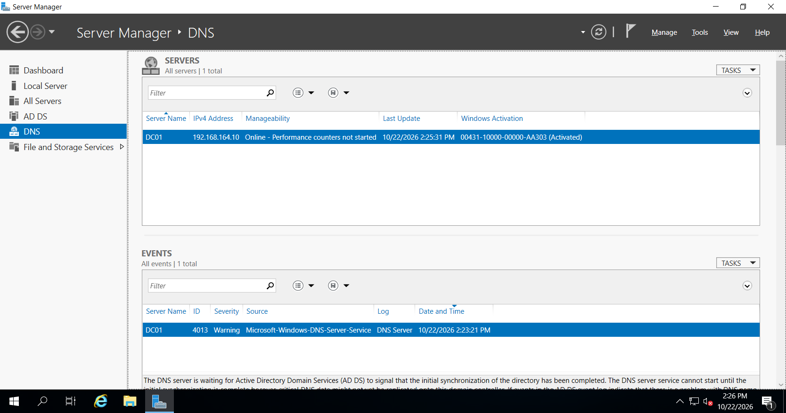

*Figure 1: Verifying the DNS Server role in Windows Server 2019.*

## 1.3 Verify Using PowerShell

I opened Windows PowerShell as Administrator and executed:

```powershell
Get-WindowsFeature -Name DNS
```

### Expected Result

The DNS Server role should display an installation state of:

```text
Installed
```

I also checked whether the DNS service was running:

```powershell
Get-Service -Name DNS
```

### Expected Result

```text
Status   Name   DisplayName
------   ----   -----------
Running  DNS    DNS Server
```
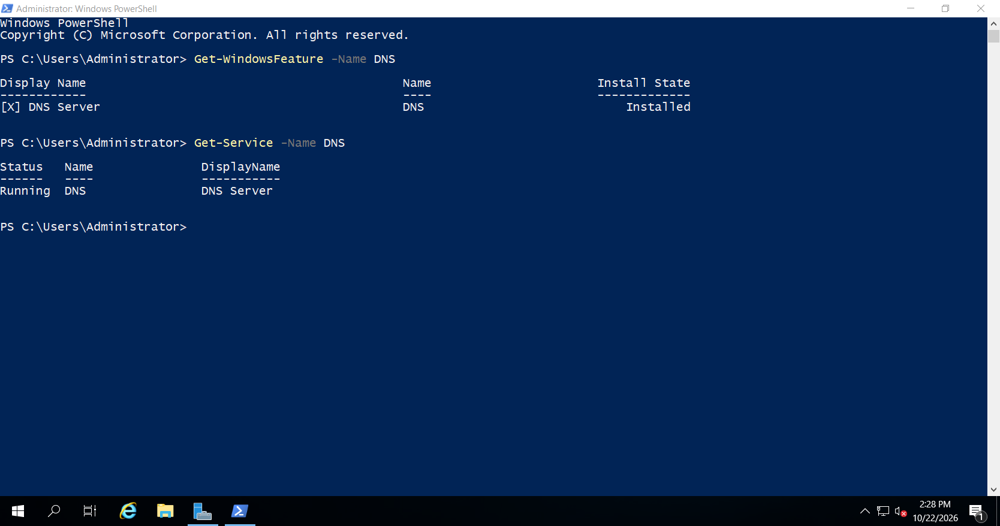

If the DNS Server role is missing, it can be installed using Server Manager under **Manage > Add Roles and Features > DNS Server**.

---

# Step 2 — Verify the Server's DNS Client Configuration

## 2.1 Purpose

Before examining DNS zones, I verified the network adapter's DNS settings.

Since DC01 is the only Domain Controller and DNS server in this lab, its preferred DNS server should point to its own static IP address.

This allows DC01 to resolve the Active Directory domain using its locally hosted DNS service.

## 2.2 Check the Current Network Configuration

I opened Command Prompt and executed:

```cmd
ipconfig /all
```

I reviewed the following network information:

- IPv4 Address
- Subnet Mask
- Default Gateway
- DNS Servers
- Connection-specific DNS Suffix

### Example Configuration

The following values are examples only.

| Setting | Example Value |
|---|---|
| Server Name | DC01 |
| IPv4 Address | 192.168.164.10 |
| Subnet Mask | 255.255.255.0 |
| Default Gateway | 192.168.164.2 |
| Preferred DNS | 192.168.164.10 |
| DNS Suffix | rapaljotlab.local |

The actual IP address must match the static IP previously configured on DC01.

### Screenshot

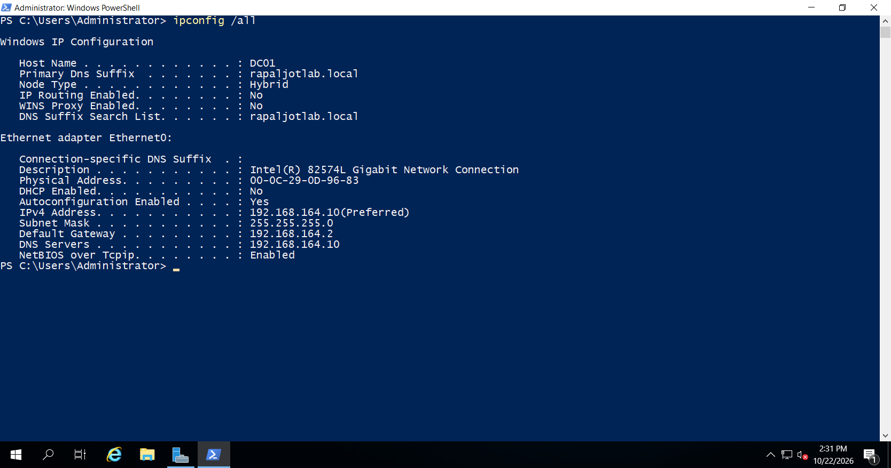

*Figure 2: Verifying the DNS client configuration using ipconfig /all.*

## 2.3 Configure the Preferred DNS Server

If the preferred DNS server was incorrect, I corrected the configuration.

### Configuration Steps

1. Pressed `Windows + R`.
2. Entered:

```cmd
ncpa.cpl
```

3. Pressed **Enter**.
4. Right-clicked the active Ethernet adapter.
5. Selected **Properties**.
6. Selected **Internet Protocol Version 4 (TCP/IPv4)**.
7. Clicked **Properties**.
8. Verified the existing static IP settings.
9. Set the Preferred DNS server to DC01's static IP address.
10. Clicked **OK** to apply the configuration.

I did not configure a public DNS server as DC01's alternate DNS server.

Public DNS resolution, when needed, will be configured using DNS forwarders.

---

# Step 3 — Open DNS Manager

## 3.1 Purpose

DNS Manager is a Microsoft Management Console application used to administer the Windows DNS Server role.

It allows administrators to manage DNS zones, resource records, and other DNS server settings.

## 3.2 Configuration Steps

1. Opened **Server Manager**.
2. Clicked **Tools**.
3. Selected **DNS**.
4. Waited for the DNS Manager console to open.
5. Expanded the server named `DC01`.

### Alternative Method

DNS Manager can also be opened using the Run dialog.

Press `Windows + R` and execute:

```cmd
dnsmgmt.msc
```

## 3.3 Examine DNS Manager

After expanding DC01, I reviewed the available sections.

These included:

- Forward Lookup Zones
- Reverse Lookup Zones
- Trust Points
- Conditional Forwarders

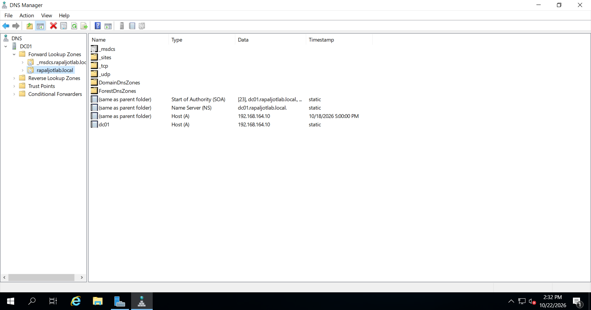

*Figure 3: Opening the DNS Manager console on DC01.*

---

# Step 4 — Verify the Forward Lookup Zone

## 4.1 What Is a Forward Lookup Zone?

A Forward Lookup Zone stores DNS records used to resolve hostnames into IP addresses.

For example:

```text
Hostname: dc01.rapaljotlab.local
IP Address: [DC01 static IP]
```

When a computer requests the IP address of `dc01.rapaljotlab.local`, DNS can return the corresponding IP address.

## 4.2 Configuration Steps

1. Opened **DNS Manager**.
2. Expanded `DC01`.
3. Expanded **Forward Lookup Zones**.
4. Located the zone:

   `rapaljotlab.local`

5. Selected the zone.
6. Reviewed the DNS records displayed in the right panel.

Because this zone was created during Active Directory installation, I did not create another copy.

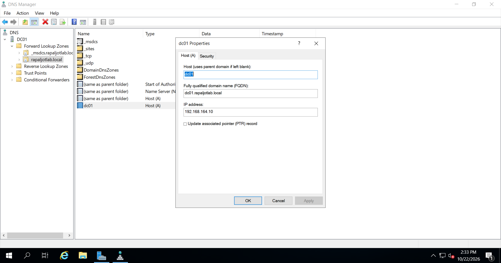

*Figure 4: Verifying the rapaljotlab.local Forward Lookup Zone.*

## 4.3 Verify Zone Properties

I right-clicked `rapaljotlab.local` and selected **Properties**.

I reviewed the following settings:

| Property | Expected Configuration |
|---|---|
| Zone Name | rapaljotlab.local |
| Zone Type | Active Directory-Integrated Primary |
| Dynamic Updates | Secure only |
| Zone Status | Available |

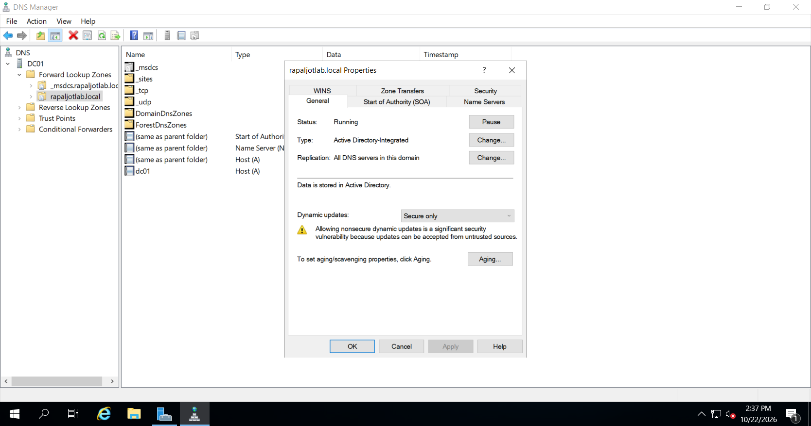

Secure dynamic updates allow authenticated domain computers to register or update their DNS records while reducing the risk of unauthorized modifications.

If the zone was already configured correctly, I left the settings unchanged.

---

# Step 5 — Examine DNS Resource Records

DNS zones contain resource records that provide information about computers, servers, and services.

I examined several important record types.

## 5.1 Host (A) Record

An A record maps a hostname to an IPv4 address.

Example:

```text
dc01.rapaljotlab.local → 192.168.80.10
```

The IP address shown is an example.

I verified that DC01 had an A record corresponding to its actual static IP address.

### Configuration Steps

1. Opened the `rapaljotlab.local` zone.
2. Located the `dc01` Host (A) record.
3. Reviewed its IPv4 address.
4. Confirmed that it matched the server's static IP configuration.


*Figure 5: Verifying the DC01 Host (A) record in DNS Manager.*

## 5.2 Name Server (NS) Record

An NS record identifies the DNS server authoritative for a zone.

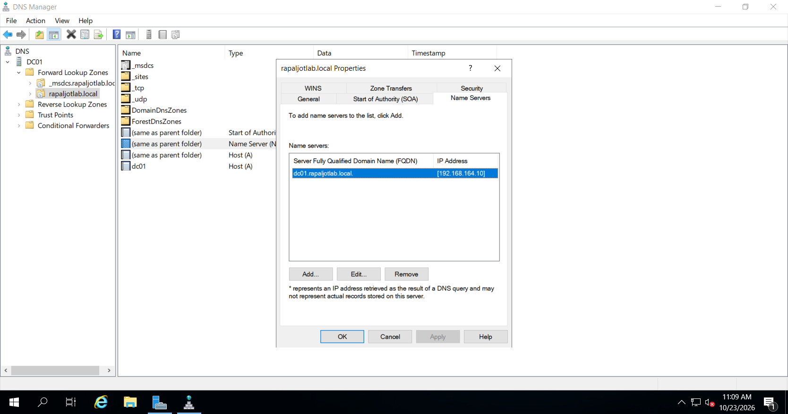

I verified that the appropriate name server record existed for the domain.

## 5.3 Start of Authority (SOA) Record

The SOA record contains administrative information about the DNS zone, including its primary authoritative server and zone parameters.

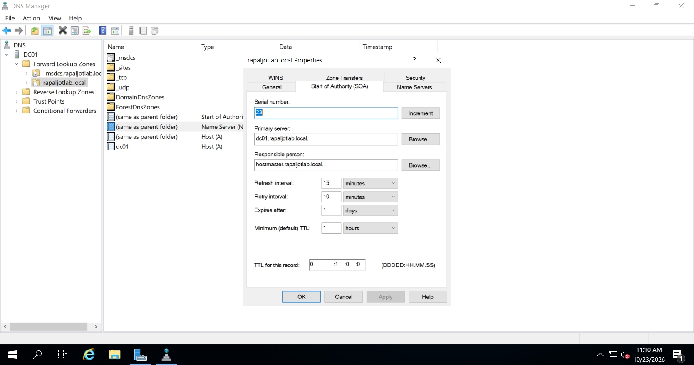

I reviewed the SOA record and confirmed that it existed.

## 5.4 Service (SRV) Records

SRV records are especially important in Active Directory.

They identify servers providing particular network services.

Examples include:

- LDAP services
- Kerberos authentication
- Domain Controller location
- Global Catalog services

These records enable clients to discover Active Directory services.

---

# Step 6 — Verify Active Directory DNS Service Records

## 6.1 Purpose

Active Directory uses DNS SRV records to allow domain clients to locate Domain Controllers.

If these records are missing or incorrect, computers may experience problems joining the domain or authenticating users.

## 6.2 Configuration Steps

1. Opened **DNS Manager**.
2. Expanded **Forward Lookup Zones**.
3. Examined the Active Directory DNS zones.
4. Located the `_msdcs` namespace.
5. Examined the relevant `_tcp` folders.
6. Verified that LDAP and Kerberos service records were registered.

Depending on the zone layout, `_msdcs.rapaljotlab.local` may appear as its own zone, while additional service-record folders appear under `rapaljotlab.local`.

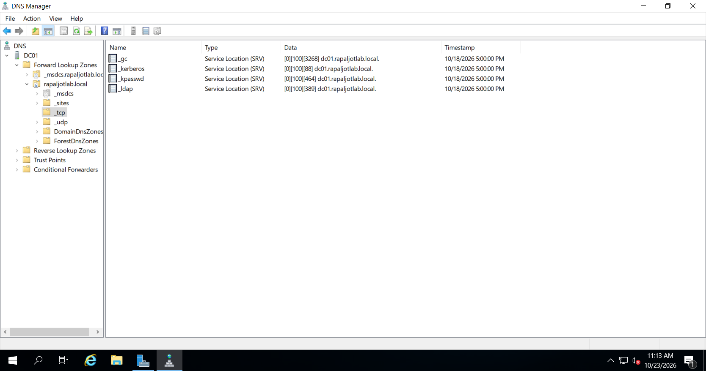

*Figure 6: Verifying the DNS service records used for Active Directory Domain Controller discovery.*

---

# Step 7 — Configure DNS Forwarders

## 7.1 What Is a DNS Forwarder?

A DNS forwarder is another DNS server that receives queries when the local DNS server cannot resolve a requested external domain from its own data.

For example, the DNS server on DC01 is responsible for the internal domain:

`rapaljotlab.local`

However, a user may also need to access:

`microsoft.com`

To resolve external domain names, DC01 can forward DNS requests to another DNS resolver.

## 7.2 Verify Internet Connectivity

Before configuring forwarders, I checked whether DC01 had external network connectivity.

I executed:

```cmd
ping 1.1.1.1
```

This test attempts to reach an external IP address without requiring DNS.

A successful response indicates ICMP connectivity to the destination.

However, some networks block ping requests, so a failed ping does not always mean internet access is unavailable.

If DC01 cannot access external networks, I first review the VMware NAT configuration, default gateway, and host computer connectivity.

## 7.3 Open DNS Forwarder Settings

### Configuration Steps

1. Opened **DNS Manager**.
2. Right-clicked the server named `DC01`.
3. Selected **Properties**.
4. Opened the **Forwarders** tab.
5. Reviewed any existing DNS forwarders.

If suitable forwarders were already configured, I verified them before making changes.

## 7.4 Configure Forwarders

For this lab, public DNS servers can be used as forwarders if the virtual machine has internet connectivity and the network permits DNS queries to them.

Example:

| DNS Provider | IPv4 Address |
|---|---|
| Cloudflare | 1.1.1.1 |
| Google Public DNS | 8.8.8.8 |

### Configuration Steps

1. Clicked **Edit** on the Forwarders tab.
2. Entered `1.1.1.1`.
3. Entered `8.8.8.8` as an additional forwarder.
4. Waited for DNS Manager to check the addresses.
5. Clicked **OK**.
6. Clicked **Apply**.

These addresses were configured as server

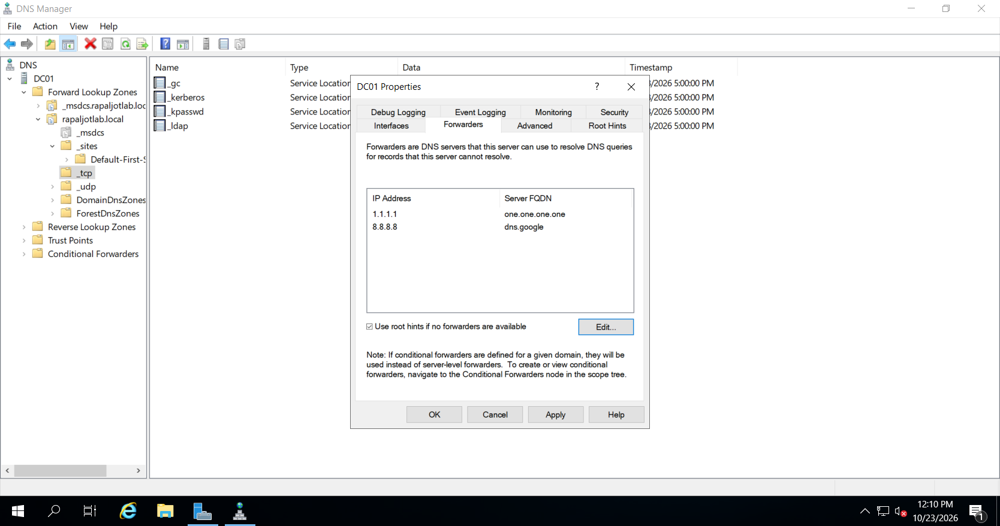

*Figure 7: Configuring DNS forwarders on DC01.*

---

# Step 8 — Configure a Reverse Lookup Zone

## 8.1 What Is a Reverse Lookup Zone?

A Reverse Lookup Zone resolves an IP address to a hostname.

Forward lookup:

```text
dc01.rapaljotlab.local → 192.168.80.10
```

Reverse lookup:

```text
192.168.80.10 → dc01.rapaljotlab.local
```

Reverse DNS commonly uses Pointer (PTR) records.

This step is included to practice DNS administration and is not required for basic Active Directory authentication.

## 8.2 Create a Reverse Lookup Zone

### Configuration Steps

1. Opened **DNS Manager**.
2. Expanded `DC01`.
3. Right-clicked **Reverse Lookup Zones**.
4. Selected **New Zone**.
5. Clicked **Next**.
6. Selected **Primary Zone**.
7. Kept **Store the zone in Active Directory** selected.
8. Clicked **Next**.
9. Selected an appropriate DNS replication scope for the domain.
10. Selected **IPv4 Reverse Lookup Zone**.
11. Entered the network ID corresponding to the lab subnet.

For example, for the network `192.168.80.0/24`, the network ID would be:

```text
192.168.80
```

12. Selected **Allow only secure dynamic updates**.
13. Reviewed the configuration.
14. Clicked **Finish**.

The Reverse Lookup Zone was created.

> The network ID must match the actual lab network. Do not use the example address unless it matches your configuration.

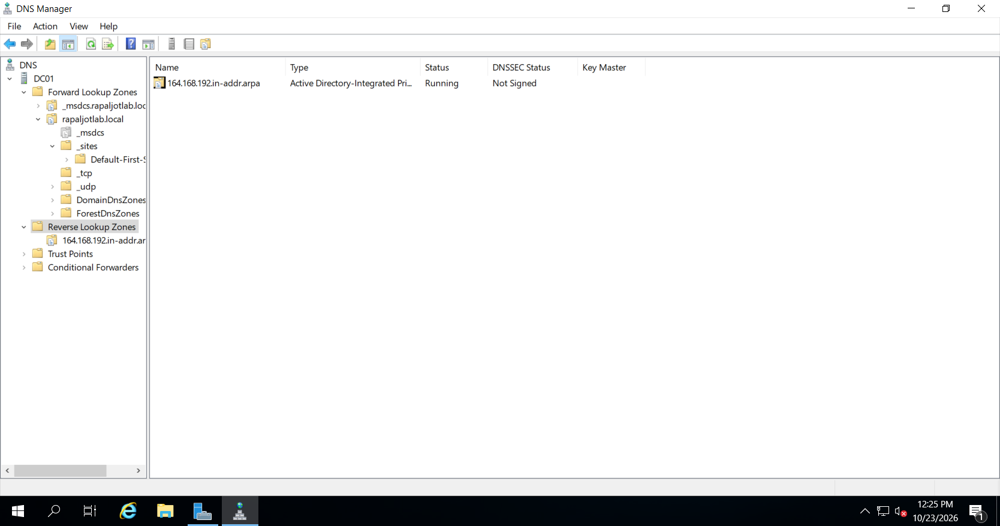

*Figure 8: Creating an IPv4 Reverse Lookup Zone for the lab network.*

## 8.3 Create a PTR Record for DC01

Creating a Reverse Lookup Zone does not guarantee that an existing PTR record is automatically created.

If no PTR record exists for DC01, I can create one manually.

### Configuration Steps

1. Opened the new Reverse Lookup Zone.
2. Right-clicked the zone.
3. Selected **New Pointer (PTR)**.
4. Entered DC01's IPv4 address information.
5. Entered its fully qualified hostname:

   `dc01.rapaljotlab.local`

6. Clicked **OK**.

I verified that the PTR record pointed to the correct hostname.

---

# Step 9 — Test Forward DNS Resolution

After reviewing the DNS configuration, I tested whether DC01 could resolve internal domain names.

## 9.1 Test the Domain Controller Hostname

I opened Command Prompt and executed:

```cmd
nslookup dc01.rapaljotlab.local
```

### Expected Result

The DNS query should return the IPv4 address assigned to DC01.

For the example network:

```text
Name:    dc01.rapaljotlab.local
Address: 192.168.80.10
```

The actual output may also display the DNS server name and additional information.


*Figure 9: Testing forward DNS resolution for dc01.rapaljotlab.local.*

---

# Step 10 — Test Reverse DNS Resolution

After configuring the Reverse Lookup Zone and PTR record, I tested reverse name resolution.

For the example IP address, I executed:

```cmd
nslookup 192.168.80.10
```

### Expected Result

The DNS server should return the corresponding hostname:

```text
dc01.rapaljotlab.local
```

If the lookup fails, I verify that the correct PTR record exists and that I queried the correct DNS server.


*Figure 10: Testing reverse DNS resolution using nslookup.*

---

# Step 11 — Test Active Directory SRV Records

DNS service records are required for locating Domain Controllers.

I used `nslookup` to verify the LDAP service record.

### Command

```cmd
nslookup -type=SRV _ldap._tcp.dc._msdcs.rapaljotlab.local
```

### Expected Result

The response should identify a Domain Controller providing LDAP services.

For this lab, the service target should include:

```text
dc01.rapaljotlab.local
```

The SRV record also contains additional service information, including priority, weight, and port.

For LDAP, the registered service commonly uses TCP port 389.

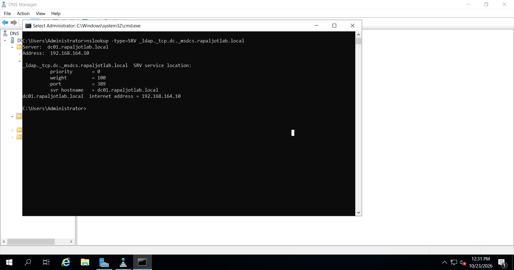

*Figure 11: Verifying Active Directory Domain Controller discovery using a DNS SRV query.*

---

# Step 12 — Test External DNS Resolution

After configuring DNS forwarders, I tested whether DC01 could resolve an external domain.

### Command

```cmd
nslookup microsoft.com
```

### Expected Result

If external DNS is functioning, the response should contain one or more IP addresses for `microsoft.com`.

The returned addresses may vary because websites often use multiple servers and content delivery networks.

If this test fails while internal DNS tests work, the problem may involve:

- No internet connectivity
- Incorrect default gateway
- VMware NAT configuration
- Unreachable DNS forwarders
- Firewall or network restrictions

External DNS resolution is not required to prove that the internal Active Directory DNS zone is functioning.

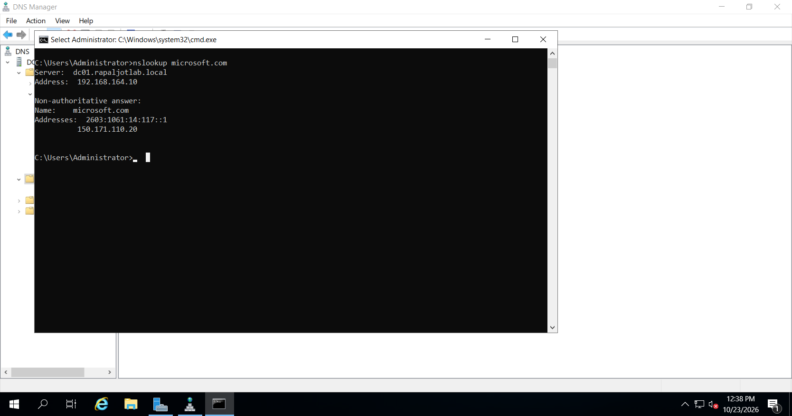

*Figure 12: Testing external DNS resolution through the DNS server.*

---

# Step 13 — Verify DNS Using PowerShell

PowerShell provides additional tools for querying and troubleshooting Windows DNS.

## 13.1 Display DNS Zones

I executed:

```powershell
Get-DnsServerZone
```

This command displays the DNS zones hosted on DC01.
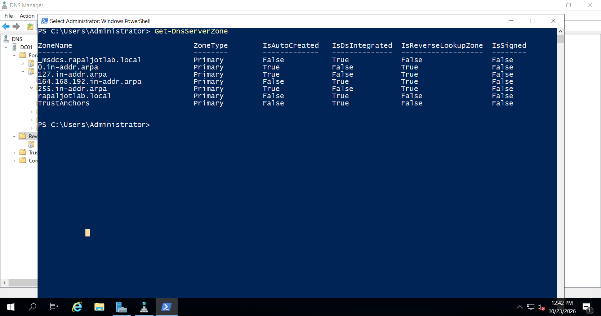
I checked that the Active Directory domain zone was present.

## 13.2 View the Domain Controller's A Record

I executed:

```powershell
Get-DnsServerResourceRecord `
    -ZoneName "rapaljotlab.local" `
    -Name "dc01" `
    -RRType A
```

This command retrieves the DNS Host (A) record for DC01.

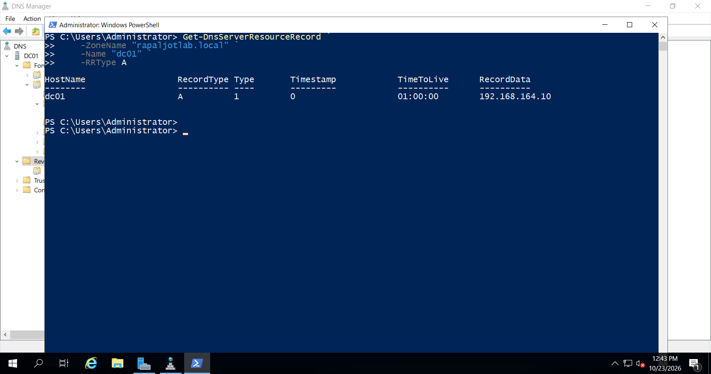

I verified that the record contained the correct IPv4 address.

## 13.3 Verify DNS Forwarders

I executed:

```powershell
Get-DnsServerForwarder
```
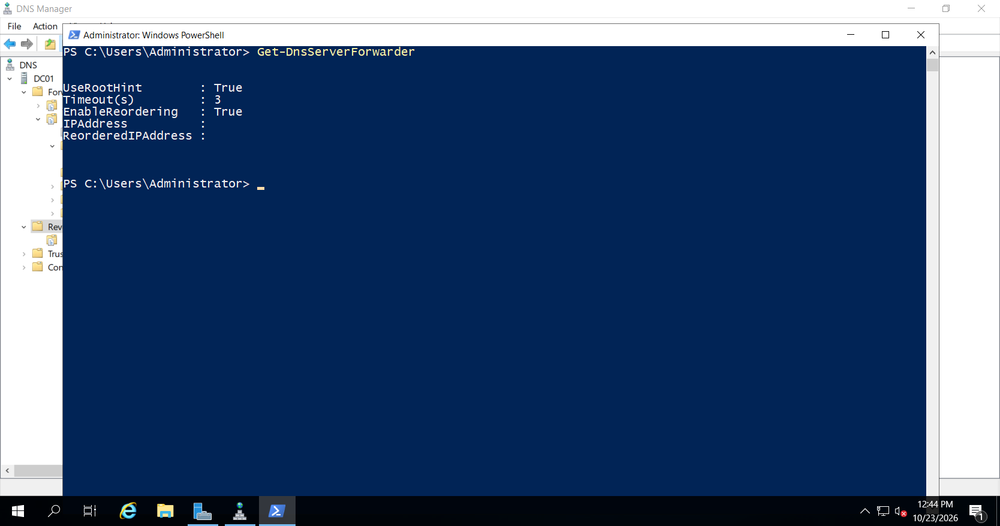

This command displays the configured DNS forwarders.

## 13.4 Test Domain Name Resolution

I executed:

```powershell
Resolve-DnsName -Name "dc01.rapaljotlab.local" -Type A
```

This command retrieves the IPv4 address associated with the Domain Controller hostname.

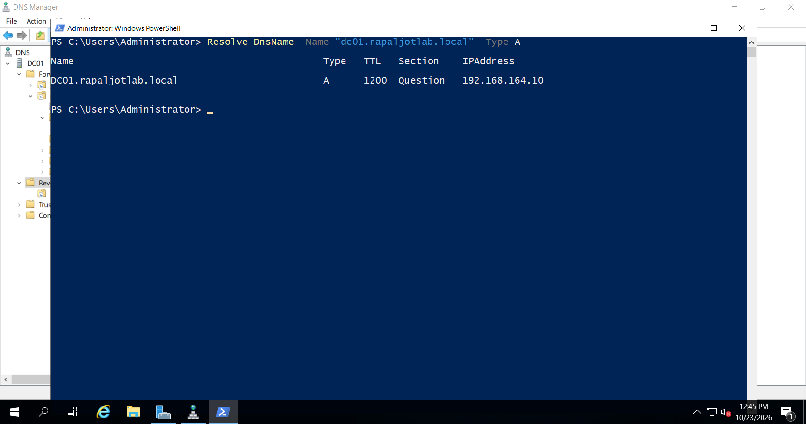

*Figure 13: Verifying DNS zones, resource records, and name resolution using PowerShell.*

---

# Step 14 — Diagnose DNS Using DCDIAG

After completing the DNS configuration, I used the Domain Controller Diagnostic tool to verify DNS health.

## 14.1 Run a Basic DNS Diagnostic Test

I opened Command Prompt as Administrator and executed:

```cmd
dcdiag /test:dns /DnsBasic /v
```

### Explanation

The `dcdiag` tool performs diagnostic checks against a Domain Controller.

The `/test:dns` parameter selects DNS-related diagnostic testing.

The `/DnsBasic` parameter checks basic DNS configuration, connectivity, and service availability.

The `/v` parameter enables verbose output.

## 14.2 Verify DNS Resource Record Registration

I also executed:

```cmd
dcdiag /test:dns /DnsRecordRegistration /v
```

This test helps verify that important Active Directory DNS records are registered.

I reviewed the results and investigated any reported failures.

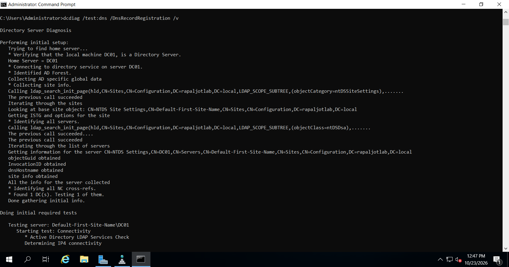

*Figure 14: Testing Domain Controller DNS functionality using dcdiag.*

---

# Step 15 — Troubleshooting DNS Problems

During the lab, I reviewed several common DNS troubleshooting scenarios.

## Issue 1 — Internal DNS Resolution Fails

### Possible Causes

- Incorrect preferred DNS server
- DNS service not running
- Missing A record
- Incorrect DNS zone
- Incorrect server IP address

### Troubleshooting

Check the DNS service:

```powershell
Get-Service DNS
```

Verify the DNS client settings:

```cmd
ipconfig /all
```

Check the Domain Controller's A record:

```cmd
nslookup dc01.rapaljotlab.local
```

If the DNS records are missing, investigate dynamic DNS registration before attempting to recreate them manually.

## Issue 2 — DNS Records Are Missing

If DC01's host A record is missing, I can request DNS registration by executing:

```cmd
ipconfig /registerdns
```

I can then verify the record again using DNS Manager.

If Domain Controller locator SRV records are missing, I can investigate the Netlogon service and DNS registration settings.

Restarting Netlogon can trigger the registration of Domain Controller locator records, but should only be performed when necessary because it briefly interrupts the service.

## Issue 3 — Internet DNS Resolution Fails

If `nslookup microsoft.com` fails but internal DNS works, the issue may be related to connectivity outside the lab network.

I would verify:

1. VMware network settings.
2. Server IP address and gateway.
3. Host computer internet access.
4. DNS forwarder configuration.
5. Firewall restrictions.

I would not replace DC01's internal preferred DNS server with a public DNS server simply to resolve external websites.

## Issue 4 — Reverse Lookup Fails

A reverse lookup may fail if the Reverse Lookup Zone or PTR record is missing.

I would verify that the correct reverse zone exists and contains a PTR record corresponding to DC01's actual IPv4 address.

---

# Step 16 — Final DNS Verification

After completing the configuration and testing, I reviewed the DNS Server settings.

## Verification Checklist

| Configuration | Expected Result |
|---|---|
| DNS Server Role | Installed |
| DNS Service | Running |
| Preferred DNS | DC01's static IP |
| Forward Lookup Zone | rapaljotlab.local |
| Host (A) Record | DC01's correct IPv4 address |
| SOA and NS Records | Present |
| Active Directory SRV Records | Present |
| Secure Dynamic Updates | Enabled |
| Forwarders | Configured if required |
| Reverse Lookup Zone | Created for the lab |
| PTR Record | Configured |
| Forward Lookup Test | Successful |
| Reverse Lookup Test | Successful |
| Active Directory SRV Query | Successful |
| DCDIAG DNS Test | Reviewed |

I recorded the actual results of each test and investigated any unsuccessful checks before considering the configuration complete.

---

# Conclusion

In this lab, I configured and tested DNS services in a Windows Server 2019 Active Directory environment.

The main objective was to verify that DC01 could provide DNS name resolution for the `rapaljotlab.local` domain.

The lab covered DNS zones, A records, PTR records, SRV records, DNS forwarders, and DNS diagnostics.

I also practiced using Command Prompt and PowerShell to troubleshoot DNS issues.

These tasks provided practical experience with DNS administration, an important skill for IT Support Technicians and Windows Server Administrators.

## Next Phase

The next phase of the Windows Server 2019 Enterprise Lab will focus on **DHCP Server installation and configuration**.

The objective will be to configure automatic IP address allocation for client computers while preventing conflicts with VMware's existing DHCP service.

---