# Windows Server 2019 — DHCP Server Installation and Configuration

## 1. Overview

In this section of my Windows Server 2019 Enterprise Lab, I configured the Dynamic Host Configuration Protocol (DHCP) Server role.

DHCP is a network service that automatically assigns IP addresses and other network configuration information to client devices.

In an enterprise environment, DHCP helps administrators manage IP address allocation without manually configuring every computer.

For this lab, DC01 will provide DHCP services to Windows client computers connected to the lab network.

### Objectives

The objectives of this section are to:

1. Understand the purpose of DHCP.
2. Verify the existing server network configuration.
3. Prepare the VMware virtual network.
4. Install the DHCP Server role.
5. Complete DHCP post-installation configuration.
6. Authorize the DHCP server in Active Directory.
7. Create a DHCP IPv4 scope.
8. Configure DHCP address ranges and lease duration.
9. Configure default gateway and DNS options.
10. Activate and verify the DHCP scope.
11. Test DHCP using a Windows client.
12. Verify DHCP leases using PowerShell.

---

## Lab Environment

| Component | Configuration |
|---|---|
| Virtualization Platform | VMware Workstation |
| Operating System | Windows Server 2019 |
| Server Name | DC01 |
| Active Directory Domain | rapaljotlab.local |
| Server Roles | AD DS, DNS, DHCP |
| DHCP Server IP | 192.168.164.10 |
| VMware Network | 192.168.164.0 |

### Example DHCP Configuration

The following configuration assumes a VMware NAT network using `192.168.164.0/24`.

| Setting | Example Value |
|---|---|
| Network Address | 192.168.164.0 |
| Subnet Mask | 255.255.255.0 |
| DC01 Static IP | 192.168.164.10 |
| Default Gateway | 192.168.164.2 |
| DHCP Starting Address | 192.168.164.100 |
| DHCP Ending Address | 192.168.164.128 |
| Preferred DNS Server | 192.168.164.254 |
| DNS Domain Name | rapaljotlab.local |
| Lease Duration | 30 Minutes |

> **Important:** These are example addresses. I must verify my actual VMware subnet, gateway, and existing addresses before configuring the DHCP scope.

---

# Step 1 — Understand DHCP

## 1.1 What Is DHCP?

DHCP stands for **Dynamic Host Configuration Protocol**.

It automatically provides IP configuration information to devices connected to a network.

When a computer connects to a network, it can request an IP address from a DHCP server instead of requiring manual configuration.

A DHCP server can provide:

- IPv4 address
- Subnet mask
- Default gateway
- DNS server addresses
- DNS domain suffix
- IP address lease duration

### Why Is DHCP Important?

In a large company, hundreds or thousands of computers may need network connectivity.

Manually assigning IP addresses to every computer would require significant administrative effort.

DHCP simplifies this process by automatically distributing available IP addresses.

It also helps administrators maintain consistent network settings and reduce addressing errors.

## 1.2 How DHCP Works — DORA

The DHCP address allocation process commonly involves four messages:

| Stage | Message | Description |
|---|---|---|
| 1 | Discover | Client searches for a DHCP server |
| 2 | Offer | DHCP server offers an available IP address |
| 3 | Request | Client requests the offered address |
| 4 | Acknowledgment | DHCP server confirms the lease |

This process is commonly known as **DORA**.

After receiving the acknowledgment, the client can use the assigned network configuration.

---

# Step 2 — Verify DC01 Network Configuration

Before installing the DHCP Server role, I reviewed the existing network configuration.

A DHCP server must have a stable IP address so that clients and administrators can reliably communicate with it.

## Configuration Steps

1. Started the Windows Server 2019 virtual machine.
2. Logged in using the domain Administrator account.
3. Opened Command Prompt.
4. Executed:

```cmd
ipconfig /all
```

5. Located the active Ethernet adapter.
6. Verified the following information:

   - IPv4 address
   - Subnet mask
   - Default gateway
   - DNS server
   - DHCP enabled status

7. Confirmed that DC01 was configured with a static IPv4 address.

### Additional Verification

I verified the computer name using:

```cmd
hostname
```

Expected result:

```text
DC01
```

I also checked the Active Directory domain using PowerShell:

```powershell
Get-ADDomain
```

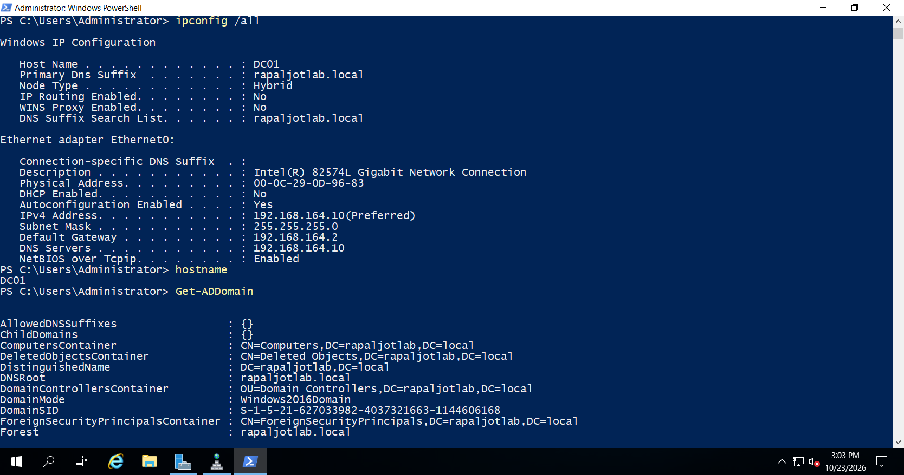

*Figure 1: Verifying the static IPv4 configuration of DC01 before DHCP installation.*

---

# Step 3 — Prepare the VMware Network

Before activating Windows Server DHCP, I needed to confirm that another DHCP service would not distribute addresses on the same virtual network.

VMware Workstation includes a built-in DHCP service that can automatically assign addresses to virtual machines.

If VMware DHCP and Windows DHCP operate on the same network without proper separation, clients may receive configuration from the wrong DHCP server.

For this lab, I planned to use Windows Server 2019 as the DHCP service for the lab clients.

## 3.1 Review VMware Network Settings

### Configuration Steps

1. Opened VMware Workstation on the host computer.
2. Selected the DC01 virtual machine.
3. Opened **VM > Settings**.
4. Selected **Network Adapter**.
5. Verified the selected network connection.
6. Recorded the virtual network being used.

For an example NAT setup, the virtual network is `VMnet8`.

### Screenshot

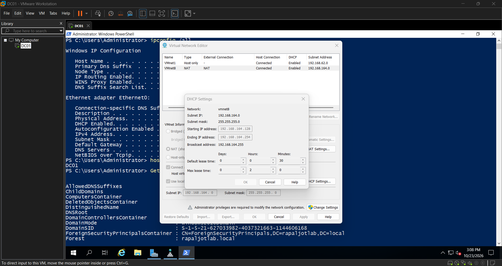

*Figure 2: Reviewing the VMware network adapter configuration for DC01.*

## 3.2 Review the VMware DHCP Service

### Configuration Steps

1. Opened **VMware Workstation**.
2. Selected **Edit > Virtual Network Editor**.
3. Clicked **Change Settings** if elevated permissions were required.
4. Selected the virtual network connected to DC01.
5. Reviewed the network subnet and DHCP settings.
6. Checked whether VMware's DHCP service was enabled.

### Preparing the Lab Network

For an isolated lab network that is dedicated to Windows Server DHCP, VMware's built-in DHCP service should be disabled on that network.

If using VMnet8:

1. Selected `VMnet8`.
2. Verified the NAT gateway and subnet.
3. Located **Use local DHCP service to distribute IP address to VMs**.
4. Unchecked the option when ready to transfer DHCP responsibility to DC01.
5. Clicked **Apply**.

I ensured that DC01 retained its static IP address and that the virtual network was not being used by unrelated machines that depended on VMware DHCP.

> **Important:** Do not disable DHCP on a shared network without understanding its impact. Alternatively, create a dedicated isolated VMware virtual network for the lab. Do not connect a lab DHCP server to a bridged home, school, or workplace network.

### Screenshot

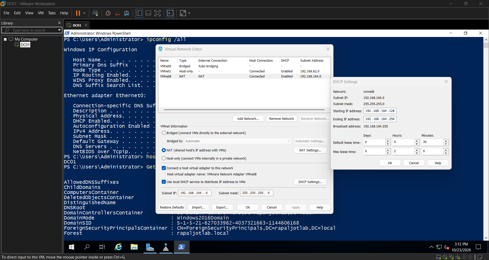

*Figure 3: Reviewing VMware's DHCP service before configuring Windows Server DHCP.*

---

# Step 4 — Open Add Roles and Features Wizard

After verifying the network configuration, I began installing the DHCP Server role.

## Configuration Steps

1. Logged in to Windows Server 2019.
2. Opened **Server Manager**.
3. Clicked **Manage** in the upper-right corner.
4. Selected **Add Roles and Features**.
5. The Add Roles and Features Wizard appeared.
6. Reviewed the information on the **Before You Begin** page.
7. Clicked **Next**.

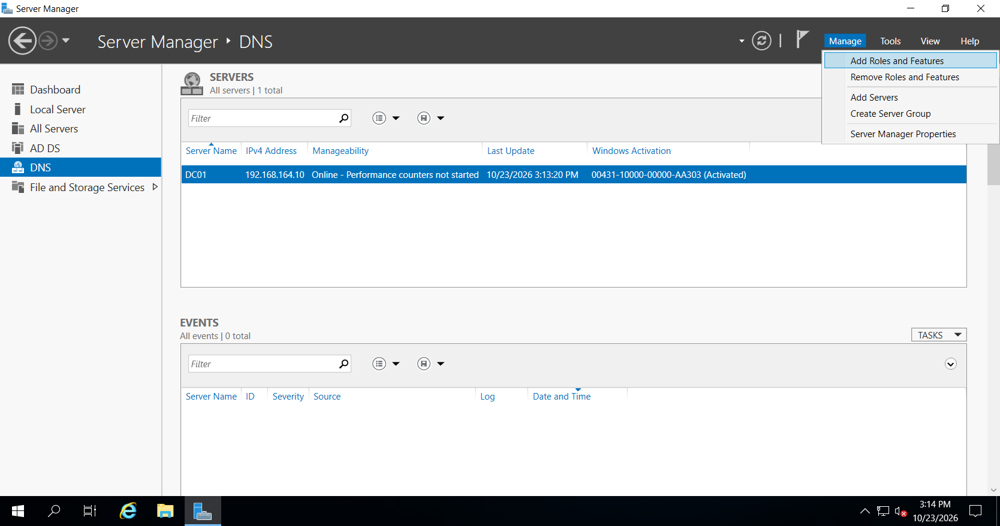

*Figure 4: Opening the Add Roles and Features Wizard to install DHCP Server.*

---

# Step 5 — Select Installation Type

The installation wizard displayed the available installation types.

## Configuration Steps

1. On the Installation Type page, selected:

   **Role-based or feature-based installation**

2. Clicked **Next**.

### Explanation

The role-based installation option is used to add services directly to Windows Server.

It can be used to install roles such as DHCP Server, DNS Server, Active Directory Domain Services, and File Services.

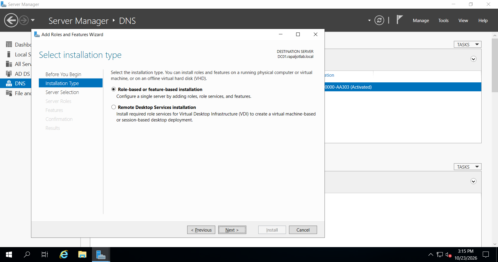

*Figure 5: Selecting role-based or feature-based installation.*

---

# Step 6 — Select the Destination Server

Next, I selected the server where the DHCP Server role would be installed.

## Configuration Steps

1. Selected **Select a server from the server pool**.
2. Located `DC01` in the server list.
3. Selected DC01.
4. Verified that the correct server was selected.
5. Clicked **Next**.

### Explanation

For this lab, DC01 will provide Active Directory, DNS, and DHCP services.

In larger production environments, DHCP may be installed on separate member servers for better service separation and availability.

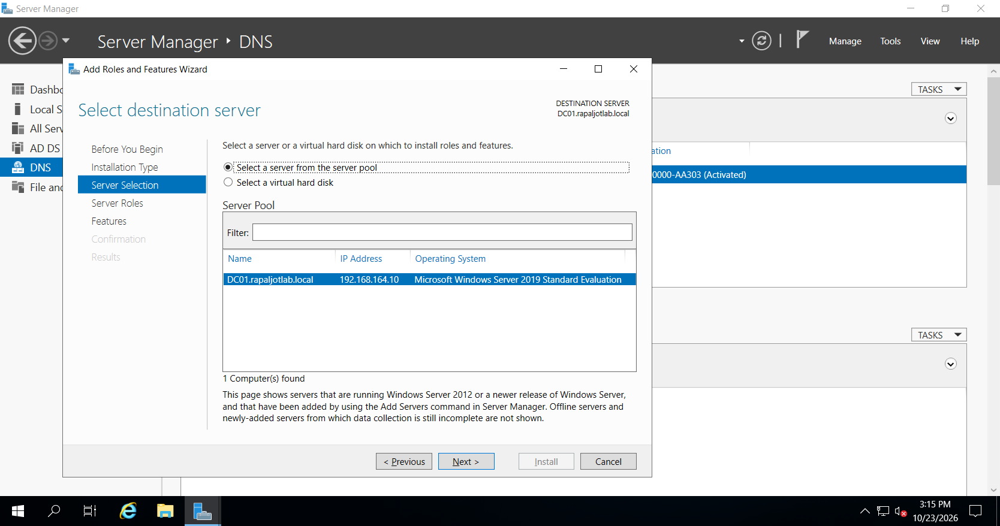

*Figure 6: Selecting DC01 as the DHCP Server installation destination.*

---

# Step 7 — Select the DHCP Server Role

After selecting the destination server, I installed the required DHCP role.

## Configuration Steps

1. On the **Server Roles** page, located **DHCP Server**.
2. Selected the checkbox beside **DHCP Server**.
3. A dialog box appeared requesting additional required features.
4. Clicked **Add Features**.
5. Confirmed that DHCP Server remained selected.
6. Clicked **Next**.
7. On the Features page, retained the default options.
8. Clicked **Next**.

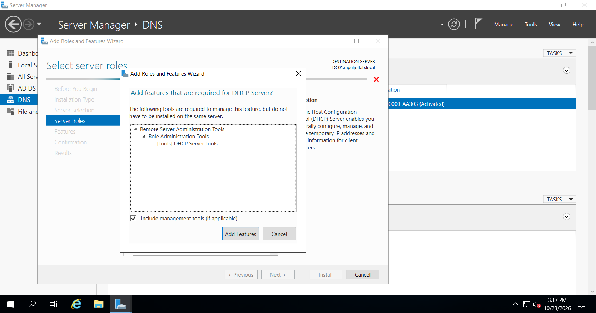

*Figure 7: Selecting the DHCP Server role and required management features.*

---

# Step 8 — Review DHCP Server Information

The installation wizard displayed an information page describing DHCP Server.

I reviewed the role information before continuing.

## Configuration Steps

1. Read the DHCP Server information.
2. Confirmed that DC01 had a static IP address.
3. Clicked **Next**.
4. Reviewed the installation summary.
5. Verified that **DHCP Server** was selected.

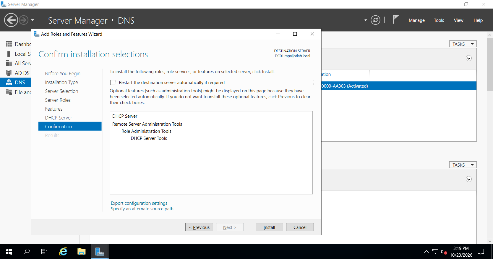

*Figure 8: Reviewing the selected DHCP Server role before installation.*

---

# Step 9 — Install DHCP Server

After reviewing the installation settings, I started the DHCP Server installation.

## Configuration Steps

1. Clicked **Install**.
2. Waited for Windows Server to install the DHCP Server role.
3. Reviewed the installation results.
4. Confirmed that the installation was successful.
5. Clicked **Close**.

The DHCP Server role installation itself normally does not require a server restart.

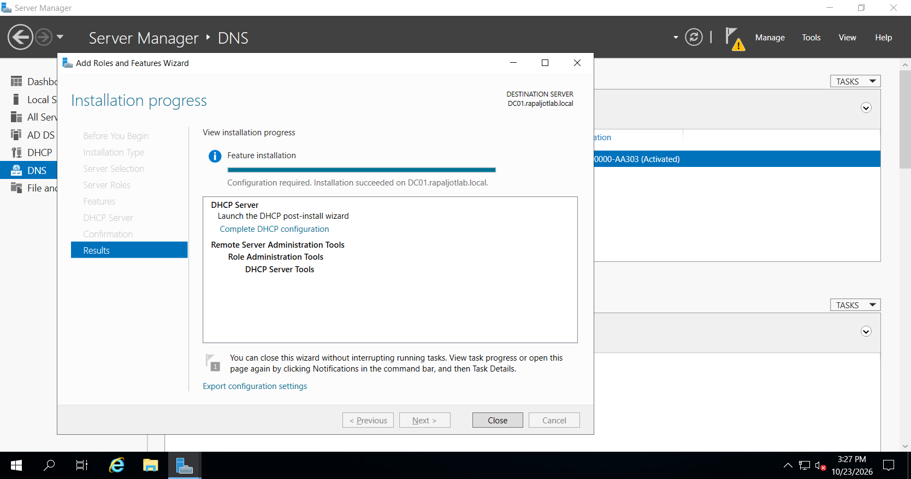

*Figure 9: DHCP Server role installation completed successfully.*

---

# Step 10 — Complete DHCP Post-Installation Configuration

After installing DHCP Server, additional configuration was required before the service could be used in the Active Directory environment.

## Configuration Steps

1. Opened **Server Manager**.
2. Located the notification flag in the upper-right corner.
3. Clicked the notification flag.
4. Located the DHCP post-deployment configuration message.
5. Clicked **Complete DHCP configuration**.

The DHCP Post-Install Configuration Wizard opened.

## 10.1 Review the Description

1. Reviewed the description page.
2. Clicked **Next**.

## 10.2 Specify Authorization Credentials

Because DC01 belongs to the Active Directory domain, DHCP must be authorized in Active Directory.

I selected an account with the required permissions.

For this lab, the domain Administrator account was used:

```text
RAPALJOTLAB\Administrator
```

## 10.3 Complete Configuration

1. Confirmed the authorization credentials.
2. Clicked **Commit**.
3. Reviewed the results.
4. Confirmed that the post-installation tasks completed successfully.
5. Clicked **Close**.

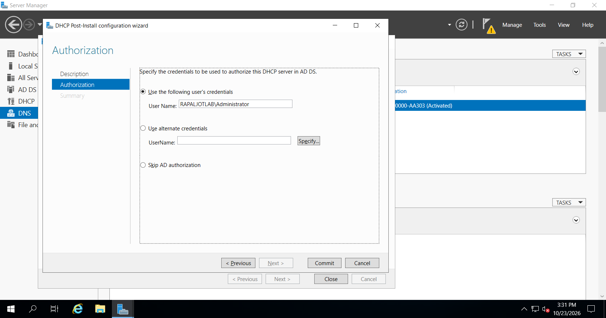
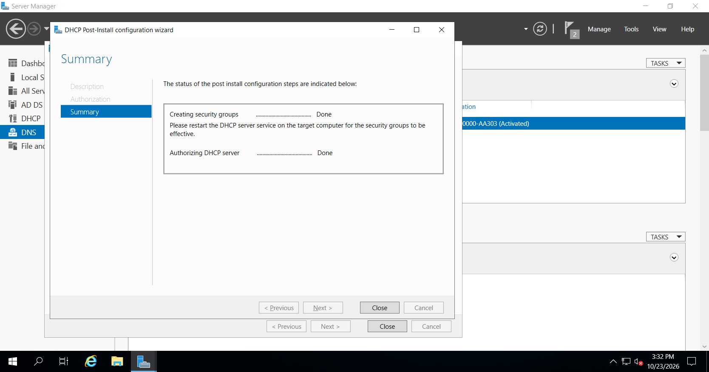

*Figure 10: Completing DHCP post-installation configuration and Active Directory authorization.*

---

# Step 11 — Open DHCP Management Console

After completing the DHCP post-installation configuration, I opened the DHCP management console.

## Configuration Steps

1. Opened **Server Manager**.
2. Clicked **Tools**.
3. Selected **DHCP**.

Alternatively, I used the Run dialog:

```cmd
dhcpmgmt.msc
```

The DHCP management console opened.

In the left navigation pane, I located the DHCP server.

### Example Server Name

```text
dc01.rapaljotlab.local
```

I expanded the server to view its IPv4 and IPv6 management sections.

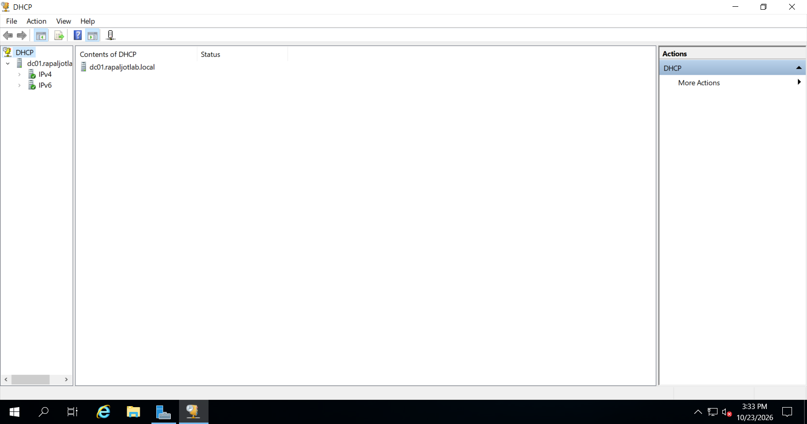

*Figure 11: Opening the DHCP management console on DC01.*

---

# Step 12 — Verify DHCP Authorization

Before creating an active scope, I verified that DHCP Server was authorized in Active Directory.

Active Directory authorization helps prevent unauthorized Windows DHCP servers from distributing IP addresses in a domain environment.

## Configuration Steps

1. Opened the DHCP management console.
2. Right-clicked the DHCP server name.
3. Checked its authorization status.
4. If authorization was required, selected **Authorize** using an account with the necessary permissions.
5. Refreshed the DHCP console.

### PowerShell Verification

I also used:

```powershell
Get-DhcpServerInDC
```

### Expected Information

The authorized DHCP server should appear in the results.

For the example network:

```text
IPAddress       DnsName
---------       -------
192.168.80.10   dc01.rapaljotlab.local
```

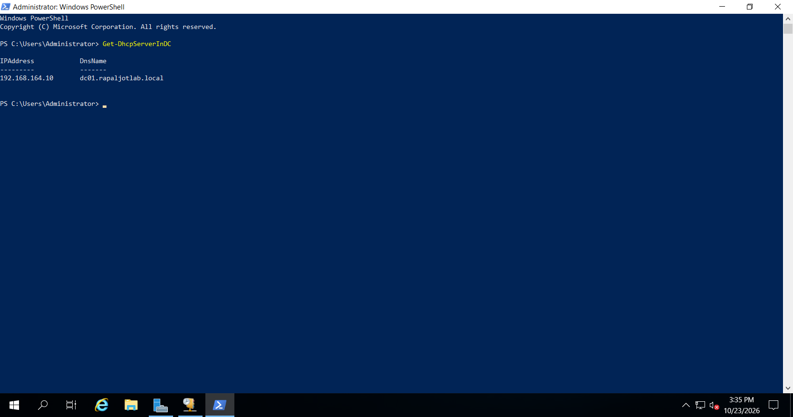

*Figure 12: Verifying that DC01 is authorized to provide DHCP services.*

---

# Step 13 — Create a New DHCP IPv4 Scope

After verifying authorization and preparing the VMware network, I created a DHCP IPv4 scope.

## 13.1 What Is a DHCP Scope?

A DHCP scope is a collection of IP addresses that a DHCP server can assign to client devices.

For example, a scope may contain addresses from:

```text
192.168.80.100
```

to:

```text
192.168.80.200
```

The DHCP server can automatically lease available addresses from this range to client computers.

## 13.2 Open New Scope Wizard

### Configuration Steps

1. Opened the DHCP management console.
2. Expanded `dc01.rapaljotlab.local`.
3. Located **IPv4**.
4. Right-clicked **IPv4**.
5. Selected **New Scope**.
6. The New Scope Wizard appeared.
7. Clicked **Next**.

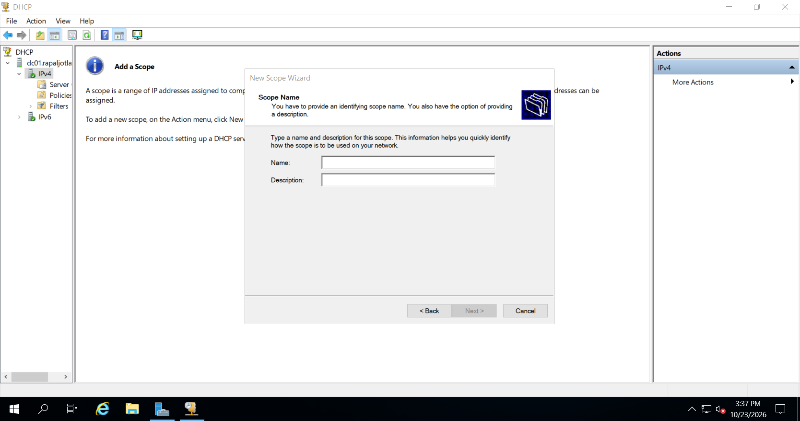

*Figure 13: Starting the New Scope Wizard in DHCP Manager.*

---

# Step 14 — Configure the DHCP Scope Name

The wizard requested a descriptive scope name and an optional description.

## Configuration Steps

1. Entered the scope name:

   `RapaljotLab-Clients`

2. Entered the description:

   `DHCP address allocation for Windows client computers in the RapaljotLab network.`

3. Clicked **Next**.

### Purpose

Using descriptive scope names helps administrators identify different networks and their DHCP configurations.

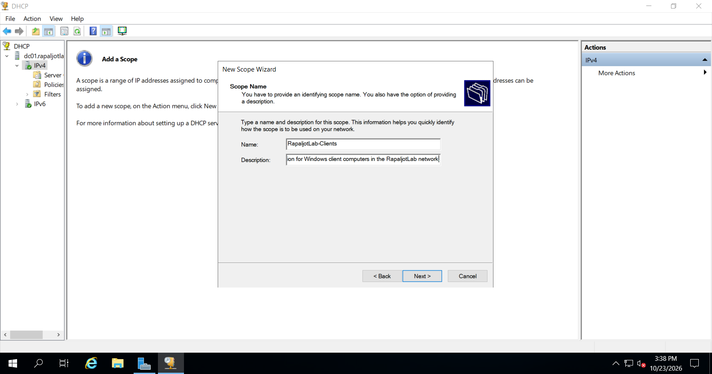

*Figure 14: Configuring the DHCP scope name and description.*

---

# Step 15 — Configure the IP Address Range

Next, I configured the IP address range available to DHCP clients.

## Example Configuration

| Setting | Value |
|---|---|
| Start IP Address | 192.168.164.100 |
| End IP Address | 192.168.164.200 |
| Subnet Mask | 255.255.255.0 |
| Prefix Length | 24 |

## Configuration Steps

1. Entered the starting IP address.
2. Entered the ending IP address.
3. Verified the subnet mask.
4. Confirmed the DHCP range belonged to the same network as DC01.
5. Clicked **Next**.

### Important Considerations

The DHCP range must not include addresses assigned to devices using static IP configuration.

For example, DC01 uses:

`192.168.164.10`

Because this address is outside the example DHCP scope, it will not be assigned to a DHCP client.

The VMware NAT gateway and host adapter addresses must also remain outside the assignable range.

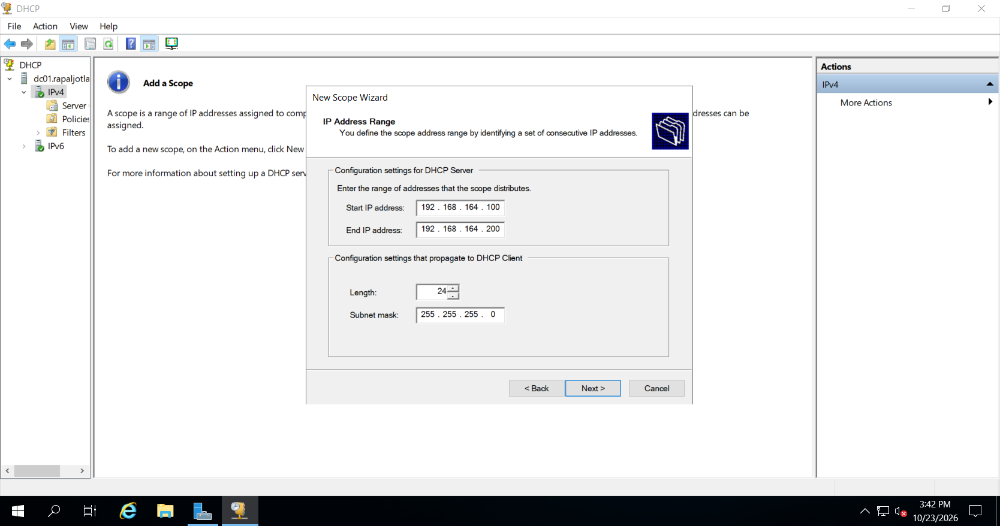

*Figure 15: Configuring the IP address range and subnet mask for the DHCP scope.*

---

# Step 16 — Configure DHCP Exclusions

After configuring the address range, the wizard displayed the **Add Exclusions and Delay** page.

## 16.1 What Is a DHCP Exclusion?

An exclusion is an IP address or range of addresses within a DHCP scope that the server must not assign to clients.

For example, if a scope distributes addresses from `192.168.80.100` to `192.168.80.200`, addresses within that range can be excluded when they must be protected from automatic assignment.

## Configuration Steps

Because my example static server and gateway addresses were already outside the scope range, no additional exclusions were necessary.

1. Reviewed the exclusion settings.
2. Confirmed that no required static addresses were included in the DHCP pool.
3. Left the exclusion fields empty.
4. Clicked **Next**.

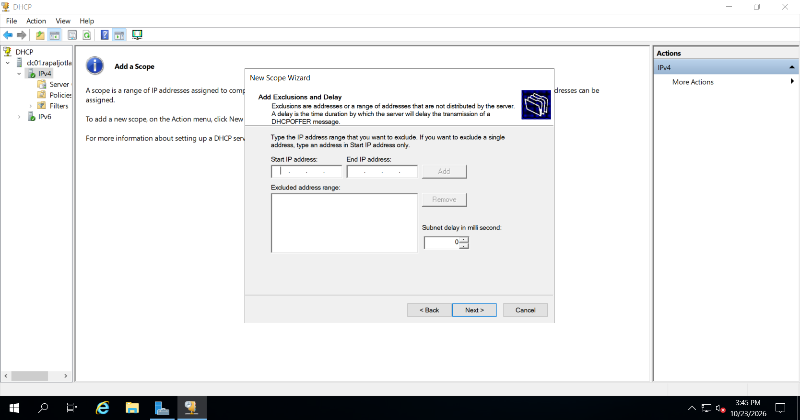

*Figure 16: Reviewing DHCP exclusion settings.*

---

# Step 17 — Configure DHCP Lease Duration

The next step was to configure the DHCP lease duration.

## 17.1 What Is a DHCP Lease?

A DHCP lease represents the period during which a client is permitted to use an assigned IP address.

Before the lease expires, the client normally attempts to renew it.

## Configuration Steps

For this lab, I selected a lease duration of:

**1 day**

A shorter lease period can be useful in a test environment where virtual machines are frequently created, removed, or reconfigured.

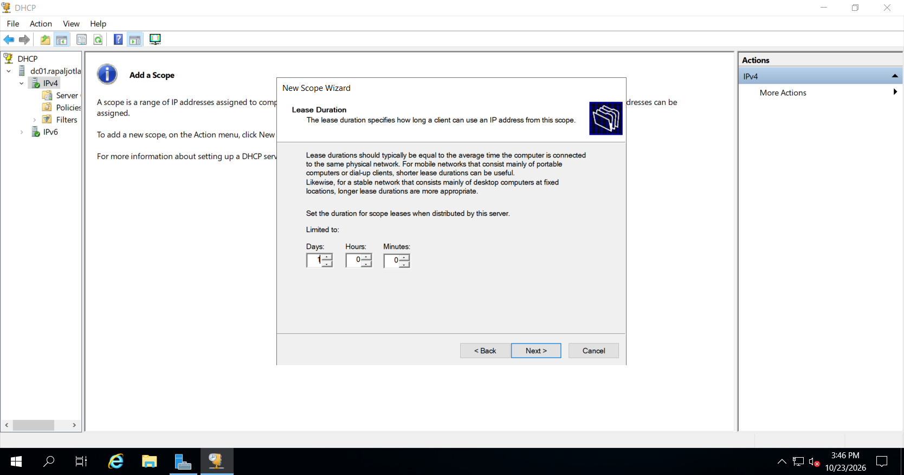

*Figure 17: Configuring DHCP lease duration for the lab network.*

---

# Step 18 — Configure DHCP Options

The wizard then asked whether DHCP options should be configured.

I selected:

**Yes, I want to configure these options now.**

DHCP options allow the server to distribute additional network settings to client computers.

For this lab, the important DHCP options were:

| Option | Purpose |
|---|---|
| 003 Router | Default gateway |
| 006 DNS Servers | DNS server IP address |
| 015 DNS Domain Name | DNS suffix |

---

# Step 19 — Configure Default Gateway

The DHCP wizard displayed the **Router (Default Gateway)** page.

The default gateway allows clients to communicate with networks outside their local subnet.

For the example VMware NAT environment, the gateway address was:

```text
192.168.164.2
```

## Configuration Steps

1. Entered the verified gateway address.
2. Clicked **Add**.
3. Confirmed the address appeared in the router list.
4. Clicked **Next**.

> The gateway must match the actual VMware NAT configuration. If using an isolated host-only network without a router, no default gateway should be specified.

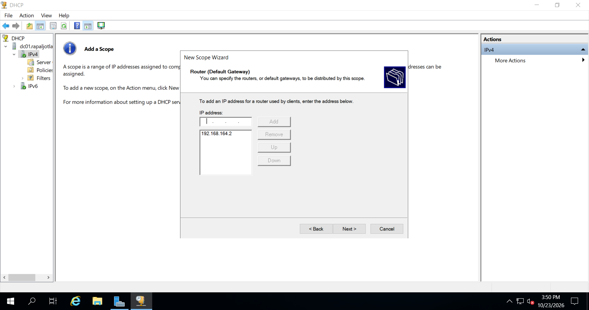

*Figure 18: Configuring DHCP Option 003 for the default gateway.*

---

# Step 20 — Configure DNS Server and Domain Name

After configuring the gateway, I configured the DNS information distributed by DHCP.

DNS is particularly important in an Active Directory environment because domain-joined clients use DNS to locate Domain Controllers.

## Example Configuration

| Setting | Value |
|---|---|
| Parent Domain | rapaljotlab.local |
| DNS Server | DC01 |
| DNS Server IP | 192.168.164.10 |

## Configuration Steps

1. Located the **Parent domain** field.
2. Entered:

   `rapaljotlab.local`

3. Entered the DNS server IP address assigned to DC01.
4. Clicked **Add**.
5. Removed any automatically populated DNS server addresses that were not intended for the Active Directory clients.
6. Verified that the appropriate internal DNS server was listed.
7. Clicked **Next**.

### Important DNS Consideration

Domain clients should use the internal Active Directory DNS server.

They should not use a public DNS server as an alternate resolver because public DNS servers do not contain the internal Active Directory service records.

External name resolution can be configured through DNS forwarders on DC01.

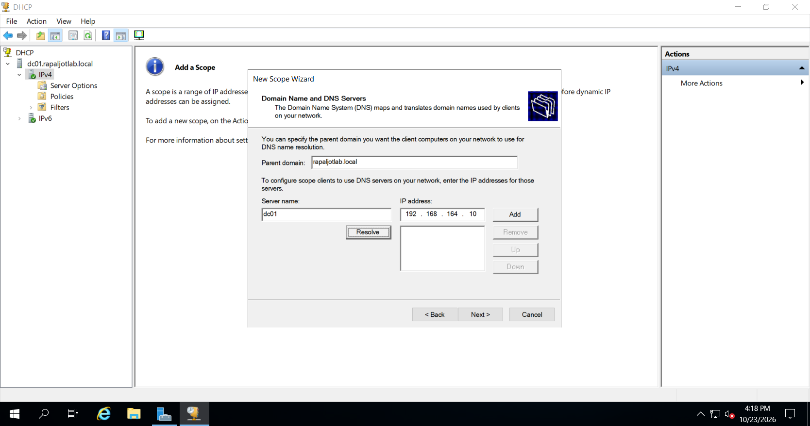

*Figure 19: Configuring DHCP Options 006 and 015 for Active Directory DNS.*

---

# Step 21 — Configure WINS Settings

The next page displayed the WINS Server configuration.

WINS stands for **Windows Internet Name Service**.

WINS was historically used for NetBIOS name resolution in older Windows networks.

For this lab, WINS was not required.

## Configuration Steps

1. Reviewed the WINS Server page.
2. Left the fields empty.
3. Clicked **Next**.

---

# Step 22 — Activate the DHCP Scope

The final stage of the wizard was to activate the newly created DHCP scope.

Before activation, I confirmed that VMware's built-in DHCP service was disabled on the lab network and that the address range did not overlap another active DHCP scope.

## Configuration Steps

1. Selected:

   **Yes, I want to activate this scope now**

2. Clicked **Next**.
3. Clicked **Finish**.

The scope became available to serve DHCP requests from clients on the lab network.

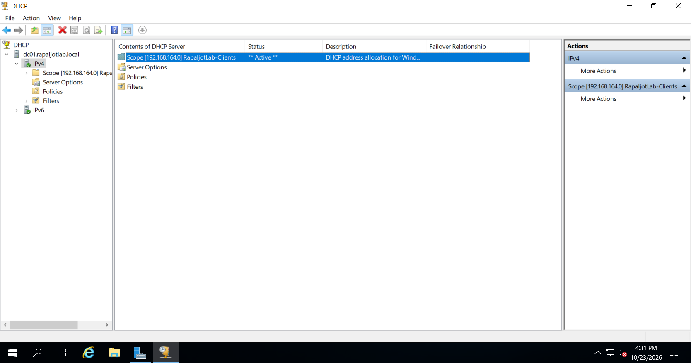

*Figure 20: Activating the DHCP IPv4 scope.*

---

# Step 23 — Verify DHCP Scope Configuration

After creating and activating the DHCP scope, I verified its settings in DHCP Manager.

## Configuration Steps

1. Opened the DHCP management console.
2. Expanded the DHCP server.
3. Expanded **IPv4**.
4. Located the newly created scope.
5. Expanded the scope.

The scope contained management sections such as:

- Address Pool
- Address Leases
- Reservations
- Scope Options

## 23.1 Verify the Address Pool

I selected **Address Pool** and reviewed the configured IP address range.

## 23.2 Verify Scope Options

I selected **Scope Options** and verified that the expected default gateway, DNS server, and DNS domain name were configured.

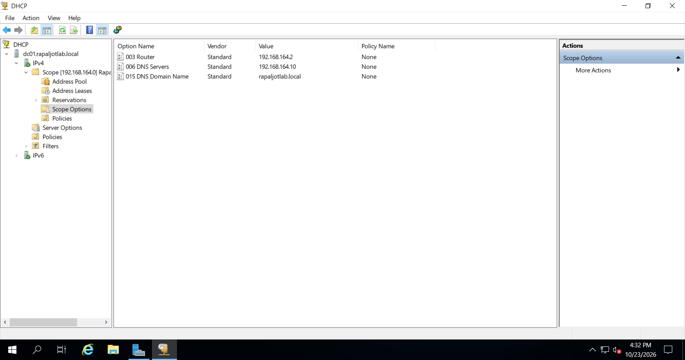

*Figure 21: Verifying the DHCP scope and network options.*

---

# Step 24 — Verify DHCP Using PowerShell

After verifying the scope through the graphical interface, I used PowerShell to review the DHCP configuration.

## 24.1 Verify DHCP Server Installation

```powershell
Get-WindowsFeature DHCP
```

The installed state should indicate that the DHCP Server role is installed.

## 24.2 Verify DHCP Service

```powershell
Get-Service DHCPServer
```

The DHCP Server service should be running.

## 24.3 List Authorized DHCP Servers

```powershell
Get-DhcpServerInDC
```

This command displays DHCP servers authorized in Active Directory.

## 24.4 Display DHCP IPv4 Scopes

```powershell
Get-DhcpServerv4Scope
```

This command displays configured DHCP IPv4 scopes.

The output includes information such as:

- Scope ID
- Start range
- End range
- Subnet mask
- Scope state

## 24.5 Verify DHCP Scope Options

For the example network:

```powershell
Get-DhcpServerv4OptionValue -ScopeId 192.168.164.0
```

This command displays the DHCP options configured for the selected scope.

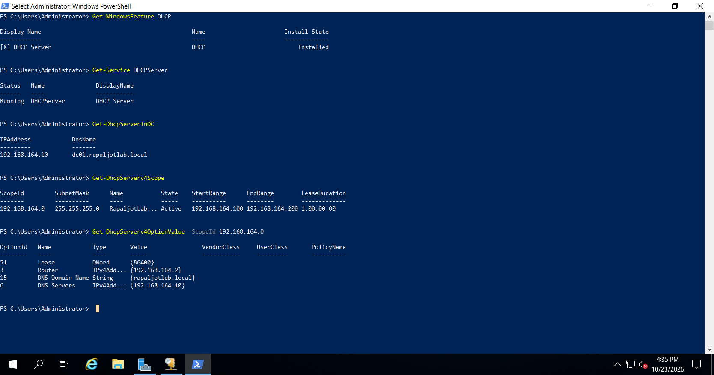

*Figure 22: Verifying the DHCP Server configuration using Windows PowerShell.*

---

# Step 25 — Test DHCP from a Windows Client

After configuring the DHCP server, the next step was to test automatic IP address assignment.

For this test, I used a separate Windows client virtual machine.

## 25.1 Configure the Windows Client Network

The client must be connected to the same VMware virtual network as DC01.

### Configuration Steps

1. Opened VMware Workstation.
2. Selected the Windows client virtual machine.
3. Opened its virtual machine settings.
4. Selected **Network Adapter**.
5. Connected the client to the same virtual network as DC01.
6. Started the Windows client.

## 25.2 Enable Automatic IP Address Assignment

Inside the Windows client:

1. Pressed `Windows + R`.
2. Entered:

```cmd
ncpa.cpl
```

3. Opened the active Ethernet adapter properties.
4. Selected **Internet Protocol Version 4 (TCP/IPv4)**.
5. Clicked **Properties**.
6. Selected:

   **Obtain an IP address automatically**

7. Selected:

   **Obtain DNS server address automatically**

8. Clicked **OK**.

## 25.3 Request an IP Address

I opened Command Prompt on the Windows client and executed:

```cmd
ipconfig /release
```

Then:

```cmd
ipconfig /renew
```

Finally:

```cmd
ipconfig /all
```

> These commands were executed on the client computer, not DC01. The Domain Controller must retain its static IP address.

## Expected Configuration

For the example network:

```text
DHCP Enabled . . . . . . . . : Yes
IPv4 Address . . . . . . . . : 192.168.80.100
Subnet Mask . . . . . . . .  : 255.255.255.0
Default Gateway . . . . . .  : 192.168.80.2
DHCP Server . . . . . . . .  : 192.168.80.10
DNS Servers . . . . . . . .  : 192.168.80.10
```

The actual assigned address may be any available address within the configured scope.

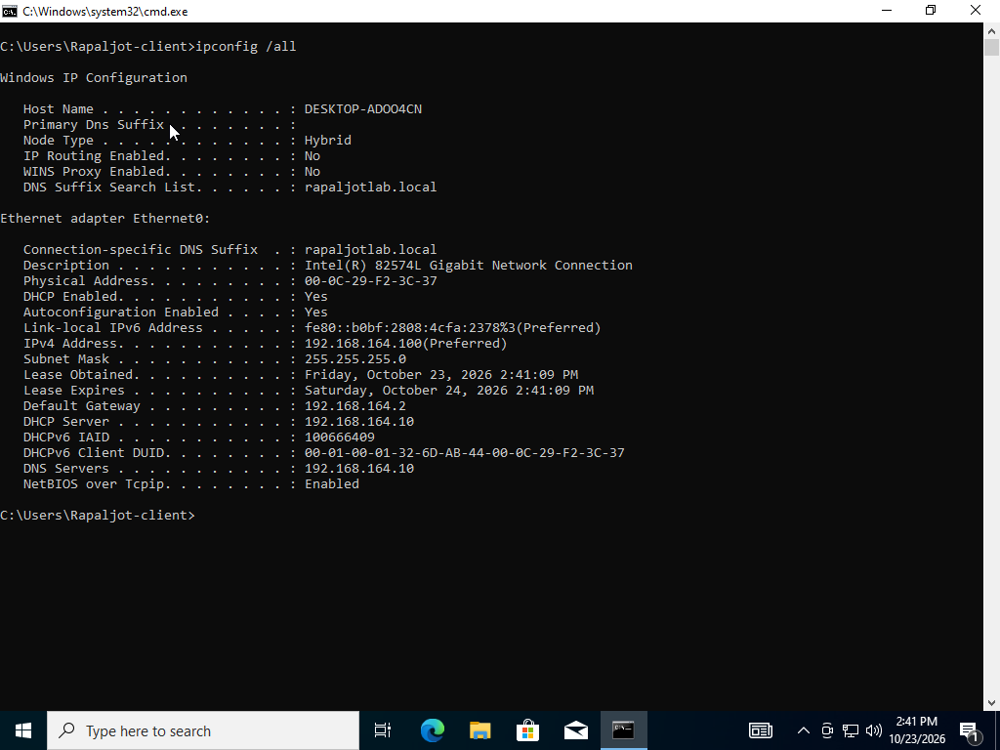

*Figure 23: Verifying automatic IPv4 address assignment on a Windows client.*

---

# Step 26 — Verify DHCP Address Leases

After the client received an IP address, I returned to DC01 to inspect the DHCP lease information.

## Configuration Steps

1. Opened the DHCP management console.
2. Expanded **IPv4**.
3. Expanded the active DHCP scope.
4. Selected **Address Leases**.
5. Located the Windows client.

The Address Leases section displays information such as the leased IP address, client name, lease expiration, and client identifier.

## PowerShell Verification

For the example scope:

```powershell
Get-DhcpServerv4Lease -ScopeId 192.168.164.0
```

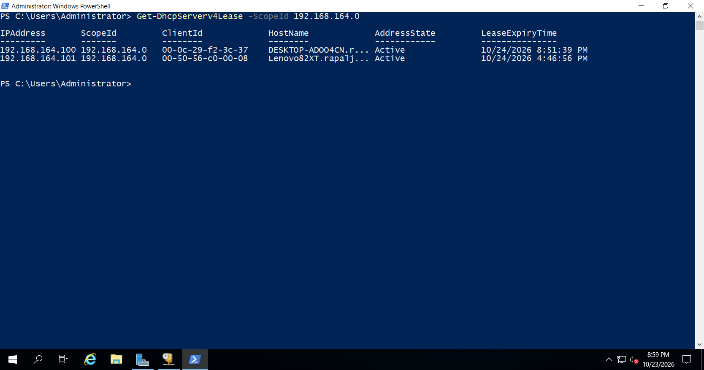

*Figure 24: Verifying that the Windows client received an IP address from DC01.*

---

# Step 27 — Test Network and DNS Connectivity

After the client received its network configuration, I performed connectivity tests.

## 27.1 Test Communication with DC01

From the Windows client, I executed:

```cmd
ping 192.168.164.10
```

This test checks whether the client can communicate with DC01 on the lab network.

## 27.2 Test DNS Name Resolution

I executed:

```cmd
nslookup dc01.rapaljotlab.local
```

The DNS response should identify the static IP address assigned to DC01.

## 27.3 Test Domain Discovery

I also tested Active Directory service record resolution:

```cmd
nslookup -type=SRV _ldap._tcp.dc._msdcs.rapaljotlab.local
```

A successful response helps verify that the client can locate DNS records used for Active Directory Domain Controller discovery.

> Some systems may block ping requests through their firewall. DHCP and DNS functionality should also be tested directly rather than relying only on ping.

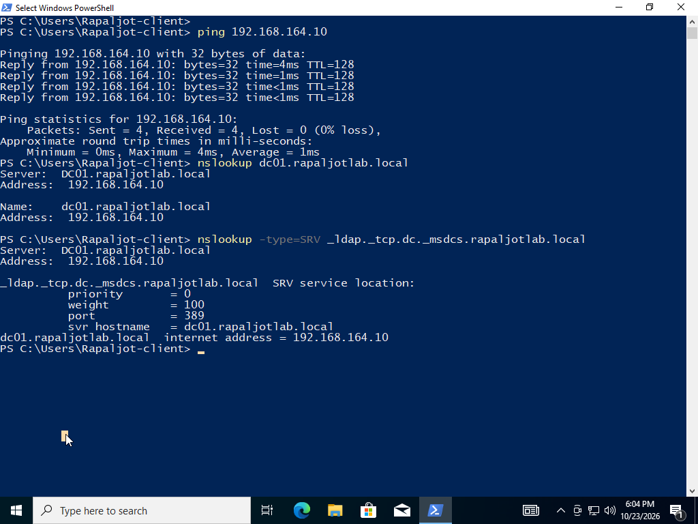

*Figure 25: Testing communication and Active Directory DNS resolution from a DHCP client.*

---

# Step 28 — Troubleshoot Common DHCP Problems

## Problem 1 — Client Does Not Receive an IP Address

### Possible Causes

- DHCP scope is inactive.
- DHCP Server service is stopped.
- DHCP server is not authorized.
- Client is connected to the wrong VMware network.
- Another DHCP service is interfering.
- Network firewall is blocking DHCP communication.

### Troubleshooting Commands

On DC01:

```powershell
Get-Service DHCPServer
```

```powershell
Get-DhcpServerv4Scope
```

```powershell
Get-DhcpServerInDC
```

On the Windows client:

```cmd
ipconfig /all
```

If the client receives an address beginning with `169.254`, it may indicate that the client could not obtain an IPv4 lease from a DHCP server.

## Problem 2 — Client Receives an Address from VMware Instead of DC01

I checked the DHCP Server field in the output of:

```cmd
ipconfig /all
```

If the listed DHCP server was not DC01, I reviewed the VMware network's built-in DHCP configuration.

## Problem 3 — Client Receives an IP Address but Cannot Access the Domain

I verified the DNS server assigned by DHCP.

The client's preferred DNS server should point to the internal Active Directory DNS server.

I also verified that the Active Directory DNS zone and Domain Controller service records were available.

## Problem 4 — Duplicate IP Address

I verified that no two DHCP services were distributing overlapping addresses.

I also checked that statically assigned addresses were not included in the DHCP address pool.

---

# Step 29 — Final DHCP Verification

After completing the configuration and testing, I reviewed the DHCP deployment.

## Verification Checklist

- [ ] DHCP Server role installed
- [ ] DHCP post-installation configuration completed
- [ ] DHCP server authorized in Active Directory
- [ ] VMware DHCP conflict prevented
- [ ] DHCP scope created
- [ ] DHCP address range configured
- [ ] DHCP lease duration configured
- [ ] Default gateway option configured
- [ ] DNS options configured
- [ ] DHCP scope activated
- [ ] Windows client received an IP address
- [ ] Windows client received the correct DNS server
- [ ] DHCP lease visible in DHCP Manager
- [ ] PowerShell verification completed
- [ ] Network connectivity tested

---

# Conclusion

In this section, I configured the DHCP Server role on Windows Server 2019.

The configuration involved installing DHCP Server, completing the post-installation tasks, authorizing the server in Active Directory, and creating an IPv4 scope.

I configured IP address allocation, lease duration, default gateway settings, and DNS options.

I also used DHCP Manager, Command Prompt, and PowerShell to verify the configuration.

After completing successful client testing, the DHCP server provides automatic IP address configuration to Windows client computers in the lab environment.

## Next Phase

The next phase will focus on connecting Windows client computers to the Active Directory domain.

This will include configuring a Windows 10 or Windows 11 virtual machine, verifying DNS connectivity, joining the client to `rapaljotlab.local`, and testing domain user authentication.

---