# Windows Server 2019 — Windows 10 Client Domain Joining

## 1. Overview

After configuring Active Directory Domain Services, DNS, DHCP, Organizational Units, and user accounts, the next phase of my Windows Server 2019 lab was to join a Windows 10 client computer to the Active Directory domain.

In an enterprise environment, domain-joined computers allow employees to sign in using their domain credentials and access centrally managed network resources.

For this lab, I configured a Windows 10 Pro virtual machine and joined it to the existing Active Directory domain.

### Objectives

The objectives of this section are to:

1. Download and install Windows 10.
2. Create a Windows 10 virtual machine using VMware Workstation.
3. Configure the virtual machine hardware and networking.
4. Rename the client computer.
5. Verify network connectivity with DC01.
6. Configure the client's DNS settings.
7. Join Windows 10 to the Active Directory domain.
8. Restart the client computer.
9. Sign in using an Active Directory employee account.
10. Verify the computer account in Active Directory.
11. Move the computer account into the correct Organizational Unit.
12. Test domain authentication and connectivity using Command Prompt and PowerShell.

---

## Lab Environment

| Component | Configuration |
|---|---|
| Virtualization Platform | VMware Workstation |
| Domain Controller | DC01 |
| Server Operating System | Windows Server 2019 |
| Active Directory Domain | rapaljotlab.local |
| NetBIOS Domain | RAPALJOTLAB |
| Client Operating System | Windows 10 Pro |
| Client Computer Name | WIN11-CLIENT01 |
| Domain Controller IP | 192.168.164.10 |
| Client IP | [Your client IP] |
| Client DNS Server | DC01 IP address |

The IP addresses used in this documentation should be updated to match the actual VMware lab network.

---

# Step 1 — Download Windows 10 ISO

## 1.1 Purpose

The first step was to obtain the Windows 10 installation media.

An ISO file contains the operating system installation files and can be mounted to a virtual machine as a virtual DVD.

## 1.2 Configuration Steps

1. Opened a web browser on the host computer.
2. Navigated to the official Microsoft Windows 10 download website.
3. Located the Windows 10 ISO download section.
4. Selected the appropriate Windows 10 ISO.
5. Selected the required language.
6. Downloaded the ISO file.
7. Saved it to the host computer.

Official Microsoft website:

https://www.microsoft.com/software-download/windows11

### Important Consideration

For this lab, Windows 10 Pro was selected because it supports joining an on-premises Active Directory domain.

Windows 10 Home does not support traditional Active Directory domain joining.

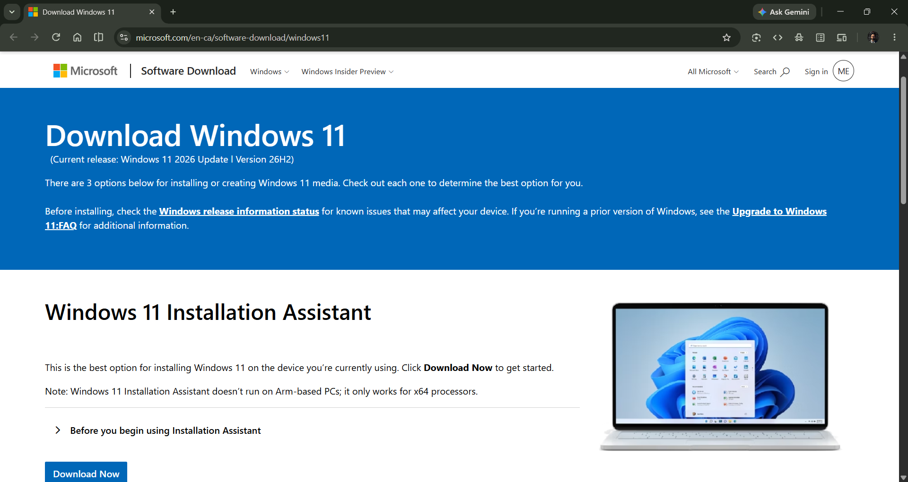

*Figure 1: Downloading the Windows 10 ISO from the official Microsoft website.*

---

# Step 2 — Create a Windows 10 Virtual Machine

After downloading the Windows 10 ISO, I created a new virtual machine using VMware Workstation.

## 2.1 Open VMware Workstation

1. Opened VMware Workstation.
2. Selected **File > New Virtual Machine**.
3. Selected **Typical (recommended)**.
4. Clicked **Next**.

## 2.2 Select the Installation Media

1. Selected **Installer disc image file (ISO)**.
2. Clicked **Browse**.
3. Located the downloaded Windows 10 ISO.
4. Selected the ISO file.
5. Clicked **Next**.

If VMware could not automatically detect the operating system, I manually selected:

- **Guest OS:** Microsoft Windows
- **Version:** Windows 10 x64

## 2.3 Name the Virtual Machine

I assigned the following VMware virtual machine name:

`Windows 10 - CLIENT01`

This name helps identify the virtual machine in VMware Workstation.

I then selected the location where the virtual machine files would be stored.

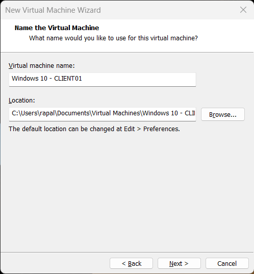

*Figure 2: Creating a Windows 10 virtual machine in VMware Workstation.*

---

# Step 3 — Configure Virtual Machine Hardware

Before installing Windows 10, I configured the virtual hardware.

## 3.1 Hardware Requirements

Windows 10 requires compatible hardware, including a 64-bit processor, sufficient RAM and storage, TPM 2.0, and Secure Boot capability.

An example virtual machine configuration is:

| Component | Example Configuration |
|---|---|
| Operating System | Windows 10 Pro |
| Processor | 2 virtual CPU cores |
| Memory | 4 GB RAM |
| Virtual Hard Disk | 64 GB or larger |
| Firmware | UEFI |
| Security | Secure Boot and virtual TPM 2.0 |
| Network Adapter | VMware NAT or designated lab network |

These values are examples; resource allocation depends on the capabilities of the host computer.

## 3.2 Configure Network Adapter

I configured the Windows 10 virtual machine to use the same VMware virtual network as DC01.

For example, if DC01 was connected to VMware NAT (VMnet8), the Windows 10 client also needed to connect to VMnet8.

This was necessary so both virtual machines could communicate over the same virtual network.

## 3.3 Verify TPM and Firmware Settings

I verified that the Windows 10 virtual machine met the required TPM and firmware settings.

Depending on the VMware Workstation version, configuring a virtual TPM may require additional virtual machine security or encryption settings.

I completed the required configuration before starting Windows installation.

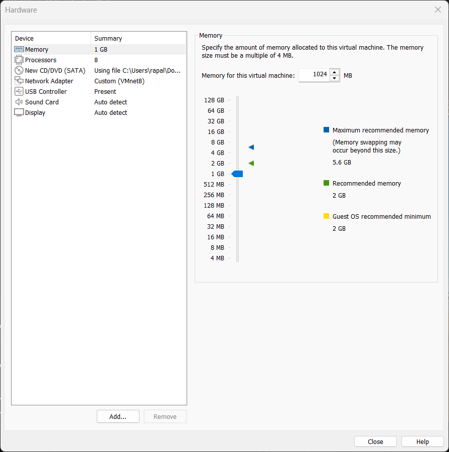

*Figure 3: Configuring the Windows 10 virtual machine hardware and network adapter.*

---

# Step 4 — Install Windows 10 Pro

After configuring the virtual machine, I installed Windows 10.

## 4.1 Start the Virtual Machine

1. Selected the Windows 10 virtual machine.
2. Clicked **Power on this virtual machine**.
3. Started Windows Setup from the attached ISO.

## 4.2 Complete Windows Setup

1. Selected the installation language and keyboard layout.
2. Continued to the Windows installation screen.
3. Selected the appropriate Windows 10 edition.
4. Ensured that **Windows 10 Pro** was selected.
5. Accepted the applicable license terms.
6. Selected the custom installation option for a new installation.
7. Selected the virtual hard disk.
8. Started the installation.
9. Waited for Windows to install and restart.
10. Completed the initial Windows setup using a supported account configuration.

## 4.3 Verify Installation

After Windows Setup completed, I signed in and verified that Windows 10 was running successfully.

To check the operating system version, I pressed `Windows + R` and entered:

```cmd
winver
```

This opened the About Windows dialog.

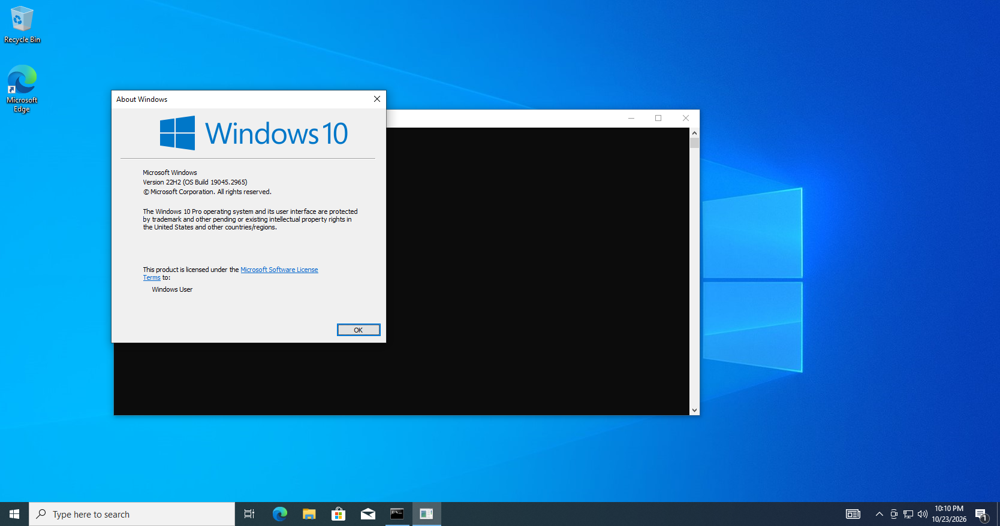

*Figure 4: Verifying the Windows 10 Pro installation.*

---

# Step 5 — Install VMware Tools

After installing Windows 10, I installed VMware Tools to improve virtual machine performance and integration.

## Configuration Steps

1. Powered on the Windows 10 virtual machine.
2. Signed in.
3. Selected **VM > Install VMware Tools** in VMware Workstation.
4. Opened **File Explorer > This PC**.
5. Opened the VMware Tools virtual CD/DVD drive.
6. Started the installer.
7. Selected the Typical installation option.
8. Completed the installation wizard.
9. Restarted Windows 10 if prompted.

### Purpose

VMware Tools provides improved virtual hardware support, mouse integration, display performance, and communication between the host and guest operating systems.

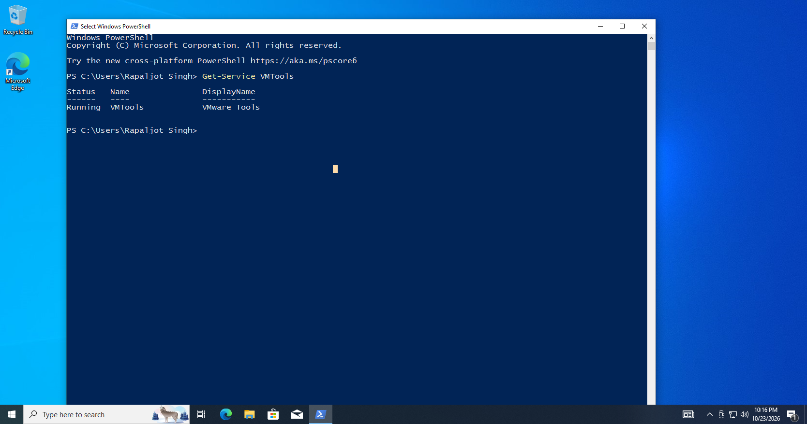

*Figure 5: Installing VMware Tools on the Windows 10 client.*

---

# Step 6 — Rename the Windows 10 Client Computer

Before joining the domain, I renamed the Windows 10 computer.

A consistent computer naming convention allows administrators to identify devices within Active Directory.

For this lab, I assigned the following name:

`WIN11-CLIENT01`

## 6.1 Open Computer Name Settings

1. Signed in to Windows 10 using an account with local administrator permissions.
2. Pressed `Windows + R`.
3. Entered:

```cmd
sysdm.cpl
```

4. Pressed **Enter**.
5. Selected the **Computer Name** tab.
6. Clicked **Change**.

## 6.2 Change the Computer Name

1. Removed the existing computer name.
2. Entered:

   `WIN11-CLIENT01`

3. Left the computer in its existing workgroup.
4. Clicked **OK**.
5. Accepted the restart notification.
6. Restarted Windows 10.

## 6.3 Verify Computer Name

After restarting, I opened Command Prompt and executed:

```cmd
hostname
```

### Expected Output

```text
WIN11-CLIENT01
```

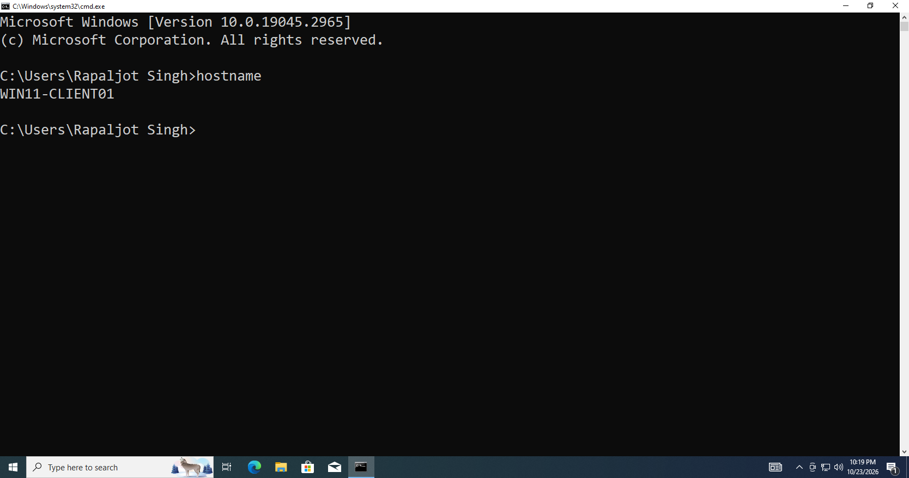

*Figure 6: Renaming the Windows 10 client computer to WIN11-CLIENT01.*

---

# Step 7 — Verify the VMware Network Configuration

Before joining Windows 10 to Active Directory, I verified that the client computer and Domain Controller could communicate.

## 7.1 Verify the Network Adapter

1. Opened VMware Workstation.
2. Selected the Windows 10 virtual machine.
3. Opened **VM > Settings**.
4. Selected **Network Adapter**.
5. Confirmed that the network adapter was connected.
6. Verified that the client was using the designated lab virtual network.

For example, if DC01 used NAT (VMnet8), I selected the same network for WIN11-CLIENT01.

## 7.2 Example Network Configuration

| Device | Example IP Address |
|---|---|
| DC01 | 192.168.164.10 |
| WIN11-CLIENT01 | 192.168.164.20 |
| Subnet Mask | 255.255.255.0 |
| Gateway | 192.168.164.2 |
| Client DNS | 192.168.164.10 |

These are example addresses only.

The actual addresses must match the VMware subnet configured for the lab.

### DHCP Consideration

If Windows Server DHCP has already been configured, the Windows 10 client can obtain its network settings automatically.

The DHCP scope should provide DC01's IP address as the DNS server.

VMware DHCP and Windows Server DHCP should not distribute conflicting settings on the same network.

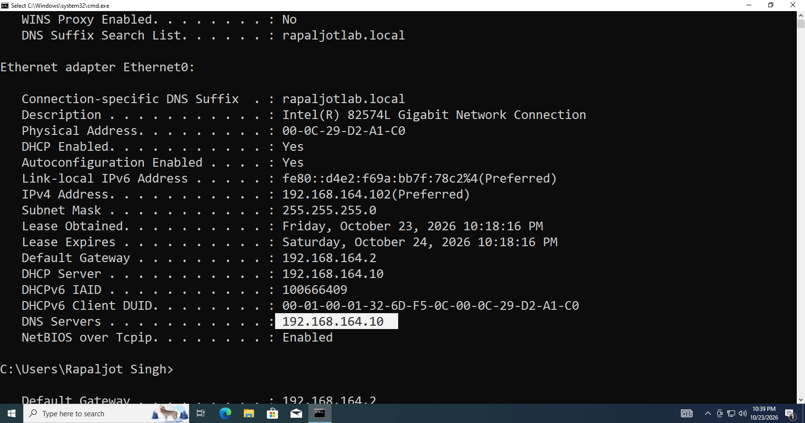

*Figure 7: Verifying that the Windows 10 client and DC01 use the same VMware virtual network.*

---

# Step 8 — Configure the Windows 10 DNS Server

DNS is one of the most important requirements for joining a computer to Active Directory.

A domain-joined Windows client uses DNS to locate Domain Controllers and Active Directory services.

For this lab, I configured the Windows 10 client to use DC01 as its DNS server.

## 8.1 Open Network Connections

1. Signed in to Windows 10.
2. Pressed `Windows + R`.
3. Entered:

```cmd
ncpa.cpl
```

4. Pressed **Enter**.
5. Located the active Ethernet adapter.
6. Right-clicked the adapter.
7. Selected **Properties**.

## 8.2 Open IPv4 Properties

1. Selected **Internet Protocol Version 4 (TCP/IPv4)**.
2. Clicked **Properties**.

The IPv4 configuration window opened.

## 8.3 Configure the DNS Address

If the client was using DHCP, I left the IP address configuration set to:

**Obtain an IP address automatically**

For this lab, the client's preferred DNS server must point to DC01.

I selected **Use the following DNS server addresses** and entered DC01's static IP address if the DHCP settings did not already supply it.

For example:

```text
Preferred DNS Server: 192.168.164.10
```

I clicked **OK** to apply the configuration.

I did not configure a public DNS server as an alternative DNS server because Active Directory clients must use DNS servers capable of resolving the internal Active Directory domain.

> **Important:** The preferred DNS address must match DC01's actual IP address, not necessarily the example shown above.

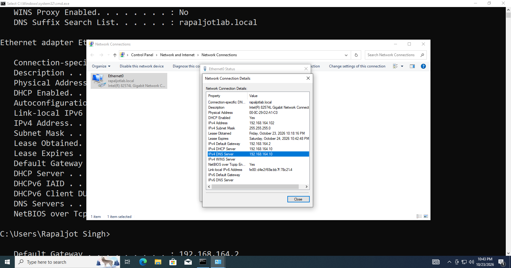

*Figure 8: Configuring the Windows 10 client to use DC01 as its preferred DNS server.*

---

# Step 9 — Verify Network and DNS Connectivity

Before attempting to join the domain, I tested network connectivity.

## 9.1 Check the Client IP Address

I opened Command Prompt and executed:

```cmd
ipconfig /all
```

I reviewed the following information:

- IPv4 address
- Subnet mask
- Default gateway
- DNS server
- DHCP configuration

I verified that the client had a valid IP address and was using DC01 as its DNS server.

## 9.2 Test Connectivity to DC01

I executed:

```cmd
ping 192.168.164.10
```

This example assumes that DC01 uses `192.168.164.10`.

Successful replies indicate that DC01 is reachable using ICMP.

If the request times out, the connection may be blocked by a firewall, or a network configuration problem may exist.

## 9.3 Test DNS Resolution

Next, I executed:

```cmd
nslookup dc01.rapaljotlab.local
```

The expected result was that the Domain Controller hostname resolved to DC01's static IP address.

I also tested:

```cmd
nslookup rapaljotlab.local
```

## 9.4 Verify Active Directory DNS Records

I executed:

```cmd
nslookup -type=SRV _ldap._tcp.dc._msdcs.rapaljotlab.local
```

This command queries the DNS service records that help clients locate Domain Controllers.

A successful response should identify DC01 as an available Domain Controller.


*Figure 9: Verifying connectivity and DNS resolution between Windows 10 and DC01.*

---

# Step 10 — Join Windows 10 to the Active Directory Domain

After confirming network and DNS connectivity, I joined WIN11-CLIENT01 to the Active Directory domain.

## 10.1 Open System Properties

1. Signed in using a local administrator account.
2. Pressed `Windows + R`.
3. Entered:

```cmd
sysdm.cpl
```

4. Pressed **Enter**.
5. Selected the **Computer Name** tab.
6. Clicked **Change**.

The Computer Name/Domain Changes window opened.

## 10.2 Enter the Domain Name

Under the **Member of** section:

1. Selected **Domain**.
2. Entered:

   `rapaljotlab.local`

3. Clicked **OK**.

Windows attempted to locate and communicate with the Domain Controller.

## 10.3 Enter Domain Administrator Credentials

A Windows Security dialog requested credentials for an account authorized to join the computer to the domain.

For this controlled lab, I used the domain Administrator account.

Example username:

```text
RAPALJOTLAB\Administrator
```

I entered the account password and clicked **OK**.

In a production environment, domain-joining permissions should be delegated appropriately rather than routinely using Domain Administrator credentials.

## 10.4 Confirm Successful Domain Joining

After successful authentication, Windows displayed a welcome message indicating that the computer had joined the domain.

The message appeared similar to:

```text
Welcome to the rapaljotlab.local domain.
```

I clicked **OK**.

### Screenshot
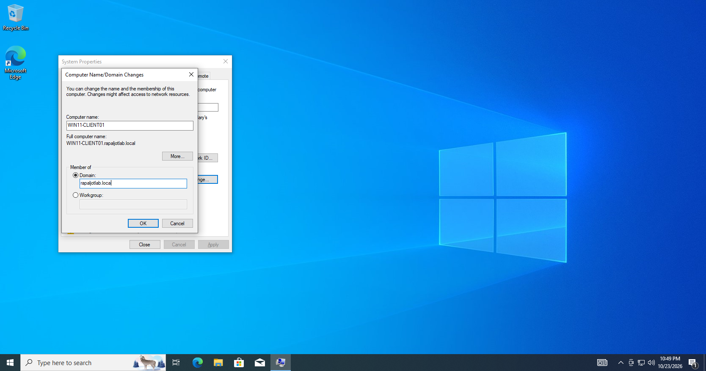
*Figure 10: Joining WIN11-CLIENT01 to the rapaljotlab.local domain.*

### Additional Screenshot

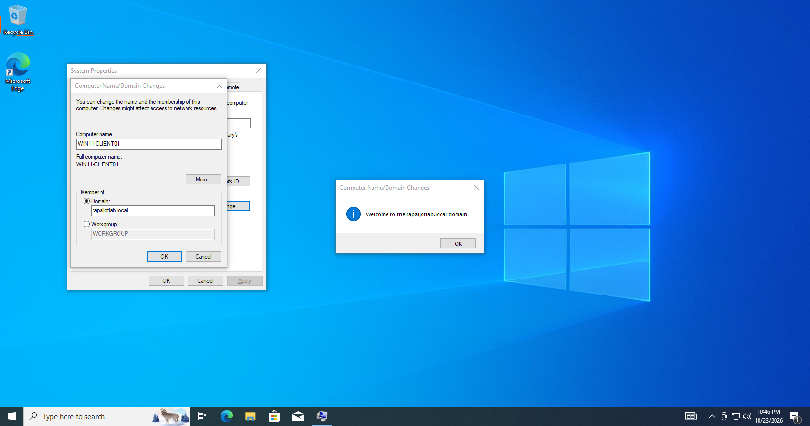

*Figure 11: Windows confirming that the client successfully joined the Active Directory domain.*

---

# Step 11 — Restart the Windows 10 Client

After joining the domain, Windows prompted me to restart the computer.

## Configuration Steps

1. Saved any open work.
2. Clicked **Restart Now**.
3. Waited for Windows 10 to restart.
4. Returned to the Windows sign-in screen.

The restart completed the domain-joining process.

---

# Step 12 — Sign In Using an Active Directory User Account

After restarting Windows 10, I tested whether an Active Directory employee could sign in.

For this lab, I selected the HR employee account:

**Sarah Johnson**

Username:

```text
sarah.johnson
```

## 12.1 Sign In to the Domain

1. Started WIN11-CLIENT01.
2. Opened the Windows sign-in screen.
3. Selected **Other user**, if necessary.
4. Entered the domain username:

```text
RAPALJOTLAB\sarah.johnson
```

Alternatively:

```text
sarah.johnson@rapaljotlab.local
```

5. Entered the employee account password.
6. Pressed **Enter**.

## 12.2 Change Password If Required

If the account was configured with **User must change password at next logon**, Windows prompted the employee to change the temporary password.

I followed the password-change prompts and entered a new password that met the domain's password policy.

After completing authentication, Windows created the user's profile during the first sign-in.

## 12.3 Verify Successful Login

After signing in, I opened Command Prompt and executed:

```cmd
whoami
```

### Expected Output

```text
rapaljotlab\sarah.johnson
```

This output confirmed that the employee was signed in using an Active Directory domain account.

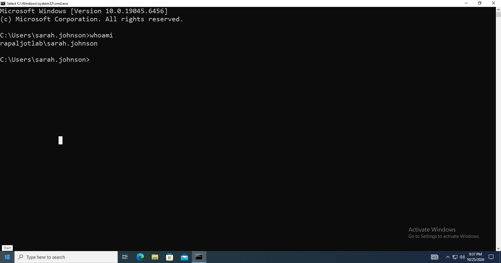

*Figure 12: Verifying an Active Directory employee login using the whoami command.*

---

# Step 13 — Verify the Client Computer in Active Directory

After joining the client to the domain, I verified that its computer account had been created in Active Directory.

## 13.1 Open Active Directory Users and Computers

On DC01:

1. Opened **Server Manager**.
2. Clicked **Tools**.
3. Selected **Active Directory Users and Computers**.
4. Expanded the domain:

   `rapaljotlab.local`

5. Selected the default **Computers** container.

Unless a different destination was specified, new domain-joined computers are commonly created in this default container.

## 13.2 Verify the Computer Object

I searched for the client computer:

`WIN11-CLIENT01`

The computer object appeared in Active Directory.

This confirmed that Active Directory had registered the client computer.

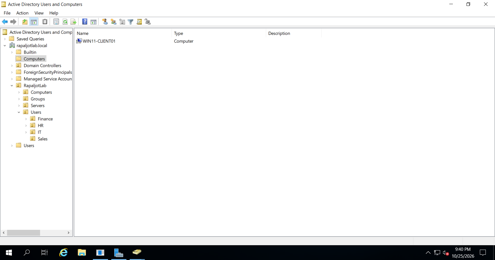

*Figure 13: Verifying that WIN11-CLIENT01 appears in Active Directory Users and Computers.*

---

# Step 14 — Move the Client to the Computers Organizational Unit

Earlier in this project, I created a custom Computers Organizational Unit under RapaljotLab.

To keep the Active Directory structure organized, I moved WIN11-CLIENT01 into this OU.

## 14.1 Locate the Computer Account

1. Opened **Active Directory Users and Computers**.
2. Expanded `rapaljotlab.local`.
3. Opened the default **Computers** container.
4. Located `WIN11-CLIENT01`.

## 14.2 Move the Computer Object

1. Right-clicked `WIN11-CLIENT01`.
2. Selected **Move**.
3. Expanded the `RapaljotLab` OU.
4. Selected the custom **Computers** OU.
5. Clicked **OK**.

The computer object was moved to the selected Organizational Unit.

### Expected Structure

```text
rapaljotlab.local
│
└── RapaljotLab
    │
    ├── Users
    │   ├── HR
    │   ├── Finance
    │   ├── Sales
    │   └── IT
    │
    ├── Computers
    │   └── WIN11-CLIENT01
    │
    ├── Servers
    │
    └── Groups
```

This structure allows computer-specific Group Policies to be linked to the custom Computers OU.

Moving the object does not immediately guarantee that every new applicable policy has been processed; Group Policy will refresh according to Windows policy processing rules.

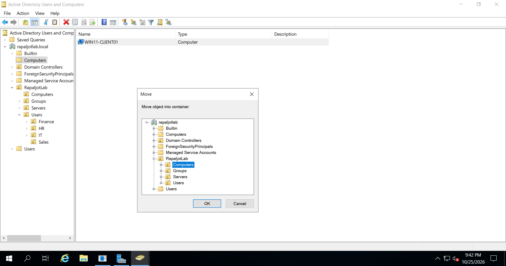

*Figure 14: Moving WIN11-CLIENT01 into the custom Computers Organizational Unit.*

---

# Step 15 — Verify Domain Membership Using PowerShell

After joining the client computer to Active Directory, I performed additional verification using PowerShell.

## 15.1 Verify the Domain Name

On Windows 10, I opened PowerShell and executed:

```powershell
Get-CimInstance Win32_ComputerSystem |
    Select-Object Name, Domain, PartOfDomain
```

### Expected Output

```text
Name           Domain             PartOfDomain
----           ------             ------------
WIN11-CLIENT01 rapaljotlab.local  True
```

### Explanation

This command displays:

- The computer name
- The domain name
- Whether the computer belongs to a domain

The `PartOfDomain` property should return `True`.

## 15.2 Verify Domain Controller Discovery

I executed:

```cmd
nltest /dsgetdc:rapaljotlab.local
```

### Purpose

The `nltest` command can be used to locate Domain Controllers and test domain discovery.

The expected result should identify DC01.

## 15.3 Verify the Domain User

I executed:

```cmd
whoami
```

This confirmed the identity of the currently signed-in domain user.

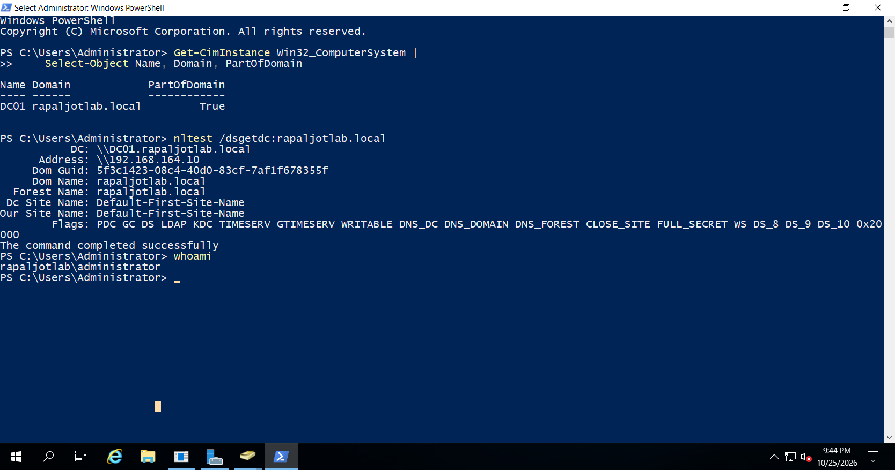

*Figure 15: Verifying Windows 10 domain membership and Domain Controller discovery.*

---

# Step 16 — Verify the Computer Object Using Active Directory PowerShell

I also verified the computer object directly from DC01.

I opened PowerShell on the Domain Controller and executed:

```powershell
Get-ADComputer -Identity "WIN11-CLIENT01"
```

### Purpose

The `Get-ADComputer` cmdlet retrieves information about a computer account from Active Directory.

It can be used to verify that the computer account exists.

To display additional details, I executed:

```powershell
Get-ADComputer -Identity "WIN11-CLIENT01" |
    Select-Object Name, DistinguishedName, Enabled
```

### Expected Information

The output should include:

```text
Name    : WIN11-CLIENT01
Enabled : True
```

The distinguished name should indicate the computer object's actual Organizational Unit location.

After moving it to the custom Computers OU, the expected distinguished name is:

```text
CN=WIN11-CLIENT01,OU=Computers,OU=RapaljotLab,DC=rapaljotlab,DC=local
```

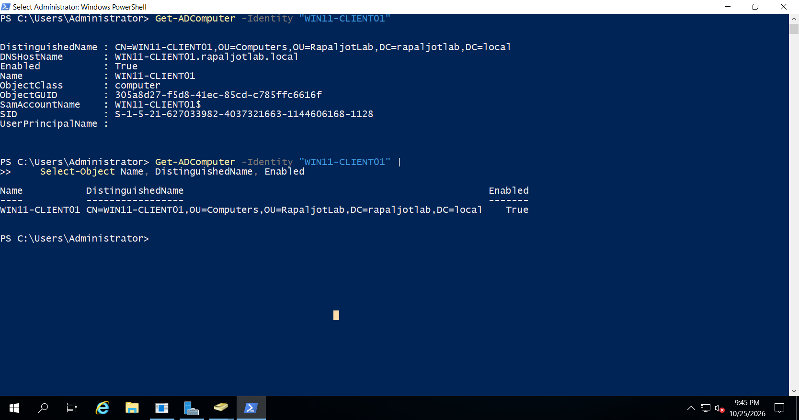

*Figure 16: Verifying the Windows 10 computer account using PowerShell on DC01.*

---

# Step 17 — Test Group Policy Processing

After successfully joining WIN11-CLIENT01 to the domain, I checked whether domain Group Policy settings could be processed.

## 17.1 Refresh Group Policy

On the Windows 10 client, I opened Command Prompt as Administrator and executed:

```cmd
gpupdate /force
```

### Purpose

The `gpupdate /force` command requests a refresh of applicable Group Policy settings.

Some policy changes may require a restart or user sign-out.

## 17.2 Review Applied Group Policies

I executed:

```cmd
gpresult /r
```

### Purpose

The `gpresult` command displays Resultant Set of Policy information.

It can show the domain, user and computer policy scope, and applied Group Policy Objects.

I reviewed the output to verify that the client was processing domain policies.

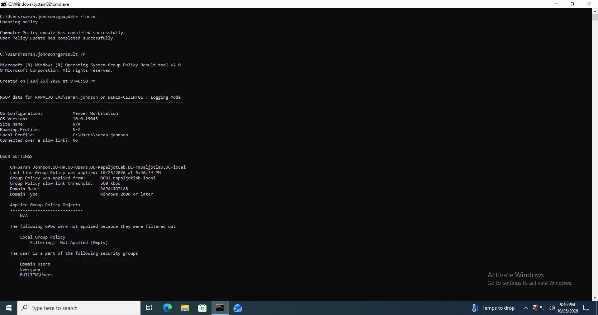

*Figure 17: Verifying domain Group Policy processing on the Windows 10 client.*

---

# Step 18 — Troubleshooting Domain Joining Issues

During domain joining, several problems may occur.

## Issue 1 — The Domain Could Not Be Contacted

### Possible Causes

- Incorrect DNS server configuration
- DC01 is powered off
- The client and Domain Controller are on different virtual networks
- Incorrect IP address or subnet mask
- Active Directory DNS records are missing
- Firewall or routing issues

### Troubleshooting Steps

1. Verified that DC01 was running.
2. Confirmed that both virtual machines were connected to the correct VMware network.
3. Checked the client's network configuration:

```cmd
ipconfig /all
```

4. Confirmed that the preferred DNS server was DC01's IP address.
5. Tested name resolution:

```cmd
nslookup dc01.rapaljotlab.local
```

6. Tested Domain Controller discovery:

```cmd
nltest /dsgetdc:rapaljotlab.local
```

---

## Issue 2 — Incorrect Domain Credentials

If the domain-joining account credentials are incorrect, Windows may reject the operation.

### Troubleshooting Steps

1. Verified that the domain username was entered correctly.
2. Confirmed the account password.
3. Confirmed that the account was enabled.
4. Confirmed that the account had permission to join computers to the domain.
5. Repeated the domain-joining process.

---

## Issue 3 — Windows Home Edition Cannot Join the Domain

Windows Home editions do not support traditional Active Directory domain joining.

### Resolution

I verified that the virtual machine was running Windows 10 Pro or another supported edition before attempting the domain join.

---

## Issue 4 — DNS Resolution Is Failing

If the client cannot resolve `rapaljotlab.local`, it may be unable to locate the Domain Controller.

### Troubleshooting Steps

1. Opened the client network adapter settings.
2. Verified that the DNS server was DC01's IP address.
3. Confirmed that the DNS Server role was running on DC01.
4. Verified that the `rapaljotlab.local` DNS zone existed.
5. Checked the Active Directory DNS SRV records.

I also used:

```cmd
ipconfig /flushdns
```

to clear the client's DNS resolver cache before retesting.

---

## Issue 5 — Domain Login Is Not Working

Possible causes include:

- Incorrect employee username or password
- Disabled or locked user account
- Expired password
- Missing network connectivity
- Domain Controller unavailable
- Time synchronization problems

### Troubleshooting Steps

1. Verified that DC01 was available.
2. Confirmed the user's account status in Active Directory.
3. Checked the DNS configuration.
4. Confirmed that the client could locate DC01.
5. Checked the client and Domain Controller time settings.

---

## Issue 6 — Further Domain Join Troubleshooting

If domain joining continues to fail, Windows records diagnostic information in:

```text
C:\Windows\Debug\NetSetup.log
```

This log can be examined to identify domain-joining errors and related troubleshooting information.

---

# Step 19 — Final Configuration Verification

After completing the Windows 10 domain-joining process, I reviewed the overall configuration.

## Verification Checklist

| Configuration | Expected Result |
|---|---|
| Windows 10 Pro installed | Successful |
| VMware Tools | Installed |
| Client computer name | WIN11-CLIENT01 |
| VMware network connectivity | Verified |
| Client DNS server | DC01 |
| Active Directory domain | rapaljotlab.local |
| Domain join | Successful |
| Domain account sign-in | Successful |
| Computer object in AD | Created |
| Computer moved to custom OU | Successful |
| PowerShell verification | Successful |
| Domain Controller discovery | Successful |
| Group Policy processing | Verified |

---

# Conclusion

In this section, I configured a Windows 10 Pro client virtual machine and joined it to the Windows Server 2019 Active Directory domain.

I verified network communication between WIN11-CLIENT01 and DC01 and configured the client to use the internal Active Directory DNS server.

After joining the domain, I tested authentication using a fictional employee account.

I also verified the computer object in Active Directory Users and Computers and moved it into the appropriate Computers Organizational Unit.

Finally, I used Command Prompt and PowerShell to verify domain membership, Domain Controller discovery, and Group Policy processing.

This exercise provided hands-on experience with Windows client administration, Active Directory domain joining, DNS troubleshooting, domain authentication, and computer account management.

## Next Phase

The next section of the lab will focus on configuring and testing Group Policy Objects (GPOs) for domain-joined Windows clients.

Examples include:

- Password and account lockout policies
- Desktop restrictions
- Control Panel restrictions
- User-specific Group Policy settings
- Computer-specific security settings
- Group Policy troubleshooting

---