# Windows Server 2019 — Group Policy Configuration

## 1. Overview

After configuring Active Directory Domain Services, Organizational Units, security groups, DNS, DHCP, and Windows client domain joining, the next phase of the lab focuses on Group Policy configuration.

Group Policy is a Windows Server feature that allows administrators to centrally manage settings for users and computers in an Active Directory environment.

In an enterprise network, Group Policy can be used to enforce security settings, configure workstation behavior, restrict access to certain features, and standardize computer configurations.

For this lab, I will create and test Group Policy Objects (GPOs) using Windows Server 2019 and a domain-joined Windows 10 virtual machine.

## Objectives

1. Understand Group Policy and Group Policy Objects.
2. Open Group Policy Management Console.
3. Examine existing Group Policy Objects.
4. Create a Group Policy for the Sales department.
5. Restrict access to Control Panel and Windows Settings.
6. Link the GPO to the Sales Organizational Unit.
7. Verify Group Policy application on Windows 10.
8. Create a workstation security policy.
9. Configure automatic workstation locking.
10. Verify configured policies using PowerShell and Command Prompt.
11. Troubleshoot Group Policy application issues.

## Lab Environment

| Component | Configuration |
|---|---|
| Virtualization Platform | VMware Workstation |
| Server Operating System | Windows Server 2019 |
| Domain Controller | DC01 |
| Active Directory Domain | rapaljotlab.local |
| Client Operating System | Windows 10 |
| Management Console | Group Policy Management |
| Test User | david.smith |
| Target User OU | Sales |
| Target Computer OU | Computers |

---

# Step 1 — Understand Group Policy

## 1.1 What Is Group Policy?

Group Policy is a Microsoft Windows feature that allows administrators to centrally manage and configure user and computer settings within an Active Directory domain.

Instead of configuring each computer individually, administrators can create Group Policy Objects and apply them to multiple users or computers.

For example, an organization may want to:

- Prevent employees from accessing certain Windows settings.
- Automatically lock computers after inactivity.
- Configure security policies.
- Deploy network printers.
- Configure Windows Firewall settings.
- Map network drives.
- Apply department-specific restrictions.

These settings can be managed centrally using Group Policy.

## 1.2 What Is a Group Policy Object?

A Group Policy Object (GPO) is a collection of policy settings used to manage Windows users and computers.

A GPO can contain two main types of settings.

### Computer Configuration

Computer Configuration contains settings applied to computer accounts.

These settings generally apply regardless of which user signs in.

Examples include computer security settings, Windows Firewall policies, and automatic workstation locking.

### User Configuration

User Configuration contains settings applied to user accounts.

These settings generally follow the domain user account when signing in to domain computers.

Examples include Control Panel restrictions, desktop settings, and mapped network drives.

## 1.3 Understanding GPO Linking

Group Policy Objects can be linked to Active Directory sites, domains, and Organizational Units.

For this lab, I will link GPOs to specific Organizational Units.

### Existing Active Directory Structure

```text
rapaljotlab.local
│
└── RapaljotLab
    │
    ├── Users
    │   ├── HR
    │   ├── Finance
    │   ├── Sales
    │   └── IT
    │
    ├── Computers
    ├── Servers
    └── Groups
```

Linking a user GPO to the Sales OU allows the policy to target employees located in that OU, subject to security filtering and policy inheritance.

---

# Step 2 — Open Group Policy Management Console

The first practical task was to open Group Policy Management Console on DC01.

## 2.1 Configuration Steps

1. Started the Windows Server 2019 virtual machine.
2. Logged in using the domain Administrator account.
3. Opened **Server Manager**.
4. Clicked **Tools** in the upper-right corner.
5. Selected **Group Policy Management**.

The Group Policy Management Console opened.

### Alternative Method

Group Policy Management can also be opened using the Run dialog.

1. Pressed `Windows + R`.
2. Entered:

```cmd
gpmc.msc
```

3. Pressed **Enter**.

This opened the Group Policy Management Console.

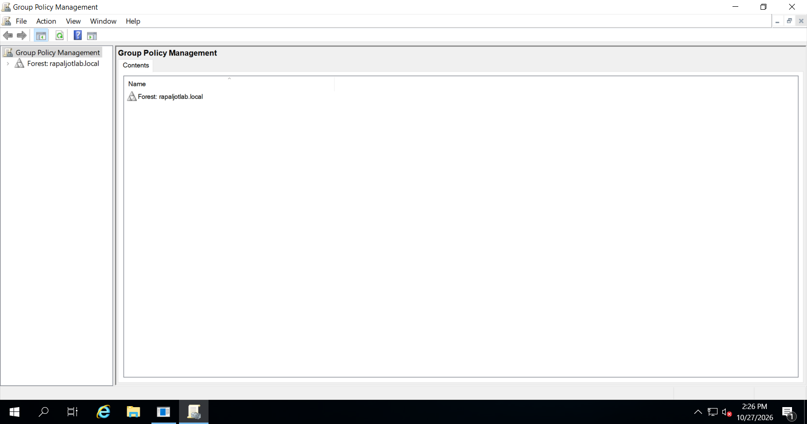

*Figure 1: Opening Group Policy Management Console on Windows Server 2019.*

---

# Step 3 — Examine the Existing Group Policy Structure

Before creating a new Group Policy Object, I reviewed the existing Group Policy configuration.

## 3.1 Configuration Steps

1. Opened **Group Policy Management**.
2. Expanded **Forest: rapaljotlab.local**.
3. Expanded **Domains**.
4. Expanded **rapaljotlab.local**.
5. Located **Group Policy Objects**.
6. Expanded the Group Policy Objects container.

The default Active Directory Group Policy Objects were visible.

## 3.2 Understanding Default Group Policies

### Default Domain Policy

The Default Domain Policy is linked to the domain.

It is commonly used for domain-wide account policies, including password policies, account lockout policies, and Kerberos-related settings.

### Default Domain Controllers Policy

The Default Domain Controllers Policy is linked to the Domain Controllers OU.

It contains default security settings for Domain Controllers.

### Important Consideration

For this exercise, I will create separate Group Policy Objects instead of modifying the default policies.

This allows me to manage and test policies independently without unnecessarily modifying important domain configurations.

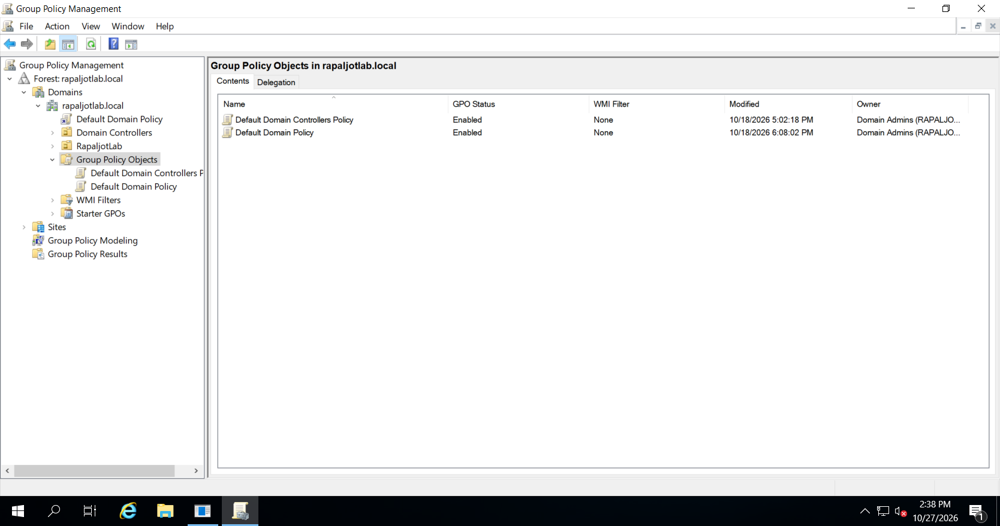

*Figure 2: Reviewing existing Group Policy Objects within the Active Directory domain.*

---

# Step 4 — Create a Group Policy for the Sales Department

The first policy I will configure restricts access to Control Panel and Windows Settings for Sales employees.

## 4.1 Purpose

In some enterprise environments, IT administrators may restrict access to operating system configuration tools.

These restrictions can help prevent employees from changing selected computer settings.

For this lab, I will demonstrate a restriction affecting Sales department user accounts.

This is an intentionally broad restriction for testing. In a production environment, more targeted controls may be preferable.

## 4.2 Configuration Steps

1. Opened **Group Policy Management**.
2. Expanded the domain `rapaljotlab.local`.
3. Expanded `RapaljotLab`.
4. Expanded `Users`.
5. Located the `Sales` Organizational Unit.
6. Right-clicked **Sales**.
7. Selected:

   **Create a GPO in this domain, and Link it here...**

8. The New GPO window appeared.
9. Entered the following GPO name:

   `GPO-Sales-Restrict-ControlPanel`

10. Left **Source Starter GPO** as `(none)`.
11. Clicked **OK**.

The new Group Policy Object was created and linked to the Sales OU.

## Configuration Summary

| Setting | Value |
|---|---|
| GPO Name | GPO-Sales-Restrict-ControlPanel |
| Target OU | Sales |
| Policy Type | User Configuration |
| Purpose | Restrict Control Panel and Settings access |

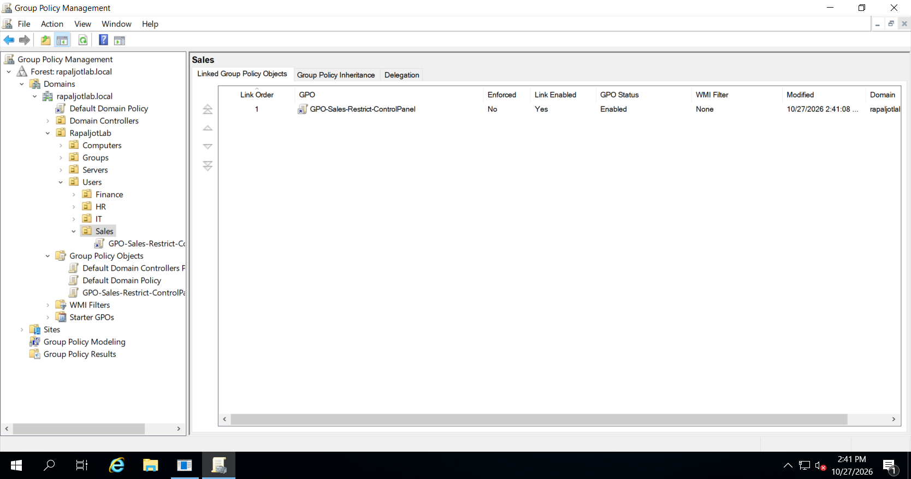

*Figure 3: Creating a Group Policy Object for the Sales Organizational Unit.*

---

# Step 5 — Edit the Sales Group Policy

After creating the Group Policy Object, the next step was to configure the required policy setting.

## 5.1 Open Group Policy Management Editor

1. Opened **Group Policy Management**.
2. Expanded the Sales Organizational Unit.
3. Located:

   `GPO-Sales-Restrict-ControlPanel`

4. Right-clicked the GPO.
5. Selected **Edit**.

The Group Policy Management Editor opened.

## 5.2 Navigate to Control Panel Policies

In Group Policy Management Editor, I navigated to:

```text
User Configuration
└── Policies
    └── Administrative Templates
        └── Control Panel
```

This location contains user-based Group Policy settings for controlling access to Control Panel and Windows Settings.

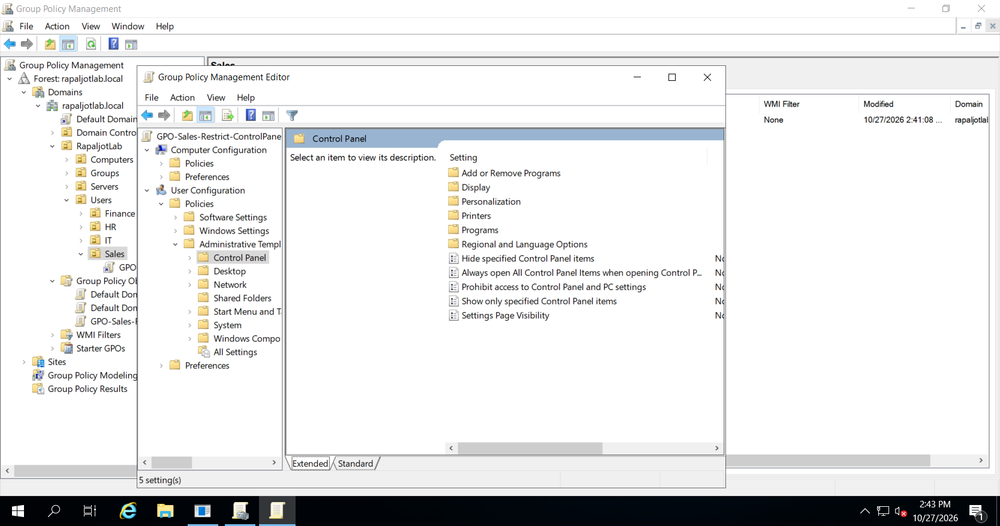

*Figure 4: Navigating to the Control Panel administrative template settings.*

---

# Step 6 — Restrict Access to Control Panel and Settings

Next, I configured the policy that prevents users from opening Control Panel and Windows Settings.

## 6.1 Configuration Steps

1. In the **Control Panel** section, located:

   **Prohibit access to Control Panel and PC settings**

2. Double-clicked the policy.
3. The policy configuration window appeared.
4. Selected:

   **Enabled**

5. Clicked **Apply**.
6. Clicked **OK**.

## 6.2 Policy Configuration

| Setting | Value |
|---|---|
| Policy Name | Prohibit access to Control Panel and PC settings |
| Policy Location | User Configuration |
| Policy State | Enabled |
| Target | Sales department users |

## 6.3 Expected Behavior

When the policy is applied to a Sales employee account, Windows prevents the user from accessing Control Panel and the Windows Settings application through the restricted interfaces.

For example, when David Smith signs in using:

```text
RAPALJOTLAB\david.smith
```

he should be prevented from accessing those Windows configuration tools.

This setting does not replace appropriate user permissions or other security controls.

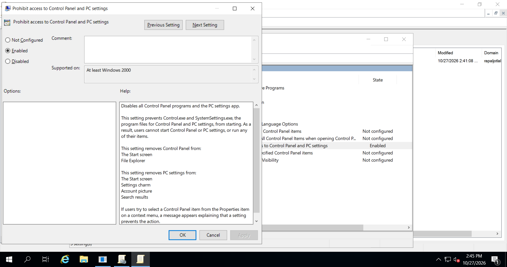

*Figure 5: Enabling the policy that restricts access to Control Panel and Windows Settings.*

---

# Step 7 — Verify the Group Policy Link

After configuring the restriction, I verified that the GPO was linked to the correct Organizational Unit.

## 7.1 Verification Steps

1. Returned to **Group Policy Management**.
2. Expanded the Sales Organizational Unit.
3. Selected:

   `GPO-Sales-Restrict-ControlPanel`

4. Opened the **Scope** tab.
5. Verified that the GPO was linked to the Sales OU.
6. Confirmed that the GPO link was enabled.
7. Reviewed the Security Filtering configuration.

For this initial test, I retained the default **Authenticated Users** security filtering.

The OU link determines the user scope, while security filtering determines which identities are permitted to apply the policy.

## Expected Result

```text
rapaljotlab.local
└── RapaljotLab
    └── Users
        └── Sales
            └── GPO-Sales-Restrict-ControlPanel
```

The GPO is linked to the Sales OU.

Because this policy is configured under User Configuration, it is intended to apply to user accounts located in the Sales OU.

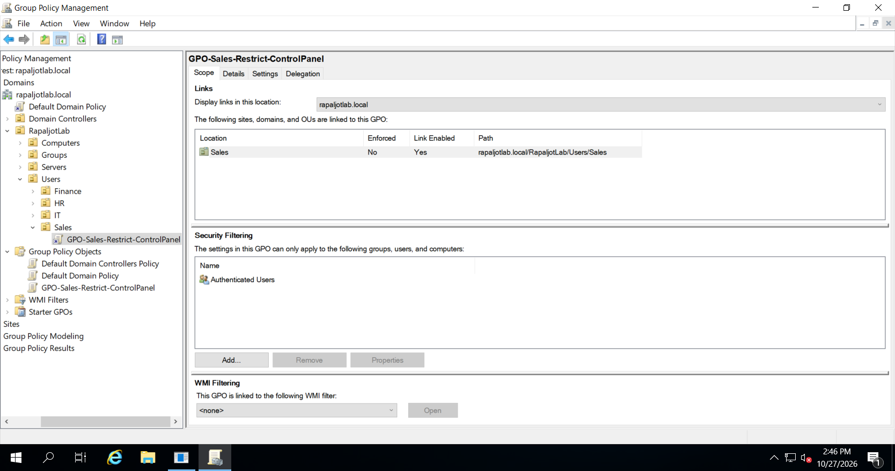

*Figure 6: Verifying the Group Policy Object link and scope for the Sales department.*

---

# Step 8 — Test Group Policy on Windows 10

After creating and configuring the Group Policy Object, I used a domain-joined Windows 10 virtual machine to test the policy.

## 8.1 Prerequisites

Before testing Group Policy, I verified that:

- Windows 10 was joined to `rapaljotlab.local`.
- Windows 10 could communicate with DC01.
- Windows 10 used DC01 as its DNS server.
- The Sales test user account existed in Active Directory.
- The Sales test user was located inside the Sales Organizational Unit.

For this test, I used the fictional employee account:

`david.smith`

## 8.2 Sign In to Windows 10

1. Started the Windows 10 virtual machine.
2. Selected **Other user** at the sign-in screen, if necessary.
3. Entered:

```text
RAPALJOTLAB\david.smith
```

4. Entered the account password.
5. Signed in to Windows 10.

This ensured that the test was performed using a Sales department user account instead of a domain Administrator account.


*Figure 7: Signing in to Windows 10 with the Sales department test account.*

---

# Step 9 — Update Group Policy on Windows 10

After signing in, I manually refreshed the Group Policy configuration.

Normally, Group Policy is processed during computer startup, user sign-in, and periodic background refreshes.

The `gpupdate` command allows administrators to request a manual policy refresh.

## 9.1 Configuration Steps

1. Opened **Command Prompt** on Windows 10.
2. Executed:

```cmd
gpupdate /force
```

3. Waited for Group Policy processing to complete.

### Expected Output

```text
Computer Policy update has completed successfully.
User Policy update has completed successfully.
```

If Windows requested a sign-out or restart, I followed the prompt.

I then signed out and signed back in using the same Sales employee account.

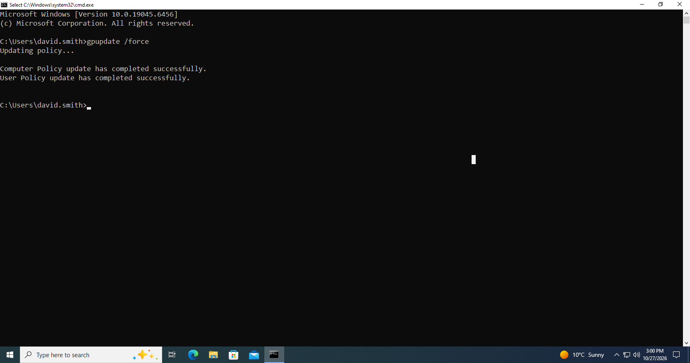

*Figure 8: Refreshing Group Policy settings using the gpupdate command.*

---

# Step 10 — Verify the Control Panel Restriction

After refreshing Group Policy, I tested whether the restriction had been applied.

## 10.1 Test the Restriction

1. Signed in to Windows 10 as `david.smith`.
2. Opened the Start menu.
3. Searched for **Control Panel**.
4. Attempted to open Control Panel.
5. Opened the Start menu again.
6. Attempted to open **Settings**.

## 10.2 Expected Result

Windows should prevent the Sales employee from accessing Control Panel and Windows Settings.

The exact notification may vary by Windows version and configuration.

This demonstrates that the user-based Group Policy restriction is working.

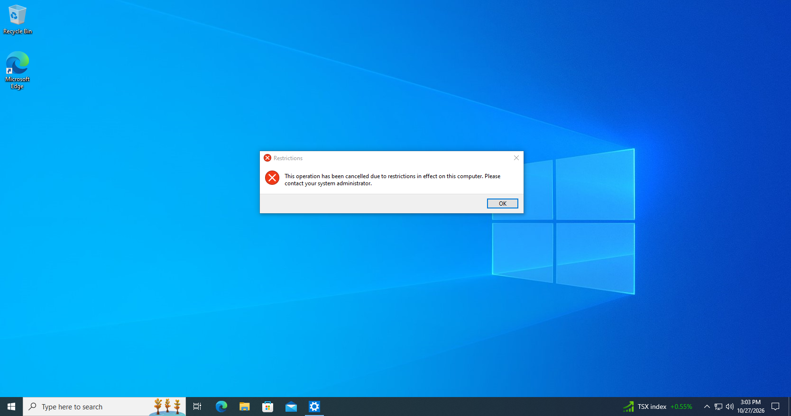

*Figure 9: Verifying that the Sales employee cannot access Control Panel and Windows Settings.*

---

# Step 11 — Verify Applied Group Policies Using Command Prompt

After testing the restriction, I verified which Group Policy Objects were applied to the Windows 10 user account.

## 11.1 Run gpresult

While signed in as the Sales test user, I opened Command Prompt and executed:

```cmd
gpresult /r /scope:user
```

## 11.2 Purpose

The `gpresult` command displays the Resultant Set of Policy information for a user or computer.

It helps administrators determine which Group Policy Objects have been applied.

## 11.3 Expected Result

Under **Applied Group Policy Objects**, I expected to see:

```text
GPO-Sales-Restrict-ControlPanel
```

Other inherited policies may also appear in the results.

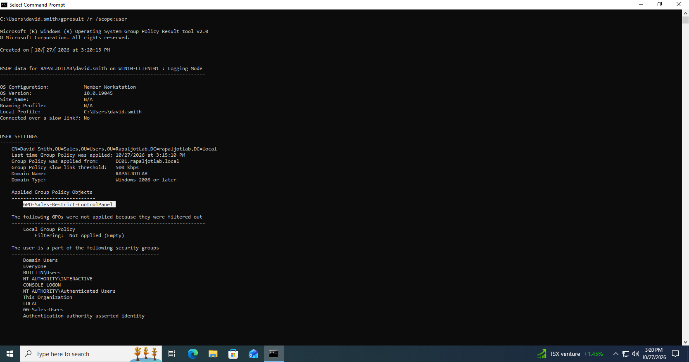

*Figure 10: Verifying the applied Sales Group Policy Object using gpresult.*

---

# Step 12 — Create an Automatic Workstation Lock Policy

After creating the Sales user restriction, I configured a second Group Policy Object for Windows client computers.

This policy will automatically lock inactive workstations after 15 minutes.

## 12.1 Purpose

Automatic workstation locking helps protect company computers when employees leave their workstations unattended.

For example, an employee might leave their computer unlocked while attending a meeting.

If the computer remains inactive for a configured period, Windows can automatically lock the session.

This reduces the risk of unauthorized access to an unattended session.

## 12.2 Create the GPO

1. Opened **Group Policy Management** on DC01.
2. Expanded `rapaljotlab.local`.
3. Expanded `RapaljotLab`.
4. Located the `Computers` Organizational Unit.
5. Right-clicked **Computers**.
6. Selected:

   **Create a GPO in this domain, and Link it here...**

7. Entered:

   `GPO-Workstations-AutoLock-15min`

8. Clicked **OK**.

The new Group Policy Object was created and linked to the Computers OU.

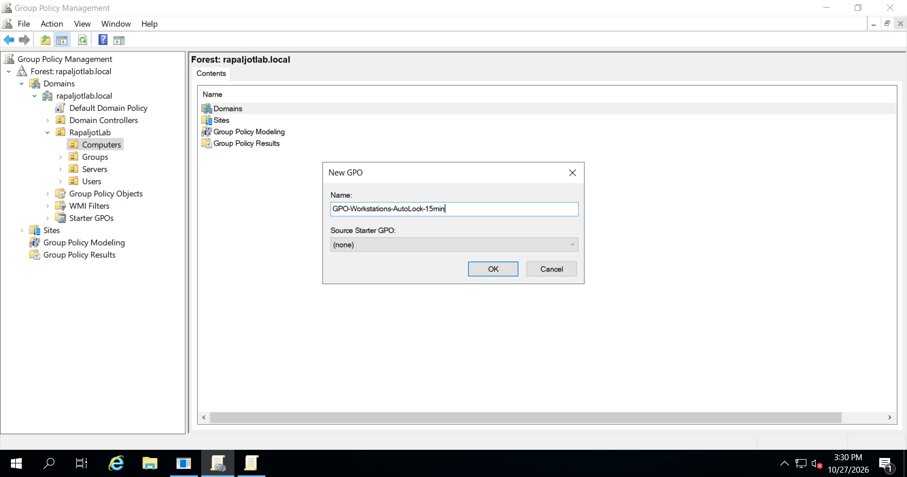

*Figure 11: Creating a workstation security policy for domain-joined computers.*

---

# Step 13 — Configure Automatic Workstation Locking

After creating the workstation policy, I configured the automatic locking settings.

## 13.1 Open the GPO Editor

1. Right-clicked:

   `GPO-Workstations-AutoLock-15min`

2. Selected **Edit**.

3. Navigated to:

```text
Computer Configuration
└── Policies
    └── Windows Settings
        └── Security Settings
            └── Local Policies
                └── Security Options
```

## 13.2 Configure Machine Inactivity Limit

1. Located the policy:

   **Interactive logon: Machine inactivity limit**

2. Double-clicked the policy.
3. Enabled **Define this policy setting**, if shown.
4. Entered the inactivity duration:

   `900`

5. Clicked **Apply**.
6. Clicked **OK**.

## 13.3 Why 900 Seconds?

The setting uses seconds rather than minutes.

```text
15 minutes × 60 seconds = 900 seconds
```

Therefore, the workstation inactivity limit was configured as 900 seconds.

## Configuration Summary

| Setting | Value |
|---|---|
| GPO Name | GPO-Workstations-AutoLock-15min |
| Policy | Interactive logon: Machine inactivity limit |
| Configuration Type | Computer Configuration |
| Inactivity Duration | 900 seconds |
| Target OU | Computers |

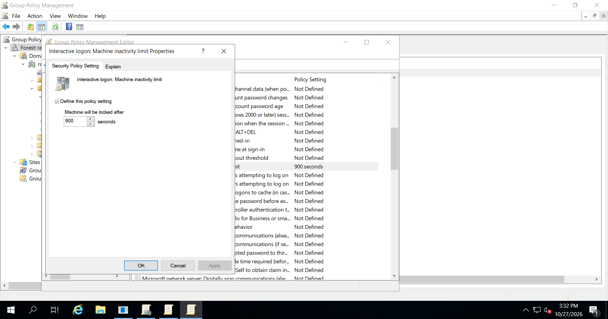

*Figure 12: Configuring the workstation inactivity limit to 900 seconds.*

---

# Step 14 — Verify the Computer Account Location

Because the automatic locking GPO is linked to the Computers OU, I verified that the Windows 10 computer account was located in the correct OU.

## 14.1 Configuration Steps

1. Opened **Active Directory Users and Computers** on DC01.
2. Expanded the domain `rapaljotlab.local`.
3. Expanded `RapaljotLab`.
4. Selected the custom `Computers` OU.
5. Checked whether the Windows 10 computer account was present.

If the computer account was located in the default Active Directory Computers container, I moved it into the custom Computers OU.

## 14.2 Move the Computer Account

1. Located the Windows 10 computer object.
2. Right-clicked the object.
3. Selected **Move**.
4. Selected:

   `RapaljotLab > Computers`

5. Clicked **OK**.

### Important Note

The default Computers container and the custom Computers OU are different locations.

Linking a GPO to the custom Computers OU does not automatically apply it to computers in the default Computers container.

### Screenshot
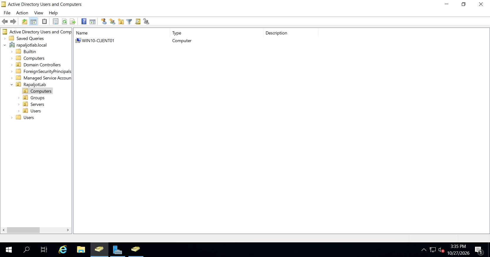

*Figure 13: Verifying that the Windows 10 computer account is located in the correct Organizational Unit.*

---

# Step 15 — Apply the Workstation Security Policy

After verifying the computer account location, I refreshed Group Policy on Windows 10.

## 15.1 Configuration Steps

1. Started the Windows 10 virtual machine.
2. Signed in using an account with appropriate administrative permissions.
3. Opened **Command Prompt as Administrator**.
4. Executed:

```cmd
gpupdate /force
```

5. Waited for policy processing to finish.
6. Restarted Windows 10 to ensure the computer-based policy was applied.

## 15.2 Verify Applied Computer Policies

After the restart, I opened an elevated Command Prompt and executed:

```cmd
gpresult /r /scope:computer
```

Under Applied Group Policy Objects, I checked for:

```text
GPO-Workstations-AutoLock-15min
```

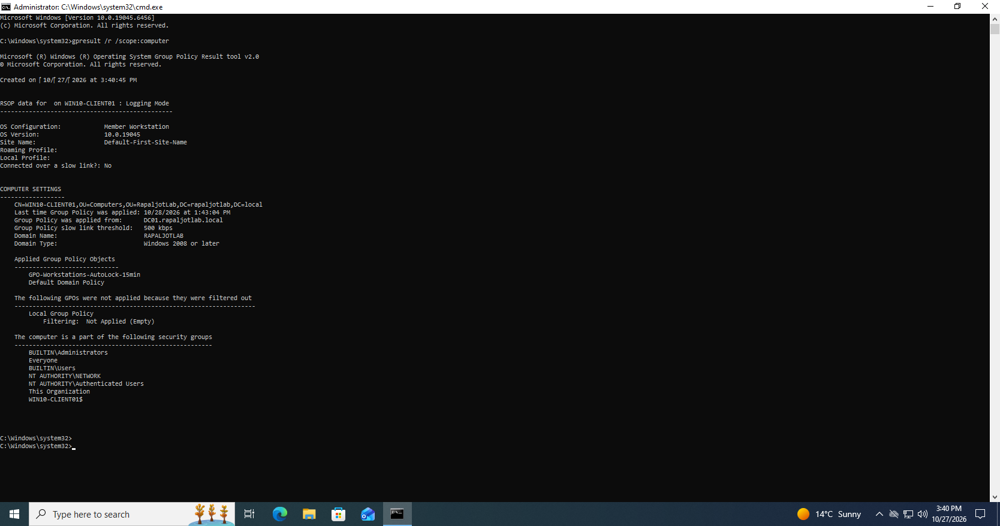

*Figure 14: Verifying that the automatic workstation locking GPO is applied to Windows 10.*

---

# Step 16 — Test Automatic Workstation Locking

After applying the workstation security policy, I tested the automatic locking feature.

## 16.1 Testing Steps

1. Signed in to Windows 10.
2. Left the workstation inactive.
3. Avoided moving the mouse or using the keyboard.
4. Allowed the configured inactivity period to pass.
5. Checked whether Windows automatically locked the session.

## 16.2 Expected Result

After approximately 15 minutes of inactivity, Windows should lock the user session and display the lock screen.

This confirms that the machine inactivity limit is functioning.


*Figure 15: Verifying that Windows 10 automatically locks the session after the configured inactivity period.*

---

# Step 17 — Verify Group Policies Using PowerShell

In addition to the graphical interface, I used PowerShell to verify the Group Policy Objects.

## 17.1 Import the Group Policy Module

On DC01, I opened PowerShell and executed:

```powershell
Import-Module GroupPolicy
```

## 17.2 List All Group Policy Objects

I executed:

```powershell
Get-GPO -All |
    Select-Object DisplayName, GpoStatus, CreationTime
```

### Purpose

The `Get-GPO` command retrieves Group Policy Objects from Active Directory.

This command displays:

- GPO name
- GPO status
- Creation date

## 17.3 Verify the Sales GPO

I executed:

```powershell
Get-GPO -Name "GPO-Sales-Restrict-ControlPanel"
```

This command retrieves information about the Sales Group Policy Object.

## 17.4 Verify the Workstation GPO

I executed:

```powershell
Get-GPO -Name "GPO-Workstations-AutoLock-15min"
```

This verifies that the workstation policy exists in Active Directory.

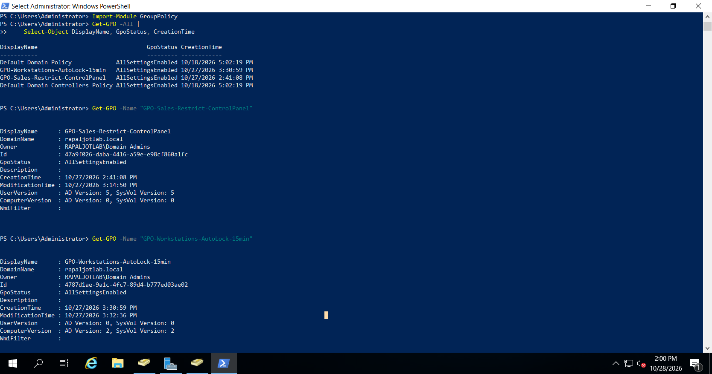

*Figure 16: Verifying Group Policy Objects using PowerShell.*

---

# Step 18 — Verify GPO Links Using PowerShell

Next, I used PowerShell to verify which policies were linked to the Organizational Units.

## 18.1 Verify the Sales OU

```powershell
Get-GPInheritance -Target "OU=Sales,OU=Users,OU=RapaljotLab,DC=rapaljotlab,DC=local"
```

The output includes Group Policy link and inheritance information for the Sales OU.

I reviewed the `GpoLinks` property to identify directly linked policies.

## 18.2 Verify the Computers OU

```powershell
Get-GPInheritance -Target "OU=Computers,OU=RapaljotLab,DC=rapaljotlab,DC=local"
```

This command retrieves Group Policy inheritance information for the Computers OU.

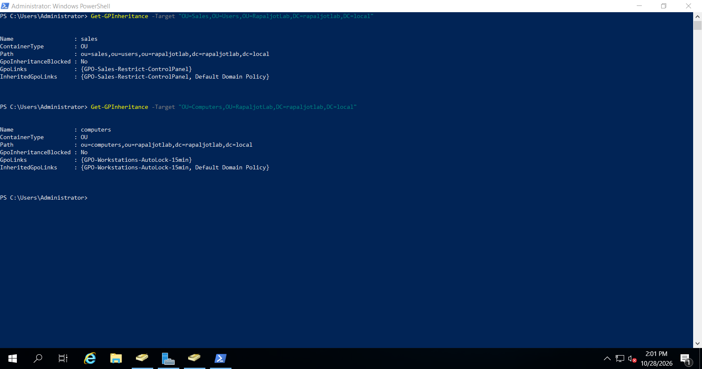

*Figure 17: Verifying Group Policy links and inheritance using PowerShell.*

---

# Step 19 — Generate a Group Policy Report

To document the policies applied to the Windows 10 client, I generated a Group Policy results report.

## 19.1 Configuration Steps

1. Logged in to Windows 10 using the Sales test account.
2. Opened Command Prompt.
3. Executed:

```cmd
gpresult /h "%USERPROFILE%\Desktop\GPO-Result-Sales.html"
```

This command generates an HTML report containing Resultant Set of Policy information.

## 19.2 Review the Report

1. Opened the generated HTML file.
2. Reviewed the applied user policies.
3. Located the Sales Control Panel restriction.
4. Confirmed that the expected Group Policy Object appeared.

For computer-side verification, an elevated Command Prompt can be used to generate a report covering computer policy results.

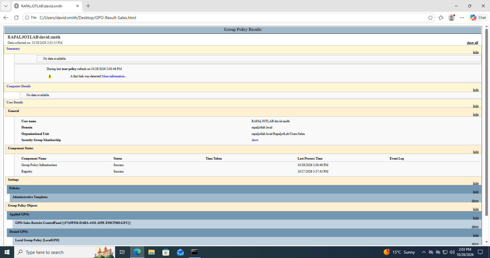

*Figure 18: Reviewing the Group Policy results report generated using gpresult.*

---

# Step 20 — Troubleshoot Group Policy Issues

During Group Policy administration, a policy may not apply as expected.

I reviewed common reasons for Group Policy application failures.

## Issue 1 — GPO Not Applying to a User

Possible causes include:

- The user account is located in the wrong OU.
- The GPO is linked to the wrong OU.
- The GPO link is disabled.
- Security filtering prevents the user from applying the policy.
- Group Policy has not refreshed.
- The user has not signed out and signed back in when required.

### Troubleshooting Commands

```cmd
gpupdate /force
```

```cmd
gpresult /r /scope:user
```

I reviewed the output to determine whether the intended GPO was applied.

---

## Issue 2 — GPO Not Applying to a Computer

Possible causes include:

- Computer account located in the wrong OU.
- Incorrect GPO link.
- Computer Configuration section disabled.
- Incorrect DNS configuration.
- Communication issues between Windows 10 and DC01.

### Troubleshooting Commands

```cmd
gpupdate /force
```

```cmd
gpresult /r /scope:computer
```

---

## Issue 3 — Windows 10 Cannot Contact the Domain Controller

For domain-based Group Policy to work correctly, Windows 10 must be able to communicate with Active Directory and DNS services.

I checked DNS configuration using:

```cmd
ipconfig /all
```

I verified the Domain Controller hostname using:

```cmd
nslookup dc01.rapaljotlab.local
```

I also checked the domain-related DNS records and network connectivity.

---

## Issue 4 — Group Policy Still Not Applying

If the previous checks did not resolve the problem, I reviewed the Group Policy operational logs.

I opened Event Viewer and navigated to:

```text
Applications and Services Logs
└── Microsoft
    └── Windows
        └── GroupPolicy
            └── Operational
```

This log contains information about Group Policy processing and can help identify policy application failures.

---

# Step 21 — Final Verification

After configuring the Group Policy Objects, I reviewed the lab configuration.

## Group Policy Summary

| Group Policy | Target | Expected Result |
|---|---|---|
| GPO-Sales-Restrict-ControlPanel | Sales OU | Restricts Control Panel and Settings |
| GPO-Workstations-AutoLock-15min | Computers OU | Locks inactive workstations after 900 seconds |

## Verification Checklist

| Task | Expected Result |
|---|---|
| Open Group Policy Management | Successful |
| Create Sales GPO | Created |
| Configure Control Panel Restriction | Enabled |
| Link GPO to Sales OU | Linked |
| Refresh User Group Policy | Successful |
| Verify Sales Policy on Windows 10 | Restriction applied |
| Create Workstation GPO | Created |
| Configure Automatic Locking | 900 seconds |
| Link Workstation GPO | Linked |
| Verify Computer Policy | Applied |
| Verify GPOs Using PowerShell | Successful |
| Generate Group Policy Report | Report generated |

---

# Conclusion

In this section, I practiced configuring and managing Group Policy Objects using Windows Server 2019.

I created separate Group Policy Objects for user and computer configurations.

The Sales department policy was designed to restrict access to Control Panel and Windows Settings for employees in the Sales Organizational Unit.

The workstation security policy was designed to automatically lock Windows 10 computers after 15 minutes of inactivity.

I also practiced refreshing Group Policy settings and verifying applied policies using `gpupdate`, `gpresult`, PowerShell, and Group Policy Management Console.

These exercises demonstrate how IT administrators can centrally manage users and computers within an Active Directory domain.

## Next Phase

The next phase of the Windows Server lab can focus on additional Group Policy administration tasks, including:

- Department-specific policies
- Password and account lockout policies
- Network drive mapping
- Printer deployment
- Group Policy security filtering
- Group Policy inheritance
- Advanced Group Policy troubleshooting

---